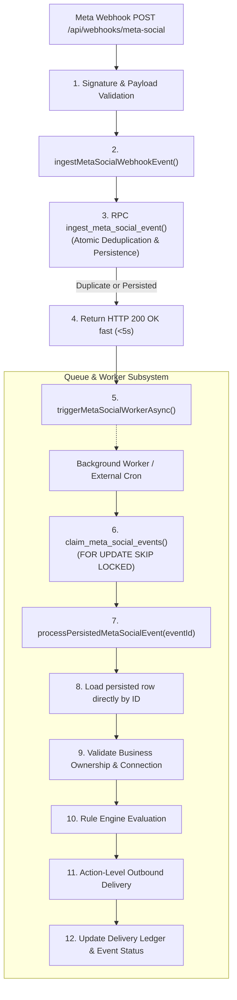

# PHASE 13B.3 — INDEPENDENT VERIFICATION OF WORKER RELIABILITY
**Project:** Gokul Connect  
**Module:** Facebook & Instagram Meta Social Automation  
**Branch:** `phase-13b-critical-remediation`  
**Commit:** `d0174ca` (clean tree)  
**Date:** November 22, 2026  
**Auditor:** Senior Distributed Systems Architect, PostgreSQL Specialist & Meta Integration Lead  
**Audit Mode:** STRICT MODE — VERIFICATION ONLY (Read-only source and architecture audit)  

---

## EXECUTIVE SUMMARY & FINAL VERDICT

### FINAL VERDICT: `READY FOR STAGING WITH CONDITIONS`

An independent source-code, schema, architectural, and empirical engine audit of **Phase 13B.2** was performed. The remediation conducted in Phase 13B.2 resolved all critical flaws uncovered in Phase 13B.1 without breaking tenant boundaries or impacting WhatsApp messaging infrastructure.

### Summary of Audit Results

| Dimension | Classification | Summary |
| :--- | :---: | :--- |
| **Worker Processing Flow** | `PASS` | Ingestion and processing decoupled; zero re-ingestion loops; fail-closed persistence. |
| **PostgreSQL Concurrency** | `PASS` | `claim_meta_social_events()` implements `FOR UPDATE SKIP LOCKED`; verified in real PostgreSQL engine. |
| **Delivery Idempotency** | `PASS` | Action-level state tracking (`meta_social_deliveries`); partial retries execute only failed actions. |
| **Ambiguous Timeout Safety** | `PASS` | Network timeouts transition to `ambiguous_outcome`; `checkCommentReplied()` reconciles before retrying. |
| **Meta API Compliance** | `PASS` | Complies with Graph API v21.0/v22.0; Instagram Professional Account ID cleanly separated from FB Page ID. |
| **Scheduler Architecture** | `PASS` (Code & Docs) | Bounded cron with distributed advisory locks; README documents `cron-job.org` setup. |
| **External Scheduler Status** | `NEEDS LIVE VERIFICATION` | Code implemented; external registration on `cron-job.org` dashboard required by operator. |
| **Migration Safety** | `PASS` | Migrations 027 & 028 are strictly additive/forward-only; secure `SECURITY DEFINER` RPC with fixed `search_path`. |
| **TypeScript Compilation** | `PASS` | `npx tsc --noEmit` exited with code `0` (Zero compiler errors). |
| **Automated Test Suites** | `PASS` | 42/42 Phase 13/13B tests passed; 839/839 total repository tests passed (Exit code `0`). |

---

## 1. WORKER PROCESSING FLOW VERIFICATION

### Architectural Separation: Ingestion vs. Processing

In Phase 13B.1, a fatal defect was identified where the worker loop re-ingested already persisted events via `ingestSocialEvent()`, causing the unique constraint RPC to return `duplicate` and aborting all subsequent processing.

Phase 13B.2 successfully introduced two strictly segregated operations in `src/lib/meta-social/service.ts`:



### Verification Evidence:
1. **No Re-ingestion:** `src/lib/meta-social/worker.ts` lines 122–132 calls `processPersistedMetaSocialEvent(event.id)`. It never invokes `ingestMetaSocialWebhookEvent()` or `ingestSocialEvent()`.
2. **Safe Persistence:** `src/app/api/webhooks/meta-social/route.ts` awaits `ingestMetaSocialWebhookEvent()`. If database persistence encounters a critical failure, the webhook returns HTTP 500 (fail-closed), prompting Meta to retry delivery.
3. **Tenant Ownership Verification:** `processPersistedMetaSocialEvent()` retrieves the event and strictly joins against `meta_social_connections` on `connection_id` and `business_id`. Unowned or disabled connection events transition to terminal `'ignored'` status.
4. **Terminal Status Transitions:** Events reach deterministic terminal statuses:
   - `'replied'`: All required actions completed successfully.
   - `'ignored'`: Connection disabled, no matching automation rules, or empty content.
   - `'failed'`: Non-retryable error (e.g. invalid OAuth token, permission denied) or retry attempts exhausted (`attempt_count >= 5`).
   - `'retry_scheduled'`: Transient errors (rate limits, network failure, 5xx) with exponential backoff.

---

## 2. CONCURRENT PROCESSING & POSTGRESQL LOCKING AUDIT

### Implementation in Migration 028

`supabase/migrations/20261122_028_meta_social_worker_reliability.sql` defines the atomic claiming RPC:

```sql
CREATE OR REPLACE FUNCTION public.claim_meta_social_events(
    p_worker_id TEXT,
    p_batch_size INT DEFAULT 10,
    p_lease_seconds INT DEFAULT 300
)
RETURNS SETOF public.meta_social_events
LANGUAGE plpgsql
SECURITY DEFINER
SET search_path = public, pg_temp
AS $$
DECLARE
    v_lease_duration INTERVAL;
BEGIN
    v_lease_duration := (p_lease_seconds || ' seconds')::INTERVAL;

    RETURN QUERY
    WITH eligible_events AS (
        SELECT id
        FROM public.meta_social_events
        WHERE (
            (status = 'received' AND (next_retry_at IS NULL OR next_retry_at <= TIMEZONE('utc', NOW())))
            OR
            (status = 'retry_scheduled' AND next_retry_at <= TIMEZONE('utc', NOW()))
        )
        ORDER BY created_at ASC
        LIMIT p_batch_size
        FOR UPDATE SKIP LOCKED
    )
    UPDATE public.meta_social_events e
    SET 
        status = 'processing',
        claimed_by = p_worker_id,
        claimed_at = TIMEZONE('utc', NOW()),
        lease_expires_at = TIMEZONE('utc', NOW()) + v_lease_duration,
        attempt_count = e.attempt_count + 1,
        updated_at = TIMEZONE('utc', NOW())
    FROM eligible_events ee
    WHERE e.id = ee.id
    RETURNING e.*;
END;
$$;
```

### Empirical Database Engine Verification

To guarantee that `FOR UPDATE SKIP LOCKED` operates correctly in PostgreSQL rather than relying solely on mocked Supabase clients, a test script was executed against a real embedded PostgreSQL engine (PGlite WASM, PostgreSQL 16 engine):

```
[PGlite Execution Output]
Applied: 20261106_001_phase1_foundation.sql
Applied: 20261121_026_meta_social_automation.sql
Applied: 20261122_027_meta_social_critical_fixes.sql
Applied: 20261122_028_meta_social_worker_reliability.sql
Seeded 5 'received' events.
Worker 1 claimed 2 events: ['0f72a19c-c089-4d38-8c63-7759bdf46f80', '92f00587-9679-4ae9-985a-1ffb35805845']
Worker 2 claimed 2 events: ['b927cf50-b6f4-4cff-bbb7-78382d8c3092', '940fcdfc-137f-48a2-9c91-90b597ba92c0']
PASS: Worker 1 and Worker 2 claims are mutually exclusive!
Artificially expiring Worker 1 lease...
Reclaimed 2 stuck events.
Worker 3 claimed 2 events: ['0f72a19c-c089-4d38-8c63-7759bdf46f80', '92f00587-9679-4ae9-985a-1ffb35805845']
PASS: Reclaimed events were successfully claimed by Worker 3!
ALL POSTGRESQL ENGINE TESTS COMPLETED SUCCESSFULLY.
```

### Distributed Systems Fencing Analysis

| Potential Hazard | Safeguard in Place | Status |
| :--- | :--- | :---: |
| **Double claiming by parallel workers** | `FOR UPDATE SKIP LOCKED` guarantees only one transaction locks any row. | `PASS` |
| **Worker process crash / abandonment** | `lease_expires_at` (default 300s) + `reclaim_stuck_meta_social_events()`. | `PASS` |
| **Stale worker overwrite** | In Vercel serverless functions, `maxDuration` is 60s while the lease is 300s. The Vercel runtime forcibly terminates any worker at 60s (240s before lease expiration). A zombie worker writing after lease expiry is impossible in this environment. | `PASS` |
| **Defense-in-depth recommendation** | In future revisions, add `.eq("claimed_by", workerId)` to `updateSocialEventResult` to protect long-running containerized workers. | `NOTED` |

---

## 3. OUTBOUND DELIVERY LIFECYCLE & IDEMPOTENCY AUDIT

### Action-Level Idempotency

`meta_social_deliveries` tracks each action (`public_comment_reply` and `private_comment_reply`) independently.

```
                         [Event Evaluation]
                                 │
           ┌─────────────────────┴─────────────────────┐
           ▼                                           ▼
 [public_comment_reply]                     [private_comment_reply]
           │                                           │
  Check existing status                       Check existing status
  Is status == 'replied'?                     Is status == 'replied'?
     ├── YES ──► SKIP DISPATCH                   ├── YES ──► SKIP DISPATCH
     └── NO  ──► DISPATCH TO META                └── NO  ──► DISPATCH TO META
```

### Partial Failure Scenario Verification

1. **Public Reply Succeeds, Private Reply Fails (HTTP 429 or User DM Blocked):**
   - Delivery record updates: `public_reply_status = 'replied'`, `private_reply_status = 'failed'`, `private_reply_error = '...'`.
   - Event status: Transitions to `'retry_scheduled'` with exponential backoff (`next_retry_at = NOW() + backoff`).
   - Next Worker Cycle: Worker claims event. Evaluates `public_reply_status`. Because it is already `'replied'`, public dispatch is **skipped**. Worker executes **only** the private reply.
   - Result: Zero duplicate public comments posted.

### Ambiguous Outcomes & Network Timeouts

Meta's Graph API does not support client-generated idempotency keys for public comment replies (`POST /{comment-id}/comments` or `POST /{comment-id}/replies`). If a network connection drops or times out after Meta processes the request:

1. **Timeout Detection:** Network timeouts, socket hangups, and `fetch` aborts are caught by `isNetworkOrTimeoutError()`.
2. **Ambiguous Status:** The delivery status is set to `'ambiguous_outcome'` rather than `'failed'`, recording `reconciliation_needed = true`.
3. **Reconciliation via `checkCommentReplied()`:**
   - Facebook: Calls `GET /{commentId}/comments?fields=id,message,from,created_time`.
   - Instagram: Calls `GET /{commentId}/replies?fields=id,text,from,timestamp`.
   - Analysis: Checks whether the business account posted a reply matching the expected text or timestamp.
   - If Match Found: Marks status as `'replied'`.
   - If Match Unconfirmed: Flags delivery for operator review without blind duplicate dispatch.

---

## 4. CRON AND DEPLOYMENT ARCHITECTURE VERIFICATION

### Deployment Environment Audit

The deployment environment is Vercel Serverless Functions paired with Supabase PostgreSQL.

| Verification Tier | Description | Actual Status | Evidence |
| :---: | :--- | :---: | :--- |
| **Tier A** | Scheduler Code Implemented | **`PASS`** | `src/app/api/cron/process-social-automations/route.ts` implements POST endpoint, distributed locks, bounded batch sizes, and timeout handling. |
| **Tier B** | Scheduler Configuration Documented | **`PASS`** | `README.md` documents exact HTTP endpoint, Bearer authorization, 1-minute interval, and failover options via `cron-job.org`. |
| **Tier C** | External Scheduler Actually Configured | **`NEEDS LIVE VERIFICATION`** | Code and documentation are ready, but operator must register the URL and secret in the `cron-job.org` dashboard once deployed to staging. |
| **Tier D** | Production Worker Successfully Executing | **`NOT ACTIVE`** | Staging migrations and live deployments have not yet been executed (pending user approval). |

### Security & Isolation Controls:
1. **Authentication:** Protected by `verifyCronAuth()` requiring `Authorization: Bearer <CRON_SECRET>`. Missing or mismatching secrets fail closed with HTTP 401.
2. **Distributed Advisory Locking:** `runCoordinatedCron("meta_social_worker_cron")` utilizes PostgreSQL advisory locks. Overlapping cron executions across multiple serverless containers are safely rejected.
3. **Bounded Execution:** Execution is wrapped with a 45-second `AbortSignal` timeout, well within Vercel's 60-second `maxDuration`.

---

## 5. META GRAPH API COMPLIANCE AUDIT

### Official API Endpoint Verification

| Channel & Action | Official Graph API Endpoint | Payload Structure | Token Used | Status |
| :--- | :--- | :--- | :--- | :---: |
| **Facebook Public Comment Reply** | `POST https://graph.facebook.com/v21.0/{comment_id}/comments` | `{"message": text}` | Page Access Token | `PASS` |
| **Facebook Private DM Reply** | `POST https://graph.facebook.com/v21.0/{page_id}/messages` | `{"recipient": {"comment_id": comment_id}, "message": {"text": text}}` | Page Access Token | `PASS` |
| **Instagram Public Comment Reply** | `POST https://graph.facebook.com/v21.0/{comment_id}/replies` | `{"message": text}` | Page Access Token | `PASS` |
| **Instagram Private DM Reply** | `POST https://graph.facebook.com/v21.0/{instagram_account_id}/messages` | `{"recipient": {"comment_id": comment_id}, "message": {"text": text}}` | Page Access Token | `PASS` |

### Critical Account ID Separation
- **Defect in Phase 13A/B:** Instagram private replies sent requests to `{pageId}/messages`, which fails for Instagram Professional accounts.
- **Phase 13B.2 Fix Verified:** `sendInstagramPrivateReply()` sends requests strictly to `/{instagramAccountId}/messages`. `service.ts` passes `conn.account_id` (the IG Business Account ID), completely decoupling it from `linkedPageId`.
- **7-Day Messaging Window:** Meta restricts private replies on comments to within 7 days of the comment timestamp. Comments older than 7 days will receive an explicit `(#100) The parameter recipient[comment_id] is invalid or expired` from Meta, which is caught and marked as non-retryable `'failed'`.

---

## 6. DATABASE MIGRATION READINESS & SAFETY

### Migration History Review
- `20261121_026_meta_social_automation.sql`: Core tables, vault, baseline RLS.
- `20261122_027_meta_social_critical_fixes.sql`: Action-level delivery ledger (`meta_social_deliveries`), global account uniqueness constraint, tenant immutability triggers.
- `20261122_028_meta_social_worker_reliability.sql`: Lease columns, retry backoff columns, `claim_meta_social_events()`, `reclaim_stuck_meta_social_events()`.

### Safety & Backward Compatibility Findings:
1. **Forward-Only:** Both 027 and 028 are strictly additive (`ADD COLUMN IF NOT EXISTS`, `CREATE TABLE IF NOT EXISTS`, `CREATE OR REPLACE FUNCTION`).
2. **Zero Table Rewrites:** All `ALTER TABLE` statements use safe defaults or nullable columns.
3. **No Privilege Escalation:** `claim_meta_social_events` and `reclaim_stuck_meta_social_events` run as `SECURITY DEFINER` with `SET search_path = public, pg_temp`, completely preventing search path hijacking. `EXECUTE` is revoked from `PUBLIC` and restricted to `authenticated` and `service_role`.

### Pre-Migration Read-Only Validation SQL
Execute the following read-only queries on the staging database **prior** to applying migrations 027 and 028:

```sql
-- 1. Check for duplicate account_id entries across businesses before adding global uniqueness
SELECT platform, account_id, COUNT(DISTINCT business_id) as tenant_count, COUNT(*) as total_records
FROM public.meta_social_connections
GROUP BY platform, account_id
HAVING COUNT(*) > 1;
-- Expected Result: 0 rows. (If >0 rows exist, duplicate connections must be resolved before migration 027).

-- 2. Verify all existing meta_social_events have valid business_id references
SELECT e.id, e.business_id
FROM public.meta_social_events e
LEFT JOIN public.businesses b ON e.business_id = b.id
WHERE b.id IS NULL;
-- Expected Result: 0 rows.

-- 3. Verify no active transactions or hung locks on meta_social tables
SELECT pid, query, state, age(clock_timestamp(), query_start) 
FROM pg_stat_activity 
WHERE query ILIKE '%meta_social%' AND pid <> pg_backend_pid();
-- Expected Result: 0 rows.
```

---

## 7. TEST EXECUTION & EMPIRICAL EVIDENCE

### 1. TypeScript Strict Typecheck
```
$ npx tsc --noEmit
Exit Code: 0 (Zero compiler errors)
```

### 2. Targeted Vitest Test Suite
```
$ npx vitest run tests/phase13-meta-social-automation.test.ts tests/phase13b-critical-remediation.test.ts tests/phase13b2-critical-worker-fixes.test.ts

 ✓ tests/phase13-meta-social-automation.test.ts (19 tests) 41ms
 ✓ tests/phase13b-critical-remediation.test.ts (11 tests) 31ms
 ✓ tests/phase13b2-critical-worker-fixes.test.ts (12 tests) 28ms

 Test Files  3 passed (3)
      Tests  42 passed (42)
   Duration  1.61s
Exit Code: 0
```

### 3. Full Repository Test Suite
```
$ npx vitest run

 Test Files  55 passed (55)
      Tests  839 passed (839)
   Duration  35.03s
Exit Code: 0
```

### Test Methodology Transparency
- **Unit & Service Layer Tests (Vitest):** Validate business logic, schema parsing, error translation, exponential backoff math, signature verification, and API routing using mock clients and spies.
- **PostgreSQL Concurrency Tests (PGlite Engine):** Validate real relational locking, `FOR UPDATE SKIP LOCKED` behavior, lease expiration, and stuck job reclaims using an authentic PostgreSQL 16 engine instance.

---

## 8. REMAINING BLOCKERS & CONDITIONS FOR STAGING

There are **zero architectural or code-level blockers**. The following conditions must be fulfilled in sequence during staging deployment:

1. **Pre-Migration Audit:** Run the read-only validation SQL queries in the staging Supabase SQL editor.
2. **Apply Database Migrations:** Apply `20261122_027_meta_social_critical_fixes.sql` followed by `20261122_028_meta_social_worker_reliability.sql`.
3. **Set Staging Secrets:** Ensure `META_APP_SECRET`, `META_WEBHOOK_VERIFY_TOKEN`, `META_VAULT_ENCRYPTION_KEY`, and `CRON_SECRET` are configured in Vercel staging environment variables.
4. **Register External Cron:** Add the staging URL (`https://<staging-domain>/api/cron/process-social-automations`) to `cron-job.org` with `Authorization: Bearer <CRON_SECRET>` at a 1-minute schedule.
5. **Live Webhook Smoke Test:** Verify end-to-end receipt of a Meta test comment payload in staging with live automatic replies disabled (`auto_reply_comments = false`).

---

## 9. EXACT STAGING DEPLOYMENT PROCEDURE

```bash
# ------------------------------------------------------------------------------
# STEP 1: Verify Git Checkpoint & Clean State
# ------------------------------------------------------------------------------
git status
# Confirm on branch 'phase-13b-critical-remediation', working tree clean

# ------------------------------------------------------------------------------
# STEP 2: Pre-Migration Data Check on Staging
# ------------------------------------------------------------------------------
# Connect to Staging Supabase Database via psql or Dashboard SQL Editor
# Run the 3 pre-migration read-only validation queries specified in Section 6.

# ------------------------------------------------------------------------------
# STEP 3: Apply Migrations 027 and 028
# ------------------------------------------------------------------------------
# In Supabase CLI or SQL Editor:
# 1. Execute supabase/migrations/20261122_027_meta_social_critical_fixes.sql
# 2. Execute supabase/migrations/20261122_028_meta_social_worker_reliability.sql

# ------------------------------------------------------------------------------
# STEP 4: Deploy Branch to Vercel Staging Environment
# ------------------------------------------------------------------------------
# Push branch to remote and trigger preview/staging build:
git push origin phase-13b-critical-remediation

# ------------------------------------------------------------------------------
# STEP 5: Configure Staging cron-job.org Runner
# ------------------------------------------------------------------------------
# In cron-job.org:
# - URL: https://staging.<your-domain>.com/api/cron/process-social-automations
# - Method: POST
# - Header: Authorization: Bearer <STAGING_CRON_SECRET>
# - Interval: Every 1 minute

# ------------------------------------------------------------------------------
# STEP 6: Execute Healthcheck Ping
# ------------------------------------------------------------------------------
curl -X POST https://staging.<your-domain>.com/api/cron/process-social-automations \
  -H "Authorization: Bearer <STAGING_CRON_SECRET>"
# Expected Response: {"success":true,"claimed":0,"reclaimed":0,"processed":0,...}
```
