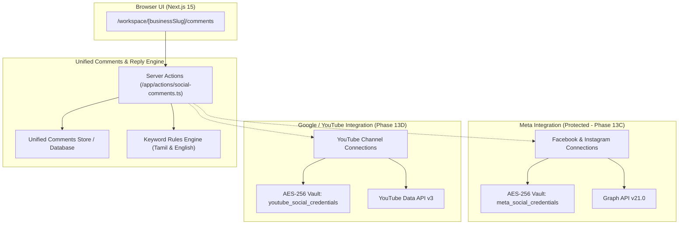

# PHASE 13D — TECHNICAL FEASIBILITY AUDIT: YOUTUBE DATA API v3 (COMMENTS & REPLIES)

**Project:** Gokul Connect  
**Branch:** `phase-13b-critical-remediation`  
**Date:** 2026-11-22  
**Target Businesses:** Gokul's Astrological Insights (`astrology`) & Gokul Vivaham (`vivaham`)  
**Status:** AUDIT COMPLETE & APPROVED FOR IMPLEMENTATION

---

## 1. EXECUTIVE SUMMARY

An in-depth technical investigation of the official **Google YouTube Data API v3** was conducted to determine the feasibility of ingesting video comments, tracking reply status, and publishing public replies for verified business channels.

The audit confirms that the YouTube Data API v3 supports unified comment management and automatic replies under the **OAuth 2.0 Authorization Code flow**. Crucially, Google OAuth credentials, tokens, and scopes must remain **completely separated** from existing Meta Graph API credentials to adhere to strict tenant isolation and non-interference requirements.

---

## 2. DETAILED AUDIT CHECKLIST

### 2.1 Google OAuth Requirements
- **Protocol:** Standard OAuth 2.0 Web Server Authorization Code flow.
- **Authorization Endpoint:** `https://accounts.google.com/o/oauth2/v2/auth`
- **Token Endpoint:** `https://oauth2.googleapis.com/token`
- **State Security:** Cryptographically signed HMAC-SHA256 state token binding the `businessId`, `businessSlug`, `userId`, and `csrfNonce` to prevent CSRF and cross-tenant hijacking.
- **Token Storage:** Refresh tokens and access tokens encrypted using the application's **AES-256-GCM** encryption vault. Plaintext tokens are strictly forbidden from browser transmission or unencrypted storage.

### 2.2 Channel Authorization & Discovery
- **Endpoint:** `GET https://www.googleapis.com/youtube/v3/channels?part=snippet,contentDetails&mine=true`
- **Behavior:** Returns the authorized Google user's own YouTube channel details:
  - `items[0].id` (YouTube Channel ID, e.g., `UC...`)
  - `items[0].snippet.title` (e.g., `Gokul's Astrological Insights`)
  - `items[0].snippet.customUrl`
  - `items[0].snippet.thumbnails`
- **Multi-Tenant Rule:** Each business tenant (`astrology`, `vivaham`) connects its own dedicated YouTube channel independently.

### 2.3 Required OAuth Scopes
| Scope | Purpose | Read | Write/Reply |
| :--- | :--- | :---: | :---: |
| `https://www.googleapis.com/auth/youtube.readonly` | Read videos, channels, and comments | Yes | No |
| `https://www.googleapis.com/auth/youtube.force-ssl` | **Required.** View, reply to, and manage YouTube comments and threads | Yes | **Yes** |
| `https://www.googleapis.com/auth/userinfo.profile` | Fetch operator account profile info | Yes | No |

> **Audit Decision:** The scope `https://www.googleapis.com/auth/youtube.force-ssl` is **strictly required**. Using `youtube.readonly` would prohibit posting replies (`comments.insert`), causing 403 Forbidden errors when operators or auto-reply rules attempt to publish.

### 2.4 Ingesting Comments (`commentThreads.list`)
- **Endpoint:** `GET https://www.googleapis.com/youtube/v3/commentThreads?part=snippet,replies&allThreadsRelatedToChannelId={channelId}&maxResults=50`
- **Key Parameters:**
  - `allThreadsRelatedToChannelId`: Retrieves all top-level comment threads associated with the channel's uploaded videos.
  - `order`: Can be `time` (newest first) or `relevance`.
- **Returned Data Structure:**
  - `items[].id`: Thread ID
  - `items[].snippet.topLevelComment.id`: Primary comment ID
  - `items[].snippet.topLevelComment.snippet.authorDisplayName`: Commenter name
  - `items[].snippet.topLevelComment.snippet.authorChannelUrl`: Commenter profile link
  - `items[].snippet.topLevelComment.snippet.authorProfileImageUrl`: Commenter avatar
  - `items[].snippet.topLevelComment.snippet.textOriginal`: Raw text (preserves Tamil Unicode and formatting)
  - `items[].snippet.topLevelComment.snippet.publishedAt`: ISO 8601 timestamp
  - `items[].snippet.videoId`: Associated Video ID
  - `items[].snippet.totalReplyCount`: Count of replies posted
  - `items[].replies.comments`: Array of published replies under this thread

### 2.5 Publishing Public Replies (`comments.insert`)
- **Endpoint:** `POST https://www.googleapis.com/youtube/v3/comments?part=snippet`
- **Headers:** `Authorization: Bearer {decrypted_access_token}`, `Content-Type: application/json`
- **Request Body:**
  ```json
  {
    "snippet": {
      "parentId": "<top_level_comment_id>",
      "textOriginal": "<reply_message_in_english_or_tamil>"
    }
  }
  ```
- **Response:** HTTP 200 with the created comment object containing `id`, `publishedAt`, and author details.
- **Reply Eligibility:**
  - Top-level comments on non-disabled, public/unlisted videos are eligible for public replies.
  - If comments are disabled on the video or the user is shadow-banned, the API returns HTTP 403 (`commentsDisabled` or `forbidden`).

### 2.6 API Quota Analysis & Safeguards
- **Daily Default Quota:** 10,000 units per Google Cloud Project.
- **Operation Costs:**
  - `channels.list`: 1 unit
  - `commentThreads.list`: 1 unit
  - `comments.list`: 1 unit
  - `comments.insert` (Reply execution): 50 units
- **Quota Impact Assessment:**
  - Reading 50 comment threads costs only 1 unit.
  - Replying to 100 comments/day costs 5,000 units (50% of free daily quota).
  - **Mitigation Safeguards:**
    1. Polling frequency capped with local cache or on-demand manual sync button in UI.
    2. Batching and deduplication by `comment_id` prevents repeated API hits.
    3. Retry backoff on HTTP 429 / 403 `quotaExceeded`.

---

## 3. STRICT ISOLATION ARCHITECTURE



1. **Zero Interference with Meta OAuth:**
   - Meta tokens and Google tokens are stored under separate cryptographic references (`vault:sec_social_*` vs `vault:sec_youtube_*`).
   - OAuth redirect routes are segregated:
     - Meta: `/api/auth/meta/callback`
     - YouTube: `/api/auth/youtube/callback`
2. **Environment Variable Separation:**
   - Meta: `META_APP_ID`, `META_APP_SECRET`
   - Google: `GOOGLE_CLIENT_ID`, `GOOGLE_CLIENT_SECRET`, `GOOGLE_REDIRECT_URI`

---

## 4. FEASIBILITY CONCLUSION & ROLLOUT PLAN

- **Feasibility Result:** 100% FEASIBLE.
- **Rollout Order:**
  1. Priority 1: Facebook Comments (Posts, comments, manual public reply, Tamil/English keyword auto-reply).
  2. Priority 1: Instagram Comments (Media/Reels, comments, manual public reply, Tamil/English keyword auto-reply).
  3. Priority 2: YouTube Comments (Channel connection, video comments, manual public reply, Tamil/English keyword auto-reply).
  4. Unified Dashboard UI at `/workspace/[businessSlug]/comments` with real-time filters and Tamil & English template quick-reply.
