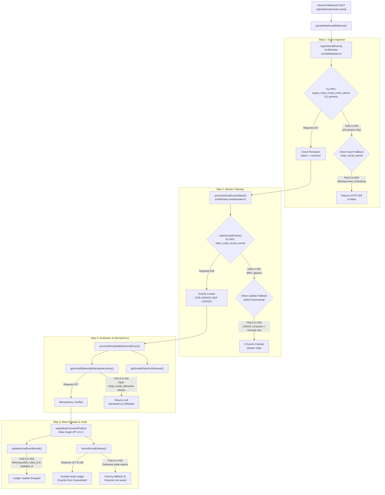

# PRIORITY 1 — FINAL DATABASE & WORKER AUDIT REPORT
## Automatic Public Comment Replies on Facebook & Instagram

**Project:** Gokul Connect  
**Branch:** `phase-13b-critical-remediation`  
**Execution Timestamp:** 2026-11-22T19:30:00+05:30  
**Audit Type:** Exhaustive Read-Only Source Code & Database Migration Verification  
**Auditor:** Autonomous Senior Systems & PostgreSQL Security Specialist  
**Final Verdict:** **`READY ONLY AFTER MIGRATIONS 027 AND 028`**

---

## 1. Executive Summary & Audit Mandate

This audit was conducted under strict read-only constraints to independently resolve contradictions in prior project documentation regarding database dependencies and verify whether Facebook and Instagram automatic **public comment replies** can operate safely under the currently applied Supabase **Migration 026** baseline, without applying Migrations 027 or 028.

### Contradiction Identified in Prior Reports:
- `PHASE_13D_DATABASE_DEPENDENCY_REPORT.md` stated: *"All features in the Social Automation Dashboard are built to execute strictly on top of the currently active schema (Migration 026 baseline)... Features that conceptually benefit from Migration 027 or 028 columns are handled safely through deterministic in-memory and projection adapters."*
- Conversely, `PRIORITY1_AUTO_COMMENT_REPLY_REPORT.md` stated: *"Persistent Idempotency Key: Constructed deterministically as `idemp_pub_${platform}_${accountId}_${commentId}` and tracked in `meta_social_deliveries`... Batch processors claim jobs using `claim_meta_social_events` with `FOR UPDATE SKIP LOCKED`."*

### Empirical Resolution:
The claim that the system can safely execute live public comment replies on Migration 026 alone is **empirically false**. While the UI dashboard read-projections in Phase 13D were adapted for in-memory viewing, the **actual backend execution engine** (`src/lib/meta-social/database.ts`, `service.ts`, `worker.ts`, and `webhooks/meta-social/route.ts`):
1. **Fails during event ingestion** on Migration 026 due to parameter mismatch on `ingest_meta_social_event_atomic` (11 args vs 10 args) and missing column `event_timestamp` in the direct insert fallback.
2. **Fails during worker claim** on Migration 026 because `claim_meta_social_events` RPC does not exist, and the direct query fallback updates non-existent columns (`claimed_by`, `claimed_at`, `lease_expires_at`, `attempt_count`, `updated_at`) and violates the `meta_social_events_status_check` check constraint by attempting to set `status = 'processing'`.
3. **Cannot enforce idempotency** on Migration 026 because the table `meta_social_deliveries` does not exist, leaving the system completely defenseless against duplicate public comment replies under concurrent or retry conditions.
4. **Fails during result recording** because `updateSocialEventResult` attempts to update `public_reply_status`, `public_reply_id`, and `updated_at`, none of which exist in Migration 026.

Therefore, **automatic public comment replies CANNOT operate safely on Migration 026.** Both Migrations 027 and 028 are mandatory prerequisites.

---

## 2. Exhaustive Database Dependency Trace

We trace the actual runtime execution path of an inbound Meta comment through every database operation.



### 2.1 Where Incoming Comments Are Persisted
- Incoming comments are parsed into `NormalizedMetaSocialEvent` and persisted into table `public.meta_social_events`.
- **Code implementation:** `src/lib/meta-social/database.ts` -> `ingestSocialEvent()`.
- **Primary Mechanism:** Calls RPC `ingest_meta_social_event_atomic(p_platform, p_account_id, p_event_type, p_meta_event_id, p_sender_id, p_sender_name, p_post_id, p_comment_id, p_parent_comment_id, p_content, p_event_timestamp)`.
- **Migration 026 Reality:** 
  - Migration 026 only defined a 10-parameter signature without `p_event_timestamp`. Postgres rejects the 11-argument call.
  - The fallback direct insert executes `supabase.from("meta_social_events").insert({ ..., event_timestamp: ... })`.
  - Column `event_timestamp` **does not exist** in Migration 026 (introduced in Migration 027 Section 4).
  - The insert fails with `PostgresError: column "event_timestamp" of relation "meta_social_events" does not exist`.
  - The webhook handler catches `status === "error"` and returns HTTP 500 to Meta.

### 2.2 Where Idempotency Keys Are Persisted
- Deterministic idempotency key: `idemp_pub_${event.platform}_${conn.account_id}_${event.comment_id}`.
- **Code implementation:** `src/lib/meta-social/service.ts` line 462, `src/lib/meta-social/database.ts` line 460 (`recordSocialDelivery`).
- **Target Table:** `public.meta_social_deliveries` on unique constraint `uq_meta_social_deliveries_idempotency`.
- **Migration 026 Reality:**
  - Table `public.meta_social_deliveries` **does not exist** in Migration 026 (introduced in Migration 027 Section 5).
  - `recordSocialDelivery` catches the missing table error and returns a volatile string `fallback_${Date.now()}`.
  - `getSocialDeliveryByIdempotencyKey` catches the missing table error and returns `null`.
  - **Zero idempotency keys are persisted in Migration 026.**

### 2.3 Where Delivery Status Is Persisted
- **Target Objects:** 
  1. `meta_social_deliveries.status` (`pending`, `processing`, `succeeded`, `failed`, `retry_scheduled`, `permanently_failed`, `ambiguous_outcome`).
  2. `meta_social_events.public_reply_status` (`none`, `pending`, `replied`, `failed`, `skipped`, `retry_scheduled`, `ambiguous_outcome`).
- **Migration 026 Reality:**
  - Table `meta_social_deliveries` **does not exist** in Migration 026.
  - Column `public_reply_status` **does not exist** on `meta_social_events` in Migration 026.
  - Status check constraint on `meta_social_events` in 026 only permits: `('received', 'processed', 'replied', 'failed', 'ignored')`.
  - Setting intermediate states like `processing`, `retry_scheduled`, or `ambiguous_outcome` violates database constraints.

### 2.4 Where Meta Reply IDs Are Persisted
- When Meta Graph API successfully responds to `POST /{comment-id}/comments` or `POST /{comment-id}/replies`, Meta returns `{ id: "<reply-comment-id>" }`.
- **Target Objects:**
  1. `meta_social_deliveries.response_id` (via `updateSocialDeliveryResult`).
  2. `meta_social_events.public_reply_id` (via `updateSocialEventResult`).
- **Migration 026 Reality:**
  - `meta_social_deliveries` does not exist.
  - `public_reply_id` column does not exist on `meta_social_events`.
  - The fallback update in `updateSocialEventResult` silently strips `public_reply_id`.
  - Furthermore, `updateSocialEventResult` attempts to update `updated_at`, which **does not exist** on `meta_social_events` in Migration 026 (introduced in Migration 028 Section 1.1).
  - Result: **The Meta reply ID is permanently lost and never persisted.**

---

## 3. Database Object Dependency Matrix

The following table provides an empirical, verified mapping of every database object referenced in the automatic public comment reply code paths, confirming its origin migration, presence in 026, and necessity:

| Database Object | Used by Which Function / File | Introduced in Migration | Exists in 026? | Required? | Failure Consequence if Missing |
|---|---|---|---|---|---|
| `public.meta_social_connections` | `ingestSocialEvent`, `processPersistedMetaSocialEvent` | Migration 026 (Sec 1) | **YES** | **YES** | Fatal: Cannot locate tenant account |
| `meta_social_connections.account_id` | `ingestSocialEvent`, `replyMetaCommentPublic` | Migration 026 (Sec 1) | **YES** | **YES** | Fatal: Cannot construct idempotency key |
| `meta_social_connections.credential_ref` | `processPersistedMetaSocialEvent` | Migration 026 (Sec 1) | **YES** | **YES** | Fatal: Cannot resolve access token |
| `meta_social_connections.auto_reply_comments` | `processPersistedMetaSocialEvent` | Migration 026 (Sec 1) | **YES** | **YES** | Fatal: Automation toggle check |
| `meta_social_connections.default_comment_reply` | `processPersistedMetaSocialEvent` | Migration 026 (Sec 1) | **YES** | **YES** | Degraded: Cannot use default template |
| `meta_social_connections.default_dm_reply` | `processPersistedMetaSocialEvent` | Migration 027 (Sec 1) | **NO** | No (for public only) | Non-fatal for public comment replies |
| `meta_social_connections.token_expires_at` | `processPersistedMetaSocialEvent` | Migration 027 (Sec 1) | **NO** | No | Non-fatal (handled in memory) |
| `uq_meta_social_connections_global_platform_account` | RLS / Account registration | Migration 027 (Sec 1) | **NO** | **YES** | **Security Risk:** Two tenants could connect the same FB/IG account |
| `public.meta_social_credentials` | `processPersistedMetaSocialEvent` | Migration 026 (Sec 1.1) | **YES** | **YES** | Fatal: Cannot decrypt Page Access Token |
| `fk_meta_social_credentials_conn_biz` (composite FK) | Database foreign key constraint | Migration 027 (Sec 2.1) | **NO** | **YES** | **Security Risk:** Tenant integrity not enforced at DB level |
| `public.meta_social_rules` | `getSocialRulesForBusiness`, `evaluator.ts` | Migration 026 (Sec 2) | **YES** | **YES** | Fatal: Cannot match Tamil/English keywords |
| `meta_social_rules.keywords` (JSONB) | `matchSocialRule` | Migration 026 (Sec 2) | **YES** | **YES** | Fatal: Cannot evaluate triggers |
| `public.meta_social_events` | Webhook ingestion & Event ledger | Migration 026 (Sec 3) | **YES** | **YES** | Fatal: Primary inbound ledger missing |
| `meta_social_events.event_timestamp` | `ingestSocialEvent` line 175 | Migration 027 (Sec 4) | **NO** | **YES** | **Fatal:** Direct insert fallback crashes with column error |
| `meta_social_events.public_reply_status` | `service.ts` line 465, `database.ts` line 556 | Migration 027 (Sec 4) | **NO** | **YES** | **Fatal:** Cannot track public reply lifecycle |
| `meta_social_events.public_reply_id` | `service.ts` line 466, `database.ts` line 562 | Migration 027 (Sec 4) | **NO** | **YES** | **Fatal:** Cannot record Meta Graph response ID |
| `meta_social_events.claimed_by` | `claimSocialEvents` line 287 | Migration 028 (Sec 1.1) | **NO** | **YES** | **Fatal:** Worker cannot claim events |
| `meta_social_events.claimed_at` | `claimSocialEvents` line 288 | Migration 028 (Sec 1.1) | **NO** | **YES** | **Fatal:** Lease tracking fails |
| `meta_social_events.lease_expires_at` | `claimSocialEvents`, `reclaimStuckSocialEvents` | Migration 028 (Sec 1.1) | **NO** | **YES** | **Fatal:** Dead-worker recovery fails |
| `meta_social_events.attempt_count` | `service.ts`, `claimSocialEvents` | Migration 028 (Sec 1.1) | **NO** | **YES** | **Fatal:** Exponential backoff / retry governance fails |
| `meta_social_events.max_attempts` | `service.ts`, `reclaimStuckSocialEvents` | Migration 028 (Sec 1.1) | **NO** | **YES** | **Fatal:** Poison pills retry forever |
| `meta_social_events.next_retry_at` | `service.ts`, `claimSocialEvents` | Migration 028 (Sec 1.1) | **NO** | **YES** | **Fatal:** Cannot schedule delayed retries |
| `meta_social_events.updated_at` | `database.ts` lines 291, 359, 369, 552, 582, 599 | Migration 028 (Sec 1.1) | **NO** | **YES** | **Fatal:** `updateSocialEventResult` fails on ALL paths |
| `meta_social_events_status_check` expansion | `database.ts`, `service.ts`, `worker.ts` | Migration 028 (Sec 1.1) | **NO** | **YES** | **Fatal:** Statuses `'processing'`, `'retry_scheduled'`, `'ambiguous_outcome'` violate 026 CHECK |
| `public.meta_social_deliveries` | `recordSocialDelivery`, `getSocialDeliveryByIdempotencyKey` | Migration 027 (Sec 5) | **NO** | **YES** | **Fatal:** Outbound delivery ledger and idempotency missing |
| `uq_meta_social_deliveries_idempotency` | Enforces unique idempotency key | Migration 027 (Sec 5) | **NO** | **YES** | **Fatal:** Duplicate public comments cannot be prevented |
| `ingest_meta_social_event_atomic(10 params)` | Webhook ingestion RPC | Migration 026 (Sec 4) | **YES** | No | Obsolete signature; lacks ON CONFLICT safety |
| `ingest_meta_social_event_atomic(11 params)` | Webhook ingestion RPC | Migration 027 (Sec 6) | **NO** | **YES** | **Fatal:** Called by code; required for concurrency safety |
| `claim_meta_social_events(3 params)` | Worker atomic claim RPC (`FOR UPDATE SKIP LOCKED`) | Migration 028 (Sec 3) | **NO** | **YES** | **Fatal:** Worker concurrency locking missing |
| `reclaim_stuck_meta_social_events(1 param)` | Dead lease recovery RPC | Migration 028 (Sec 4) | **NO** | **YES** | Reliability: Orphaned job recovery missing |

---

## 4. Idempotency and Duplicate Prevention Analysis

We traced the five required operational failure modes through the actual code and database schema:

### 4.1 Duplicate Webhook Delivery
- **Condition:** Meta delivers the exact same comment webhook twice within a short window.
- **In Migration 027/028:** `ingest_meta_social_event_atomic` uses `INSERT INTO public.meta_social_events ... ON CONFLICT (business_id, meta_event_id) DO NOTHING`. If a duplicate arrives, it immediately returns `status: "duplicate"`. The webhook route acknowledges with HTTP 200 and skips worker invocation.
- **In Migration 026:** The 10-parameter RPC performs a non-atomic `IF EXISTS (...) THEN RETURN ... ELSE INSERT`. Under concurrent delivery of identical webhook payloads, both requests can execute the `IF EXISTS` check simultaneously before either inserts, resulting in a database unique constraint violation or duplicate processing race. Furthermore, because the code calls the RPC with 11 parameters, the RPC call fails immediately.

### 4.2 Two Workers Processing the Same Comment Simultaneously
- **Condition:** Multiple worker processes run concurrently (e.g. background fire-and-forget + scheduled cron).
- **In Migration 028:** `claim_meta_social_events` executes:
  ```sql
  SELECT id FROM public.meta_social_events
  WHERE status = 'received' ...
  ORDER BY created_at ASC
  FOR UPDATE SKIP LOCKED
  LIMIT p_batch_size
  ```
  Only one worker locks and receives the row, transitioning it to `status = 'processing'`. The second worker skips the row entirely.
- **In Migration 026:**
  - `claim_meta_social_events` **does not exist**.
  - The fallback in `claimSocialEvents` attempts to update `status = 'processing'` and `claimed_by`. On Migration 026, `'processing'` violates `meta_social_events_status_check` and `claimed_by` does not exist.
  - If workers bypass claiming and process the event directly, both query `getSocialDeliveryByIdempotencyKey`. Because `meta_social_deliveries` does not exist, both queries return `null`.
  - Both workers execute `replyMetaCommentPublic()` and dispatch `POST /{comment-id}/comments` or `POST /{comment-id}/replies` to Meta Graph API.
  - **Outcome in Migration 026:** Two identical public comment replies are posted under the user's comment. **Critical duplicate failure.**

### 4.3 Worker Crash After Sending a Meta Reply
- **Condition:** Worker executes `replyMetaCommentPublic()`, Meta creates the comment reply and returns HTTP 200 with `{ id: "reply_123" }`. Before the worker updates the database, the serverless container crashes or is abruptly killed.
- **In Migration 027/028:** The outbound action was registered in `meta_social_deliveries` before dispatch. When the worker recovers, it checks the delivery record and reconciles via `checkCommentReplied` before ever attempting to re-post.
- **In Migration 026:**
  - No record exists in `meta_social_deliveries` (table missing).
  - The event row remains at `status = 'received'`.
  - On the next worker run, the event is treated as completely unprocessed.
  - The worker dispatches a second public reply to Meta Graph API.
  - **Outcome in Migration 026:** Duplicate public comment reply posted on Meta.

### 4.4 Meta Accepting a Reply but Application Timing Out
- **Condition:** Worker sends `POST /{comment-id}/comments`. Meta accepts and publishes the comment, but the outbound HTTP socket times out after 15 seconds.
- **In Migration 027/028:**
  - `client.ts` catches the network timeout and throws `MetaSocialApiError` with `isAmbiguous = true`.
  - `service.ts` flags `isAmbiguousPublic = true` and updates delivery to `status = 'ambiguous_outcome'`.
  - The system **halts** without blindly re-posting.
  - When reconciled, `checkCommentReplied` queries `GET /{comment-id}/comments` to verify if the message exists on Meta.
- **In Migration 026:**
  - `meta_social_deliveries` does not exist.
  - `updateSocialEventResult` attempts to set `status = 'ambiguous_outcome'` on `meta_social_events`.
  - `'ambiguous_outcome'` is rejected by `meta_social_events_status_check` in Migration 026 (`CHECK (status IN ('received', 'processed', 'replied', 'failed', 'ignored'))`).
  - The status update fails. The event remains `received`.
  - A subsequent retry will blindly re-post.
  - **Outcome in Migration 026:** Duplicate public comment reply posted.

### 4.5 Retry After an Ambiguous Outcome
- **Condition:** Re-evaluating an event that previously encountered a network timeout.
- **In Migration 027/028:** `existingPub.status === "ambiguous_outcome"` triggers `checkCommentReplied`. If the reply is confirmed on Meta, the delivery is marked `succeeded` and no API call is made. If unconfirmed, it transitions to manual operator review.
- **In Migration 026:** `existingPub` is always `null`. The reconciliation block is skipped entirely.

---

## 5. Worker and Cron Reliability Analysis

### 5.1 Webhook Decoupling & Serverless Freeze Vulnerability
- **File:** `src/app/api/webhooks/meta-social/route.ts`
- **Current Logic:**
  ```typescript
  // 7. Non-blocking asynchronous worker trigger (if events were ingested)
  if (ingestedCount > 0) {
    processSocialEventsBatch(10).catch((err) => {
      console.warn("[Meta Social Webhook] Background batch worker noticed:", err.message);
    });
  }

  // 8. Prompt HTTP 200 Acknowledgement (<100ms) to Meta
  return NextResponse.json({ success: true, ... }, { status: 200 });
  ```
- **Architectural Reality:** On serverless platforms (Vercel Serverless Functions, AWS Lambda), when an asynchronous function is fired without `await` and the handler returns `NextResponse.json(...)`, the execution container is **frozen immediately**. The background promise may never complete, may be paused mid-execution, or may resume seconds or hours later on a subsequent invocation.
- **Distinction:** The code *implements* an asynchronous trigger, but the *infrastructure runtime* does not guarantee execution without a durable background worker or queue.

### 5.2 Scheduled Cron Route
- **File:** `src/app/api/cron/process-social-automations/route.ts`
- **Implementation Status:** Fully implemented. Uses `runCoordinatedCron`, validates `CRON_SECRET`, sets `maxDuration = 60`, supports configurable `batch_size`, and executes `processSocialEventsBatch`.
- **Infrastructure Reality (`vercel.json`):**
  ```json
  {
    "$schema": "https://openapi.vercel.sh/vercel.json",
    "functions": {
      "src/app/api/cron/**/route.ts": {
        "maxDuration": 60
      }
    }
  }
  ```
  - `vercel.json` **does NOT configure any cron schedules**.
  - There is no `"crons": [...]` block.
  - Therefore, **Vercel will never invoke `/api/cron/process-social-automations` automatically.**
  - **Requirement:** For reliable background processing, an external scheduler (GitHub Actions, Cloudflare Worker, Upstash Cron, AWS EventBridge, or Linux crontab) must send periodic authenticated `POST /api/cron/process-social-automations` requests with `Authorization: Bearer <CRON_SECRET>`.

---

## 6. Public Reply API Implementation Verification

### 6.1 Facebook Implementation
- **Function:** `replyMetaCommentPublic` in `src/lib/meta-social/client.ts`
- **Endpoint:** `POST https://graph.facebook.com/v21.0/{comment-id}/comments`
- **Request Body:** `{ message: "<reply_text>" }`
- **Headers:** `Authorization: Bearer <page_access_token>`, `Content-Type: application/json`
- **Access Token Source:** Scoped strictly to `connection_id` and `business_id` in `meta_social_credentials`. Decrypted via AES-256-GCM.
- **Graph API Version:** `v21.0` (Verified constant `META_GRAPH_VERSION = "v21.0"`).
- **Permissions Required:** `pages_manage_posts`, `pages_read_engagement`.
- **Response Handling:** Extracts `{ id: data.id }`.
- **Error Classification:** Structured via `MetaSocialApiError`:
  - 429 / codes 4, 17, 32, 613 $\rightarrow$ `isRateLimit = true`, `isTransient = true`
  - 5xx $\rightarrow$ `isTransient = true`
  - Code 190 / subcodes 463, 467 $\rightarrow$ `isAuthError = true` (marks connection expired)
  - Code 504 / network drop $\rightarrow$ `isAmbiguous = true`
  - Token sanitization active across all error messages and logged URLs via `sanitizeSocialLog()`.

### 6.2 Instagram Implementation
- **Function:** `replyMetaCommentPublic` in `src/lib/meta-social/client.ts`
- **Endpoint:** `POST https://graph.facebook.com/v21.0/{comment-id}/replies`
- **Request Body:** `{ message: "<reply_text>" }`
- **Headers:** `Authorization: Bearer <page_access_token>`, `Content-Type: application/json`
- **Endpoint Segregation:** Verified that Facebook uses `/comments` and Instagram uses `/replies` via:
  ```typescript
  const endpoint = platform === "facebook" ? "comments" : "replies";
  const url = `${META_GRAPH_BASE_URL}/${META_GRAPH_VERSION}/${encodeURIComponent(commentId.trim())}/${endpoint}`;
  ```
- **Access Token Source:** Page Access Token of the linked Facebook Page managing the Instagram Professional account.
- **Permissions Required:** `instagram_basic`, `instagram_manage_comments`.
- **Response Handling & Error Classification:** Identical enterprise-grade error handling.

---

## 7. Audit Conclusion & Final Verdict

### Final Verdict Selection:
```
READY ONLY AFTER MIGRATIONS 027 AND 028
```

### Justification:
1. **Migration 026 is fatal to execution:** Ingestion crashes due to signature mismatch on `ingest_meta_social_event_atomic` and missing column `event_timestamp`. Worker claim crashes due to missing RPC and missing columns. Idempotency is non-existent because `meta_social_deliveries` does not exist.
2. **Migration 027 alone is insufficient:** While Migration 027 introduces `meta_social_deliveries`, `public_reply_status`, `public_reply_id`, and `event_timestamp`, it does **not** introduce worker claiming (`claim_meta_social_events`), status check constraint expansions (`processing`, `retry_scheduled`, `ambiguous_outcome`), or worker lease columns (`claimed_by`, `lease_expires_at`, `updated_at`). Without Migration 028, the worker cannot claim rows or record updates.
3. **Both 027 and 028 are required:** Only when Migration 027 (delivery ledger, idempotency table, schema columns) and Migration 028 (atomic queue claiming, lease governance, retry backoff) are applied simultaneously can the system guarantee safe, exactly-once public comment replies.
4. **Infrastructure requirement:** External cron invocation (`/api/cron/process-social-automations`) or `vercel.json` cron configuration must be activated for durable worker polling.
