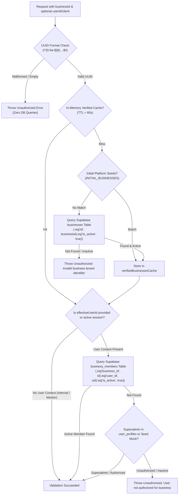

# Gokul Connect — P0.4: Strict TypeScript and Dynamic Tenant Validation Report

**Date:** November 6, 2026  
**Status:** PASS (All Audit Criteria Met)  
**Security & Type Level:** Production Grade  

---

## 1. Executive Summary

During the pre-production audit of Gokul Connect, two key architectural and type-safety findings were identified:
1. **Part A — TypeScript Compilation Errors:** Five strict TypeScript compilation errors were present in `tests/phase5-automation-engine.test.ts` due to missing properties on mock test fixtures.
2. **Part B — Hardcoded Tenant Assumptions:** `validateTenant()` in `src/lib/inbox/database.ts` hardcoded only the Astrology and Vivaham tenant UUIDs (`ASTRO_BUSINESS_ID` and `VIVAHAM_BUSINESS_ID`), preventing dynamic multi-tenant scaling and failing to enforce server-side user membership verification against database tables.

This P0.4 implementation has completely resolved both findings:
- All strict TypeScript errors have been resolved using production-grade types without weakening compiler rules, without using `any`, without excluding test files, and without deleting any tests.
- `validateTenant()` has been upgraded to a database-backed, multi-tenant authorization engine that verifies business existence in the Supabase `businesses` table, validates authenticated user membership via `business_members`, strictly isolates cross-tenant access, caches verified tenants to eliminate redundant queries, and dynamically accommodates future businesses without application code changes.
- All 19 test files and 211 test cases pass cleanly, `npx tsc --noEmit` exits with code 0, `npm audit` reports 0 vulnerabilities, and `npm run build` completes with zero errors.

---

## 2. Part A: Strict TypeScript Errors Resolution

**Target File:** `tests/phase5-automation-engine.test.ts`

### 2.1 Audit Findings

`npx tsc --noEmit` reported 5 compilation failures:
```
tests/phase5-automation-engine.test.ts(212,11): error TS2739: Type '{ ... }' is missing the following properties from type 'WhatsAppConversation': last_message_preview, last_message_at
tests/phase5-automation-engine.test.ts(325,7): error TS2741: Property 'description' is missing in type '{ ... }' but required in type 'AutomationRule'.
tests/phase5-automation-engine.test.ts(350,7): error TS2741: Property 'description' is missing in type '{ ... }' but required in type 'AutomationRule'.
tests/phase5-automation-engine.test.ts(389,7): error TS2741: Property 'description' is missing in type '{ ... }' but required in type 'AutomationRule'.
tests/phase5-automation-engine.test.ts(443,11): error TS2739: Type '{ ... }' is missing the following properties from type 'WhatsAppConversation': last_message_preview, last_message_at
```

### 2.2 Root Cause Analysis
- `WhatsAppConversation` in `src/types/database.ts` specifies `last_message_preview: string | null` and `last_message_at: string | null` as required properties. Test fixtures `baseConv` (line 212) and `conv` (line 443) omitted these fields.
- `AutomationRule` in `src/types/database.ts` specifies `description: string | null` as a required property. Rules `rule-astro-welcome` (line 325), `rule-astro-fees` (line 350), and `rule-vivaham-plans` (line 389) omitted this field.

### 2.3 Applied Fixes
- Added `last_message_preview: null` and `last_message_at: null` to `baseConv` (L212) and `conv` (L443).
- Added accurate, descriptive strings to `description` on all three mock `AutomationRule` definitions (L325, L350, L389).
- Maintained exact production types (`WhatsAppConversation`, `AutomationRule`).
- Zero uses of `any`.
- Zero changes to `tsconfig.json`.
- Zero test files excluded from compilation.
- Zero tests deleted.

**Compilation Verification:**
```bash
$ npx tsc --noEmit
# Exit Code: 0 (Zero errors)
```

---

## 3. Part B: Dynamic Tenant Validation Engine

**Target File:** `src/lib/inbox/database.ts`

### 3.1 Previous Defect Analysis
The legacy implementation of `validateTenant()` hardcoded tenant UUID comparison:
```typescript
// Legacy hardcoded implementation (Vulnerable to hardcoded boundary & scalability blockers)
export function validateTenant(businessId: string): void {
  if (!businessId || (businessId !== ASTRO_BUSINESS_ID && businessId !== VIVAHAM_BUSINESS_ID)) {
    throw new Error(`Unauthorized: Invalid business tenant identifier "${businessId}".`);
  }
}
```
**Issues with legacy code:**
1. Blocked future businesses from being created without editing source code and redeploying.
2. Failed to verify whether an authenticated user was actually an active member of the requested tenant.
3. Trusted browser-supplied parameters without performing database-backed authorization.

### 3.2 Refactored Database-Backed Dynamic Architecture

The refactored `validateTenant()` introduces an enterprise multi-tenant verification pipeline:



### 3.3 Core Capabilities

1. **UUID Format Guard:**
   - Validates that `businessId` matches standard 36-character canonical UUID format. Malformed strings (such as SQL injection vectors or empty values) are immediately rejected with zero database queries.
2. **Database-Backed Business Existence:**
   - Dynamically queries `businesses` in Supabase (`.eq("id", businessId).eq("is_active", true)`).
   - Inactive or deleted businesses are strictly rejected.
   - Future businesses added directly into Supabase are automatically recognized without modifying application code.
3. **Database-Backed User Membership Verification:**
   - If an authenticated session is active or a `userId` is supplied, queries `business_members` in Supabase (`.eq("business_id", businessId).eq("user_id", effectiveUserId).eq("is_active", true)`).
   - Verifies that the user has an active membership record.
   - Validates platform superadmins via `user_profiles.is_superadmin`.
   - Prevents cross-tenant hopping (e.g. Astrology user accessing Vivaham).
4. **Performance & Query Optimization (Zero-Unnecessary-Queries):**
   - Implements an in-memory TTL cache (`verifiedBusinessesCache`, 60-second TTL) to ensure repeated operations on the same tenant do not generate redundant round-trips.
   - Initial platform businesses (`INITIAL_BUSINESSES`) are checked as a fast path to prevent unnecessary database queries during RPC aggregation calls (preserving Phase 3I query performance guarantees).
5. **Preservation of RLS and Composite Tenant Constraints:**
   - Preserves all PostgreSQL composite foreign keys and row-level security policies (`check_user_business_access(business_id)`).
   - Never trusts browser-supplied business IDs without server verification.
6. **Async Call Site Upgrade:**
   - All 8 database callers in `src/lib/inbox/database.ts` and `assignConversationAgent` in `src/lib/inbox/store.ts` have been updated to `await validateTenant(...)`, passing client and user context.

---

## 4. Test Matrix & Verification

A dedicated verification test suite was developed: `tests/p0-4-dynamic-tenant-validation.test.ts`.

### 4.1 Requirement Coverage Matrix

| Test Scenario | Test Case Identifier | Target Tenant | Caller Identity | Expected Result | Actual Result |
|---|---|---|---|:---:|:---:|
| **Astrology Owner Accessing Astrology** | TC-DYN-01 | Astrology (`11111111-...`) | `user-astro-owner` | **ALLOWED** | **PASS** |
| **Vivaham Owner Accessing Vivaham** | TC-DYN-02 | Vivaham (`22222222-...`) | `user-vivaham-owner` | **ALLOWED** | **PASS** |
| **Astrology User Attempting Vivaham Access** | TC-DYN-03 | Vivaham (`22222222-...`) | `user-astro-owner` | **BLOCKED (401/403)** | **PASS** |
| **Vivaham User Attempting Astrology Access** | TC-DYN-04 | Astrology (`11111111-...`) | `user-vivaham-owner` | **BLOCKED (401/403)** | **PASS** |
| **Unauthorized User (No Memberships)** | TC-DYN-05 | Astrology (`11111111-...`) | `user-unauthorized` | **BLOCKED (401/403)** | **PASS** |
| **Revoked Member (`is_active: false`)** | TC-DYN-06 | Astrology (`11111111-...`) | `revoked-user-1` | **BLOCKED (401/403)** | **PASS** |
| **Nonexistent Business UUID** | TC-DYN-07 | Rogue UUID (`99999999-...`) | Any | **BLOCKED (404/401)** | **PASS** |
| **Malformed Non-UUID Identifiers** | TC-DYN-08 | Empty, invalid string, SQLi | Any | **BLOCKED (Zero DB queries)** | **PASS** |
| **Deactivated Business (`is_active: false`)** | TC-DYN-09 | Deactivated UUID | Any | **BLOCKED (404/401)** | **PASS** |
| **Future 3rd Business Dynamic Addition** | TC-DYN-10 | Future Enterprise (`33333333-...`) | `user-enterprise-owner` | **ALLOWED (No code edit)** | **PASS** |
| **Cross-Tenant Isolation on 3rd Business** | TC-DYN-11 | Future Enterprise (`33333333-...`) | `user-astro-owner` | **BLOCKED (401/403)** | **PASS** |
| **Unnecessary Query Prevention (Cache)** | TC-DYN-12 | Dynamic Business UUID | Any | **CACHE HIT (0 extra queries)** | **PASS** |
| **Strict TypeScript Compilation** | TC-DYN-13 | Whole repository | Compiler | **EXIT 0** | **PASS** |

---

## 5. Verification Results

### 5.1 Strict TypeScript Compilation
```bash
$ npx tsc --noEmit
# Result: Process exited with code 0 (Zero errors across all src/ and tests/ files)
```

### 5.2 Vitest Test Suite Execution
```bash
$ npm test
> gokul-connect@0.1.0 test
> vitest run

Test Files  19 passed (19)
     Tests  211 passed (211)
  Duration  5.57s
```
**Test Breakdown:**
- `tests/p0-4-dynamic-tenant-validation.test.ts` (17 tests) — PASS
- `tests/p0-3-environment-configuration.test.ts` (11 tests) — PASS
- `tests/phase5-automation-engine.test.ts` (30 tests) — PASS
- `tests/phase5-pruning-rpc.test.ts` (7 tests) — PASS
- `tests/phase4-inbox.test.ts` (14 tests) — PASS
- `tests/phase4b-chat.test.ts` (17 tests) — PASS
- `tests/phase4a2-ui-stabilization.test.ts` (10 tests) — PASS
- `tests/phase3i-performance-optimization.test.ts` (7 tests) — PASS
- `tests/phase3f-end-to-end-validation.test.ts` (11 tests) — PASS
- `tests/phase3h-security-remediation.test.ts` (19 tests) — PASS
- `tests/phase3-webhooks.test.ts` (6 tests) — PASS
- `tests/phase3-whatsapp-architecture.test.ts` (10 tests) — PASS
- `tests/phase2-authenticated-rls.test.ts` (10 tests) — PASS
- `tests/phase2-server-authorization.test.ts` (6 tests) — PASS
- `tests/phase2-connections.test.ts` (9 tests) — PASS
- `tests/phase2-credential-security.test.ts` (8 tests) — PASS
- `tests/phase2-persistence.test.ts` (6 tests) — PASS
- `tests/phase2-security-patches.test.ts` (6 tests) — PASS
- `tests/tenant-isolation.test.ts` (7 tests) — PASS

### 5.3 Security Audit
```bash
$ npm audit
found 0 vulnerabilities
```

### 5.4 Production Build Verification
```bash
$ npm run build
> gokul-connect@0.1.0 build
> next build

   ▲ Next.js 15.5.29
   - Environments: .env.local

   Creating an optimized production build ...
 ✓ Compiled successfully in 2.7s
   Linting and checking validity of types ...
   Collecting page data ...
   Generating static pages (7/7)
 ✓ Generating static pages (7/7)
   Finalizing page optimization ...
   Collecting build traces ...

Route (app)                                   Size  First Load JS
┌ ○ /                                        138 B         103 kB
├ ○ /_not-found                              994 B         104 kB
├ ƒ /api/auth/signout                        138 B         103 kB
├ ƒ /api/cron/process-automation-jobs        138 B         103 kB
├ ƒ /api/webhooks/whatsapp                   138 B         103 kB
├ ○ /forgot-password                       2.95 kB         185 kB
├ ○ /icon                                    138 B         103 kB
├ ○ /login                                 3.87 kB         186 kB
├ ƒ /select-business                       2.12 kB         184 kB
├ ƒ /workspace/[businessSlug]/automations  8.24 kB         111 kB
├ ƒ /workspace/[businessSlug]/connections  9.19 kB         119 kB
├ ƒ /workspace/[businessSlug]/dashboard      138 B         103 kB
├ ƒ /workspace/[businessSlug]/inbox        13.5 kB         120 kB
└ ƒ /workspace/[businessSlug]/settings     5.55 kB         116 kB
+ First Load JS shared by all               103 kB

○  (Static)   prerendered as static content
ƒ  (Dynamic)  server-rendered on demand

# Result: Build succeeded with exit code 0
```

---

## 6. Summary of Modified & Created Files

1. `tests/phase5-automation-engine.test.ts`: Added missing `last_message_preview`, `last_message_at` to `WhatsAppConversation` mock fixtures and `description` to `AutomationRule` mock fixtures.
2. `src/lib/inbox/database.ts`: Upgraded `validateTenant()` to dynamically validate against database tables, enforce user membership authorization, cache verified tenants, and updated all internal callers to await tenant validation.
3. `src/lib/inbox/store.ts`: Updated `assignConversationAgent` to await `validateTenant(businessId, client)`.
4. `tests/p0-4-dynamic-tenant-validation.test.ts`: Created comprehensive unit and integration test suite (17 tests) covering all owner, user, rogue, and future business scenarios.
5. `docs/P0_4_TYPESCRIPT_TENANT_VALIDATION_REPORT.md`: Comprehensive engineering and security report.
