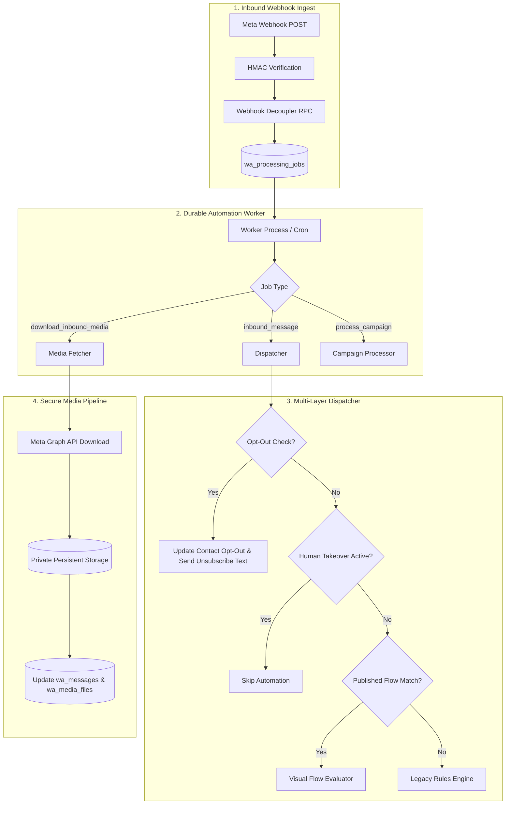
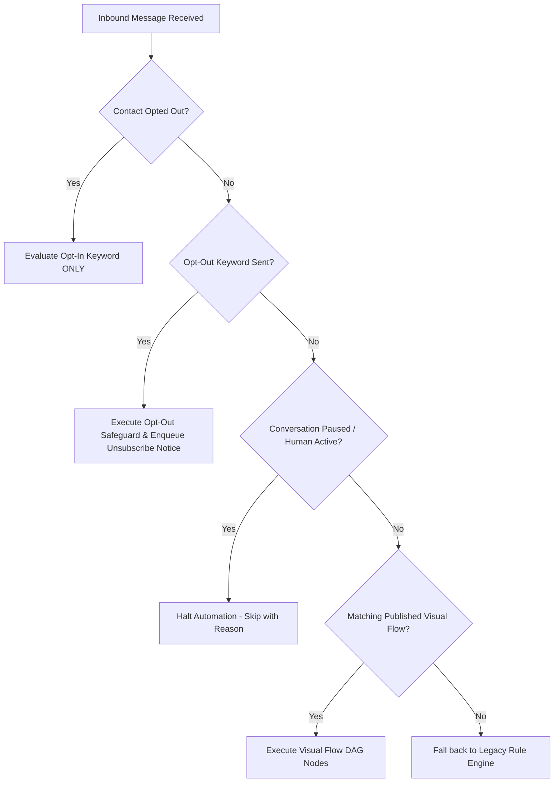

# Gokul Connect — Milestone P0 Implementation Details

This document provides architectural and technical documentation for the fixes and integrations implemented in Milestone P0.

---

## 1. Architecture Overview

Milestone P0 resolves five critical integration bottlenecks in Gokul Connect, hardening the platform for enterprise multi-tenant operations:



---

## 2. Inbound WhatsApp Media Retrieval Pipeline

### 2.1 Media Fetcher Architecture (`src/lib/whatsapp/media-fetcher.ts`)

```typescript
export interface InboundMediaOptions {
  messageId: string;
  businessId: string;
  connectionId: string;
  conversationId: string;
  mediaId: string;
  mediaType: "image" | "document" | "audio" | "video";
  mimeType?: string;
  caption?: string;
  filename?: string;
}
```

#### Execution Lifecycle:
1. **Deduplication Check**: Queries `wa_messages` by `id` and `business_id`. If `download_status === 'completed'` and `storage_path` is not null, returns immediately with the existing path.
2. **Credential Resolution**: Calls `getConnectionCredentials(connectionId)` to obtain decrypted Meta credentials (`access_token`).
3. **Metadata Resolution**: Invokes `getMetaMediaInfo(mediaId, accessToken)` on Meta Graph API (`https://graph.facebook.com/v21.0/{mediaId}`) to retrieve file size and download URL.
4. **MIME & Size Enforcement**:
   - `image`: 5 MB limit.
   - `document`: 100 MB limit.
   - `audio`: 16 MB limit.
   - `video`: 16 MB limit.
5. **Secure Stream & Persistence**:
   - Fetches media bytes using `downloadMetaMediaContent(mediaInfo.url, accessToken)`.
   - Saves binary payload via `storeMediaFile({ buffer, filename, mimeType, businessId, accessLevel: 'private' })`.
6. **Database Record Sync**:
   - Updates `wa_messages` with `storage_path`, `media_mime_type`, `media_filename`, `media_size_bytes`, `media_caption`, `download_status = 'completed'`, and clears any previous `media_error`.
   - Upserts record in `wa_media_files`.
7. **Error Masking & Token Hygiene**:
   - Errors encountered during fetch/storage catch blocks sanitize all occurrences of Bearer tokens (`[REDACTED_ACCESS_TOKEN]`) before logging or recording into `wa_messages.media_error`.

### 2.2 Dual-Authorization Media Download Endpoint (`src/app/api/media/download/route.ts`)

Supports two access pathways without making media buckets public:
1. **HMAC Signed URL**:
   - Parameters: `path`, `exp`, `sig`.
   - Validates that `Date.now() < exp` and `HMAC_SHA256(path + exp, HMAC_SECRET) === sig`.
2. **Authenticated Workspace Agent Session**:
   - Inspects Supabase auth session cookie.
   - Verifies agent membership in the business owning the media file.
   - Streams file directly from private storage with `Content-Type` and `Content-Disposition: inline`.

---

## 3. Visual Flow Engine & Inbound Worker Integration

### 3.1 Flow Evaluation Hierarchy (`src/lib/flows/evaluator.ts`)



### 3.2 Visual Flow Execution Rules
- **Status Gating**: Only flows with `status === 'published'` and matching `business_id` are loaded. Draft or disabled flows are completely excluded.
- **Trigger Matching**:
  - Checks `trigger_keyword` and `data.config.keywords`.
  - Supports English and Tamil (`தமிழ்`) keywords.
  - Case-insensitive trimming.
- **Cycle Prevention (Circuit Breaker)**:
  - Traversal tracks `visitedNodeIds: Set<string>`.
  - Maximum depth limit: 15 nodes. If a cycle is detected or traversal exceeds 15 steps, execution terminates cleanly.
- **Durable Enqueueing**:
  - Message responses from `message` nodes are converted to `send_outbound_message` jobs in `wa_processing_jobs`.
  - Responses with delays are scheduled with `job_type = "scheduled_followup"` and `scheduled_at = now + delay_seconds`.
  - Unique idempotency key pattern: `flow_reply_{flow_id}_{conversation_id}_{message_id}_{node_id}_{idx}`.

---

## 4. Multi-Number Conversation Isolation

### 4.1 Resolution Method (`src/lib/crm/database.ts`)

```typescript
export async function getOrCreateConversationForContactDb(
  businessId: string,
  contactId: string,
  optionsOrClient?: { connectionId?: string; client?: any } | any
): Promise<WhatsAppConversation>
```

#### Multi-Number Safeguards:
1. **Connection-Specific Isolation**:
   When `connectionId` is supplied:
   - Validates that the connection belongs to `businessId`. If a cross-business connection ID is passed, throws an explicit security violation: `Cross-business connection violation`.
   - Queries `wa_conversations` matching `(business_id, contact_id, connection_id)`.
   - Uses `.maybeSingle()` safely because the table enforces a composite unique constraint on `(connection_id, contact_id)`.
2. **Ambiguous Lookup Fallback**:
   When `connectionId` is not supplied:
   - Queries `wa_conversations` by `(business_id, contact_id)` ordered by `last_message_at DESC NULLS LAST LIMIT 1`.
   - Avoids PostgreSQL `PGRST116` runtime crash when a customer has conversations on multiple lines.
3. **Creation Guarantee**:
   If no conversation exists, creates a new one explicitly assigning `connection_id`, preserving phone line context for all future outbound messages.

---

## 5. Reliable Campaign Worker Dispatch & Lifecycle

### 5.1 Durable Enqueueing (`src/lib/campaigns/database.ts`)

```typescript
// On Campaign Launch & Resume:
const idempotencyKey = `campaign_dispatch_${campaignId}_${Date.now()}`;
await db.from("wa_processing_jobs").insert({
  business_id: data.business_id,
  connection_id: data.connection_id,
  job_type: "process_campaign",
  payload: {
    campaign_id: campaignId,
    business_id: data.business_id,
    connection_id: data.connection_id,
  },
  idempotency_key: idempotencyKey,
  status: "pending",
  attempts: 0,
  max_attempts: 3,
});
```

### 5.2 Pre-Send Multi-Gate Verification (`src/lib/automation/worker.ts`)

Before dispatching each recipient in the batch, the worker validates:
- **Gate 1: Campaign Status**:
  Queries the database for live campaign status. If status is `paused` or `cancelled`, the loop terminates immediately, preventing any messages from being sent.
- **Gate 2: Contact Consent**:
  Verifies `contact.is_opted_out === false`. If the customer unsubscribed after campaign launch, the send is cancelled and marked `skipped_opt_out`.
- **Gate 3: 24-Hour Messaging Window**:
  Verifies `validateMetaMessagingWindow(contact.last_inbound_at, "send_template")`. Campaign marketing messages outside the 24-hour window must use an approved Meta template.

---

## 6. Migration Fixes & Security Hardening

### 6.1 Search Path Injection Hardening

In `supabase/migrations/20261107_017_phase12_2_media_messaging.sql`:
```sql
CREATE OR REPLACE FUNCTION public.populate_wa_message_media_fields()
RETURNS TRIGGER 
LANGUAGE plpgsql
SECURITY DEFINER
SET search_path = public, pg_temp
AS $$
...
```

In `supabase/migrations/20261108_018_phase12_3_scheduled_messages.sql`:
```sql
CREATE OR REPLACE FUNCTION public.sync_scheduled_message_delivery_status()
RETURNS TRIGGER 
LANGUAGE plpgsql
SECURITY DEFINER
SET search_path = public, pg_temp
AS $$
...
```

### 6.2 Realtime Publication Replication

In `supabase/migrations/20261109_022_phase12_7_visual_flows_and_realtime.sql`:
```sql
DO $$
BEGIN
  IF EXISTS (SELECT 1 FROM pg_publication WHERE pubname = 'supabase_realtime') THEN
    ALTER PUBLICATION supabase_realtime ADD TABLE public.wa_visual_flows;
  END IF;
END $$;
```
