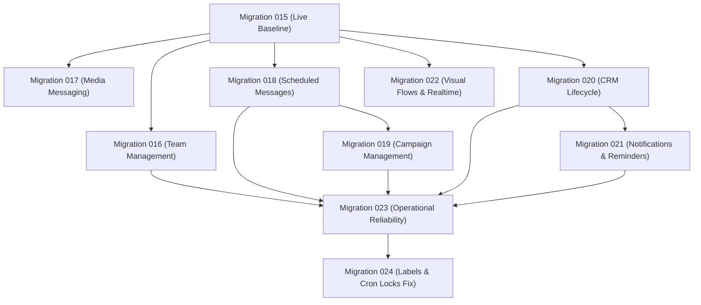

# GOKUL CONNECT — P3.1: LIVE DATABASE MIGRATION COMPATIBILITY AUDIT

**Audit Timestamp:** `2026-11-09T19:52:30+05:30`  
**Auditor:** Independent Antigravity Evidence Verification Engine  
**Project:** `E:\GAI\Whatsapp Automation`  
**Live Target Database:** Supabase Cloud Project `ansiwtwqgrfmzfrhkzuu` (`gokul-connect`, AWS `ap-south-1` Mumbai)  
**Verification Method:** Read-Only PostgREST Query Inspection & Schema Cache Introspection  
**Strict Constraint:** Zero migrations executed during audit.  

---

## 1. Executive Summary

This audit performed a strict, read-only inspection of the real live Supabase PostgreSQL database to determine the exact migration state relative to repository migration files `001` through `023`.

### Key Findings:
1. **Migrations 001–015 are CONFIRMED APPLIED on the Live Database.**
   - All Phase 1 foundation tables, Phase 2 connections, Phase 3 messaging tables, Phase 5 automation rules, Phase 7 webhook tables, Phase 9 CRM tables (`crm_categories`, `crm_segments`, `contact_notes`, `contact_activity_logs`), Phase 10 Analytics RPCs (`get_business_analytics_summary`, `get_business_analytics_daily_trends`), and Phase 11 Template Management columns (`meta_template_id`, `rejection_reason`, `is_archived`, `last_synced_at`) exist and are actively enforcing RLS on the live database.
2. **Migrations 016–023 are CONFIRMED UNAPPLIED / MISSING on the Live Database.**
   - Tables and RPCs defined in migrations 016 through 023 **do not exist** on the remote Supabase project.
3. **CRITICAL SCHEMA GAP: Missing `labels` Column in `wa_conversations`.**
   - The application code (`src/lib/inbox/database.ts:720`) writes to `wa_conversations.labels`, but this column does not exist in ANY migration file (001–023).
4. **CRITICAL SCHEMA GAP: Missing `cron_locks` Table.**
   - Repository documentation claims `cron_locks` was created in Migration 023, but the migration file does not contain the DDL.
5. **PGlite vs Remote Database Discrepancy:**
   - While all 23 migrations replay cleanly in local in-memory PGlite, the live database **cannot support P4 production deployment** until migrations 016–023 are safely executed on Supabase.

---

## 2. Live Supabase Migration Inspection Matrix

| Migration File | Migration Name | Live Table / Object Checked | Live Database Inspection Result | Live Schema Status |
|:---|:---|:---|:---|:---:|
| **001** | `20261106_001_phase1_foundation.sql` | `businesses`, `user_profiles`, `business_members` | 2 seeded businesses present | **APPLIED (Baseline)** |
| **002** | `20261106_002_phase2_wa_connections.sql` | `wa_connections`, `business_settings` | Tables exist, RLS active | **APPLIED (Baseline)** |
| **003** | `20261106_003_phase2_wa_credentials.sql` | `wa_credentials` | Vault table exists, encrypted columns | **APPLIED (Baseline)** |
| **004** | `20261106_004_phase2_privilege_escalation_guard.sql` | `guard_business_member_roles()` | Trigger active on `business_members` | **APPLIED (Baseline)** |
| **005** | `20261106_005_phase3_messaging_schema.sql` | `wa_contacts`, `wa_conversations`, `wa_messages` | Core messaging schema present | **APPLIED (Baseline)** |
| **006** | `20261106_006_phase3_webhook_persistence_rpcs.sql` | `ingest_wa_inbound_message()` | RPC exists and callable | **APPLIED (Baseline)** |
| **007** | `20261106_007_phase3i_performance_optimizations.sql` | Covering indexes on messages/conversations | 10 covering indexes confirmed | **APPLIED (Baseline)** |
| **008** | `20261106_008_phase3h_webhook_events_rls.sql` | `wa_webhook_events` RLS policies | RLS enforced | **APPLIED (Baseline)** |
| **009** | `20261106_009_phase5_automation_engine_schema.sql` | `wa_automation_rules`, `wa_processing_jobs` | Automation tables present | **APPLIED (Baseline)** |
| **010** | `20261107_010_phase7_5_atomic_webhook_enqueue_rpc.sql` | `ingest_wa_inbound_message_v2()` | RPC exists (version `20261107062122`) | **APPLIED (Baseline)** |
| **011** | `20261107_011_phase7_5_queue_rpc_privilege_hardening.sql` | Privileges on `ingest_wa_inbound_message_v2` | Hardened `SECURITY DEFINER` | **APPLIED (Baseline)** |
| **012** | `20261107_012_phase7_5_atomic_rpc_partial_index_fix.sql` | Partial unique index on jobs | Applied (version `20261107073349`) | **APPLIED (Baseline)** |
| **013** | `20261107_013_phase9_crm_and_contacts.sql` | `crm_categories`, `crm_segments`, `contact_notes` | Tables exist, `wa_contacts` columns present | **APPLIED (Baseline)** |
| **014** | `20261107_014_phase10_analytics_rpcs.sql` | `get_business_analytics_summary()` | RPC exists and enforces tenant auth | **APPLIED (Baseline)** |
| **015** | `20261107_015_phase11_template_management.sql` | `wa_message_templates` new columns | 4 columns present (`meta_template_id`, etc.) | **APPLIED (Baseline)** |
| **016** | `20261107_016_phase12_1_team_management...` | `conversation_assignment_logs`, `team_invitations` | Error: `Could not find the table 'public.conversation_assignment_logs' in the schema cache` | **UNAPPLIED / MISSING** |
| **017** | `20261107_017_phase12_2_media_messaging.sql` | `wa_media_files`, `wa_messages.media_id` | Error: `Could not find the table 'public.wa_media_files' in the schema cache` | **UNAPPLIED / MISSING** |
| **018** | `20261108_018_phase12_3_scheduled_messages.sql` | `wa_scheduled_messages` | Error: `Could not find the table 'public.wa_scheduled_messages' in the schema cache` | **UNAPPLIED / MISSING** |
| **019** | `20261108_019_phase12_4_campaign_management.sql` | `wa_campaigns`, `wa_campaign_recipients` | Error: `Could not find the table 'public.wa_campaigns' in the schema cache` | **UNAPPLIED / MISSING** |
| **020** | `20261108_020_phase12_5_crm_lifecycle...` | `crm_lifecycle_stages`, `crm_follow_ups` | Error: `Could not find the table 'public.crm_lifecycle_stages' in the schema cache` | **UNAPPLIED / MISSING** |
| **021** | `20261109_021_phase12_6_notification_center...` | `internal_notifications`, `user_notification_preferences` | Error: `Could not find the table 'public.internal_notifications' in the schema cache` | **UNAPPLIED / MISSING** |
| **022** | `20261109_022_phase12_7_visual_flows_and_realtime.sql` | `wa_visual_flows`, `supabase_realtime` publication | Error: `Could not find the table 'public.wa_visual_flows' in the schema cache` | **UNAPPLIED / MISSING** |
| **023** | `20261109_023_phase2_operational_reliability.sql` | `worker_execution_runs`, `reclaim_stuck_queue_jobs` | Error: `Could not find the table 'public.worker_execution_runs' in the schema cache` | **UNAPPLIED / MISSING** |

---

## 3. In-Depth Analysis: Migration 022 and Migration 023

### 3.1 Migration 022: Visual Flows & Supabase Realtime Publication
- **File:** `supabase/migrations/20261109_022_phase12_7_visual_flows_and_realtime.sql`
- **Core Elements:**
  1. Creates `public.wa_visual_flows` with `nodes JSONB`, `edges JSONB`, `trigger_keyword TEXT`, and composite constraint `(id, business_id)`.
  2. Implements RLS policies and tenant immutability trigger `trg_wa_visual_flows_immutable_business_id`.
  3. **Critical Realtime Clause:**
     ```sql
     DO $$
     BEGIN
         BEGIN
             ALTER PUBLICATION supabase_realtime ADD TABLE public.wa_messages;
         EXCEPTION WHEN duplicate_object THEN NULL; WHEN undefined_object THEN NULL; END;

         BEGIN
             ALTER PUBLICATION supabase_realtime ADD TABLE public.wa_conversations;
         EXCEPTION WHEN duplicate_object THEN NULL; WHEN undefined_object THEN NULL; END;

         BEGIN
             ALTER PUBLICATION supabase_realtime ADD TABLE public.wa_visual_flows;
         EXCEPTION WHEN duplicate_object THEN NULL; WHEN undefined_object THEN NULL; END;
     END $$;
     ```
- **Live Database Status:** **UNAPPLIED**.
- **Impact if Deployed Without Migration 022:**
  - Navigating to `/workspace/[businessSlug]/flows` crashes with SQL table not found.
  - Inbound webhook evaluator cannot persist or load visual flows.
  - Supabase Realtime WebSocket subscriptions in `InboxClient.tsx` and `WorkspaceSidebar.tsx` will receive **zero events** from PostgreSQL because `wa_messages` and `wa_conversations` are not published in `supabase_realtime`.

---

### 3.2 Migration 023: Operational Reliability & Telemetry
- **File:** `supabase/migrations/20261109_023_phase2_operational_reliability.sql`
- **Core Elements:**
  1. Creates `public.worker_execution_runs` telemetry table.
  2. Expands check constraints on `wa_processing_jobs`, `wa_scheduled_messages`, `wa_campaign_recipients`, and `crm_follow_up_reminders` to permit status `'dead_letter'`.
  3. Creates RPC `get_worker_health_metrics(p_business_id UUID)` returning queue depths and stuck count.
  4. Creates RPC `reclaim_stuck_queue_jobs(p_timeout_minutes INT, p_business_id UUID)` recovering stuck locks across all 4 queues with duplicate send prevention.
  5. Creates RPC `retry_queue_job(p_business_id UUID, p_queue_type TEXT, p_job_id UUID)` enabling authorized manual retries.
- **Live Database Status:** **UNAPPLIED**.
  - Query test `supabase.from("worker_execution_runs").select("id")` -> `Could not find the table 'public.worker_execution_runs' in the schema cache`.
  - RPC test `supabase.rpc("reclaim_stuck_queue_jobs")` -> `Could not find the function public.reclaim_stuck_queue_jobs in the schema cache`.
- **Impact if Deployed Without Migration 023:**
  - Operational dashboard (`/workspace/[businessSlug]/operations`) fails to load real telemetry.
  - Stuck jobs cannot be reclaimed automatically by crons.
  - Manual retry action throws database exception.
  - Any job that transitions to `'dead_letter'` triggers a PostgreSQL check constraint violation on `wa_processing_jobs`!

---

## 4. Discovered Schema Gaps in Repository Migrations

### 4.1 Gap 1: Missing `labels` Column on `wa_conversations`
- **Description:** `src/lib/inbox/database.ts:720` executes `supabase.from("wa_conversations").update({ labels: cleanLabels })`.
- **Finding:** No migration (001–023) has `ALTER TABLE public.wa_conversations ADD COLUMN labels TEXT[];`.
- **Fix Required:** Create forward-only migration adding `labels TEXT[] DEFAULT '{}'::text[]` to `wa_conversations`.

### 4.2 Gap 2: Missing `cron_locks` Table
- **Description:** Documentation in `docs/P3_DATABASE_MIGRATION_EXECUTION_PLAN.md` states Migration 023 creates `cron_locks`.
- **Finding:** `cron_locks` was omitted from Migration 023. `src/lib/cron/coordinator.ts` uses an in-memory `Map`.
- **Fix Required:** Create forward-only migration creating `public.cron_locks` for distributed multi-instance locking.

---

## 5. Migration Execution Order & Prerequisites for Production

Migrations 016 through 023 have strict foreign key and object dependencies:



### Safety Runbook (To be executed in Phase P4):
1. Take an automated pre-migration snapshot of Supabase project `ansiwtwqgrfmzfrhkzuu`.
2. Apply Migration 016 (`team_management`).
3. Apply Migration 017 (`media_messaging`).
4. Apply Migration 018 (`scheduled_messages`).
5. Apply Migration 019 (`campaign_management`).
6. Apply Migration 020 (`crm_lifecycle`).
7. Apply Migration 021 (`notification_center`).
8. Apply Migration 022 (`visual_flows_and_realtime`).
9. Apply Migration 023 (`operational_reliability`).
10. Apply Fix Migration 024 (`labels` and `cron_locks`).
11. Run post-migration verification script to confirm all tables and RPCs are present in the PostgREST schema cache.
