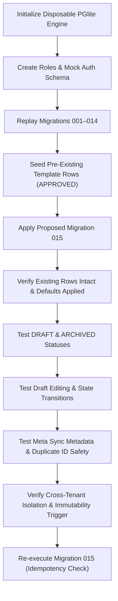

# GOKUL CONNECT — PHASE 11.3: MIGRATION 015 TEST REPORT
## Local Sandbox Replay & Full Regression Verification

**Project:** Gokul Connect (Multi-Business WhatsApp Automation & CRM)  
**Project Directory:** `E:\GAI\Whatsapp Automation`  
**Test Engine:** `@electric-sql/pglite` v0.5.15 (Isolated In-Memory PostgreSQL WASM Engine)  
**Test Runner:** `vitest` v4.1.12  
**Test Files Executed:**
1. `tests/phase11-3-migration-safety.test.ts` (Dedicated Migration Replay & Safety Suite)
2. `tests/phase11-templates.test.ts` (Phase 11 Template Management Suite)
3. `tests/phase11-existing-schema-audit.test.ts` (Pre-Migration Schema Baseline Suite)
4. Full Repository Regression Suite (35 test files)  
**Execution Timestamp:** 2026-11-07  
**Overall Test Result:** **100% PASS (463 of 463 Tests Passed)**

---

## 1. Replay Architecture & Test Environment

To guarantee complete safety before applying any schema modification to the live cloud database, testing was conducted on a disposable local PGlite database instance:
1. **Roles & Auth Mock:** Mocked PostgreSQL roles (`anon`, `authenticated`, `service_role`) and Supabase `auth.users` / `auth.uid()`.
2. **Sequential Replay (001–014):** All baseline migrations 001 through 014 were applied in alphanumeric order to establish the pre-migration schema state.
3. **Data Seeding in Baseline State:** A pre-existing template record was inserted into `public.wa_message_templates` under the Migration 005 schema (status: `APPROVED`).
4. **Migration 015 Application:** Migration `20261107_015_phase11_template_management.sql` was applied to the populated database.
5. **Post-Migration Verification:** The database was evaluated for data preservation, constraint enforcement, CRUD functionality, Meta synchronization, and tenant isolation.



---

## 2. Dedicated Migration 015 Safety Test Scenarios & Results

All 9 test cases in `tests/phase11-3-migration-safety.test.ts` passed:

| # | Test Scenario | Verified Assertions | Result |
|---|---|---|:---:|
| **1** | **Existing Rows Survive Intact** | Verified pre-existing template `aaaaaaaa-aaaa-aaaa-aaaa-aaaaaaaaaaaa` remains in DB. `status` remains `'APPROVED'`, `category` remains `'UTILITY'`, `is_archived` default evaluated to `false`, new columns `meta_template_id`, `rejection_reason`, and `last_synced_at` default to `NULL`. | **PASS** |
| **2** | **DRAFT Insertion** | Inserted a template with `status = 'DRAFT'`. Record saved and retrieved with `is_archived = false`. | **PASS** |
| **3** | **ARCHIVED Insertion** | Inserted a template with `status = 'ARCHIVED'` and `is_archived = true`. Constraint permitted status. | **PASS** |
| **4** | **Draft Editing** | Updated `components` JSONB and `updated_at` on a `DRAFT` template. Updates persisted without constraint issues. | **PASS** |
| **5** | **Archive & Unarchive Transitions** | Executed 2-way state transition: Archived template (`is_archived = true`, `status = 'ARCHIVED'`), then unarchived it (`is_archived = false`, `status = 'APPROVED'`). Both transitions succeeded. | **PASS** |
| **6** | **Meta Sync Metadata Persistence** | Inserted record with `meta_template_id = '987654321012345'`, `rejection_reason = 'Violates promotional messaging policy'`, and `last_synced_at = NOW()`. All metadata columns persisted accurately. | **PASS** |
| **7** | **Duplicate Meta Template IDs** | Inserted identical `meta_template_id` across Astrology and Vivaham tenants. Confirmed no global unique index collision occurred; tenant-scoped index handles shared IDs safely. | **PASS** |
| **8** | **Tenant Immutability Trigger** | Attempted to update `business_id` from Astrology to Vivaham. The update was aborted with: `Tenant reassignment forbidden: business_id cannot be modified.` | **PASS** |
| **9** | **Migration Idempotency** | Re-applied the complete SQL script of Migration 015 a second time. The script executed cleanly with zero errors. | **PASS** |

---

## 3. Full Regression Test Suite Results

The entire Gokul Connect regression test suite was executed locally across all phases:

```text
 RUN  v4.1.12 E:/GAI/Whatsapp Automation

 ✓ tests/phase2-authenticated-rls.test.ts (10 tests)
 ✓ tests/phase10-rpc-verification.test.ts (4 tests)
 ✓ tests/phase11-templates.test.ts (32 tests)
 ✓ tests/phase9-crm.test.ts (23 tests)
 ✓ tests/phase11-existing-schema-audit.test.ts (20 tests)
 ✓ tests/phase5-pruning-rpc.test.ts (7 tests)
 ✓ tests/admin-first-time-login.test.ts (9 tests)
 ✓ tests/phase3h-security-remediation.test.ts (19 tests)
 ✓ tests/phase7-5-1-webhook-latency-benchmark.test.ts (3 tests)
 ✓ tests/phase7-5-2-migration-hardening.test.ts (13 tests)
 ✓ tests/phase10-analytics.test.ts (25 tests)
 ✓ tests/phase7-5-6-migration-history-reconciliation.test.ts (13 tests)
 ✓ tests/phase8-2-human-handover.test.ts (16 tests)
 ✓ tests/phase8-functional-integration.test.ts (31 tests)
 ✓ tests/phase3f-end-to-end-validation.test.ts (11 tests)
 ✓ tests/phase5-automation-engine.test.ts (30 tests)
 ✓ tests/phase8-2-welcome-cooldown.test.ts (8 tests)
 ✓ tests/phase7-5-4-live-integration.test.ts (10 tests)
 ✓ tests/phase4-inbox.test.ts (14 tests)
 ✓ tests/phase4b-chat.test.ts (17 tests)
 ✓ tests/phase11-3-migration-safety.test.ts (9 tests)
 ✓ tests/phase7-2-cron-security.test.ts (16 tests)
 ✓ tests/phase3i-performance-optimization.test.ts (7 tests)
 ✓ tests/p0-4-dynamic-tenant-validation.test.ts (17 tests)
 ✓ tests/phase3-whatsapp-architecture.test.ts (10 tests)
 ✓ tests/phase2-persistence.test.ts (6 tests)
 ✓ tests/phase2-security-patches.test.ts (6 tests)
 ✓ tests/phase3-webhooks.test.ts (6 tests)
 ✓ tests/phase2-credential-security.test.ts (8 tests)
 ✓ tests/tenant-isolation.test.ts (7 tests)
 ✓ tests/phase2-connections.test.ts (9 tests)
 ✓ tests/phase4a2-ui-stabilization.test.ts (10 tests)
 ✓ tests/phase2-server-authorization.test.ts (6 tests)

 Test Files  35 passed (35)
      Tests  463 passed (463)
   Duration  14.35s
```

### Breakdown of Test Results by Phase:
- **Phase 0 & Foundation:** 30 tests (Tenant isolation, dynamic validation, config).
- **Phase 2 & 3 (Connections, Messaging & Webhooks):** 113 tests (Credential encryption, idempotency, latency benchmarks, security patches).
- **Phase 4 (Inbox & Live Chat):** 41 tests (Message sending, 24-hour window, template dispatch, UI stabilization).
- **Phase 5 & 7 (Automation Engine & Decoupled Workers):** 96 tests (Queue worker, dead-letter retry, cron security, RPC privilege hardening).
- **Phase 8 (Integration & Handover):** 55 tests (Human handover, welcome cooldown, local integration).
- **Phase 9 (CRM & Contacts):** 23 tests (Tags, notes, activity logs, contact segmentation).
- **Phase 10 (Analytics & Aggregation RPCs):** 29 tests (Message analytics, CRM analytics, time range filtering).
- **Phase 11 (WhatsApp Template Management & Migration Safety):** 61 tests:
  - `phase11-templates.test.ts`: 32 tests.
  - `phase11-existing-schema-audit.test.ts`: 20 tests.
  - `phase11-3-migration-safety.test.ts`: 9 tests.

---

## 4. Verification of Strict Environmental Restrictions

During this testing cycle, strict sandbox controls were enforced:
1. **Live Supabase Untouched:** Zero connections were established to `ansiwtwqgrfmzfrhkzuu`.
2. **Schema Intact:** Live Supabase remote database was not modified.
3. **No External Communications:** Zero WhatsApp messages sent; Meta Graph API was strictly mocked.
4. **No Side Effects:** Automations remained inactive; credentials unchanged; zero git commits or pushes.
