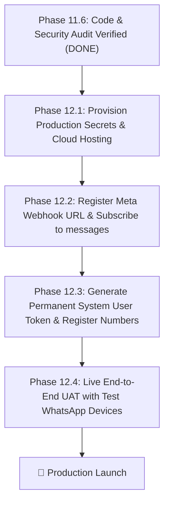

# Phase 11.6 — Remaining Blockers & Launch Prerequisites

**Project:** Gokul Connect (`E:\GAI\Whatsapp Automation`)  
**Audit Date:** 2026-11-07  

---

## Overview

The software codebase, security controls, multi-tenant isolation, database migrations, and regression tests are **100% complete and passed**. There are **zero functional defects** in the application.

Before live end-to-end messaging can occur with external WhatsApp users, the following six operational and infrastructural prerequisites must be resolved in Phase 12.

---

## 1. Inventory of Pre-Launch Blockers

### Blocker 1: Expired Meta Access Token (Vivaham Tenant)
- **Severity:** High (Operational Blocker)
- **Description:** The Meta test access token in `.env.local` expired on 2026-11-06T15:00 UTC (`OAuthException 190, error_subcode 463: Error validating access token: Session has expired`).
- **Resolution Path:**
  1. Navigate to Meta Business Suite &rarr; Business Settings &rarr; Users &rarr; System Users.
  2. Create or select a System User with `whatsapp_business_messaging` and `whatsapp_business_management` permissions.
  3. Generate a permanent (never-expiring) access token.
  4. Encrypt and store this token in the `wa_credentials` vault for the Vivaham connection (`44444444-4444-4444-4444-444444444444`).

---

### Blocker 2: Astrology WhatsApp Business Number Registration
- **Severity:** High (Operational Blocker)
- **Description:** The Astrology WhatsApp connection in the database (`33333333-3333-3333-3333-333333333333`) currently has connection status `error`. Its phone number (`+91 98400 12345`) and credentials have not been registered on the Meta WhatsApp Cloud API.
- **Resolution Path:**
  1. Add a dedicated SIM / phone number for Gokul's Astrological Insights in Meta Business Manager.
  2. Complete SMS or voice verification to obtain a verified `phone_number_id` and `waba_id`.
  3. Update `wa_connections` with the verified IDs and encrypt the assigned System User token into `wa_credentials`.

---

### Blocker 3: Production Cloud Hosting Deployment (Public HTTPS Domain)
- **Severity:** High (Infrastructure Blocker)
- **Description:** Meta Graph API webhooks require a publicly accessible HTTPS endpoint. Local `localhost:3000` cannot receive inbound webhooks without a public tunnel or cloud deployment.
- **Resolution Path:**
  1. Deploy Gokul Connect to a production cloud host (e.g., Vercel).
  2. Attach the production domain (e.g., `https://connect.gokulastrology.com` or Vercel production URL).
  3. Verify SSL certificate is valid and TLS 1.3 is enabled.

---

### Blocker 4: Meta Webhook Subscription & Verification
- **Severity:** High (Configuration Blocker)
- **Description:** Meta must be configured to deliver real-time inbound messages and delivery receipts (`messages`, `message_deliveries`, `message_reads`) to Gokul Connect.
- **Resolution Path:**
  1. In the Meta App Developer Dashboard &rarr; WhatsApp &rarr; Configuration:
     - Callback URL: `https://<domain>/api/webhooks/whatsapp`
     - Verify Token: Matches `META_WEBHOOK_VERIFY_TOKEN`
  2. Complete the initial GET verification handshake.
  3. Subscribe to the `messages` webhook field.

---

### Blocker 5: Production Environment Variables Provisioning
- **Severity:** Medium (Configuration Blocker)
- **Description:** Sensitive secrets must be provisioned on the production hosting platform and must strictly satisfy the fail-closed production guards.
- **Required Production Environment Variables:**
  ```ini
  NODE_ENV=production
  NEXT_PUBLIC_APP_URL=https://<your-production-domain>
  NEXT_PUBLIC_SUPABASE_URL=https://ansiwtwqgrfmzfrhkzuu.supabase.co
  NEXT_PUBLIC_SUPABASE_ANON_KEY=<production-anon-key>
  SUPABASE_SERVICE_ROLE_KEY=<production-service-role-key>
  APP_ENCRYPTION_SECRET=<32-byte-hex-secret-min-32-chars>
  CRON_SECRET=<strong-random-cron-bearer-token>
  META_APP_ID=<meta-app-id>
  META_APP_SECRET=<meta-app-secret>
  META_WEBHOOK_VERIFY_TOKEN=<secure-verify-token>
  ```
- **Validation:** `APP_ENCRYPTION_SECRET` will fail closed immediately during server initialization if shorter than 32 characters or if development fallback keys are used.

---

### Blocker 6: Cron Job Configuration for Automation Follow-ups
- **Severity:** Medium (Operational Requirement)
- **Description:** Scheduled follow-ups and background queue retries require a 1-minute cron heartbeat.
- **Resolution Path:**
  1. Configure Vercel Cron or an external cron worker to issue a `POST` or `GET` request every minute to:
     `https://<domain>/api/cron/process-automation-jobs`
  2. Provide header: `Authorization: Bearer <CRON_SECRET>`.

---

## 2. Launch Progression Roadmap


