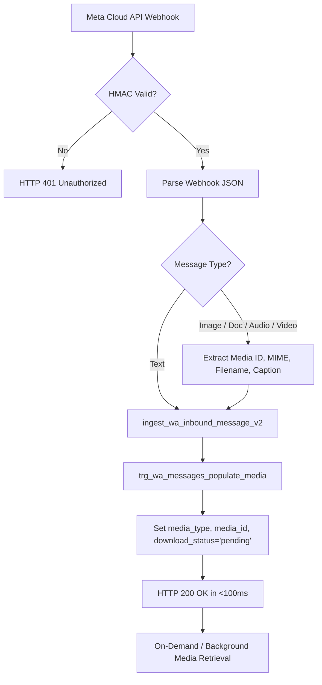

# GOKUL CONNECT — PHASE 12.2 IMPLEMENTATION DETAILS
**Technical Blueprint: Media Messaging Architecture**  
**Execution Date:** November 7, 2026

---

## 1. File Modification Log

| File Path | Type | Key Changes |
| :--- | :--- | :--- |
| `supabase/migrations/20261107_017_phase12_2_media_messaging.sql` | SQL | Added Migration 017: extended `wa_messages` check constraint for `'video'`, added media attributes, created `wa_media_files` table, tenant triggers, and RLS policies. |
| `src/types/database.ts` | TypeScript | Extended `MessageType` with `'video'`, added `SupportedMediaType`, `MediaDownloadStatus`, `WhatsAppMediaFile`, and media fields to `WhatsAppMessage`. |
| `src/lib/validation/schemas.ts` | TypeScript | Added `SupportedMediaTypeSchema`, `SendMediaMessageSchema`, `GetMediaDownloadUrlSchema`, `RetryMediaMessageSchema`, and inferred types. |
| `src/lib/media/storage.ts` | TypeScript | Media storage abstraction: size limits, MIME validations, filename sanitization, business-scoped paths, signed URL generator, HMAC verification, hybrid storage driver. |
| `src/app/api/media/download/route.ts` | Route Handler | Secure media streaming endpoint requiring signed HMAC tokens, streaming binary files with `nosniff`, `private` cache, and sanitized filenames. |
| `src/lib/whatsapp/client.ts` | TypeScript | Added `uploadMetaMedia`, `sendMetaMediaMessage`, `getMetaMediaInfo`, and `downloadMetaMediaContent` with token masking. |
| `src/lib/whatsapp/service.ts` | TypeScript | Extended `sendWhatsAppMessageService` to support media messages, auto-uploading buffers, and preview formatting (`📷`, `📄`, `🎤`, `🎥`). |
| `src/app/actions/inbox.ts` | Server Actions | Implemented `sendWhatsAppMediaMessageAction`, `getMediaDownloadUrlAction`, and `retryFailedMediaMessageAction` with RBAC and window enforcement. |
| `src/app/api/webhooks/whatsapp/route.ts` | Route Handler | Enhanced webhook message parser to extract media payloads (image, document, audio, video) and generate appropriate previews. |
| `src/components/inbox/ChatWindowPanel.tsx` | React Client | Added Paperclip button, hidden file picker, drag-and-drop zone with overlay, staged attachment banner with caption input, media bubbles (image, document, audio, video), lightbox modal, retry button, and download handlers. |
| `src/components/inbox/InboxClient.tsx` | React Client | Connected media dispatch actions, optimistic media updates, signed download URL retriever, and retry handler. |
| `tests/phase12-2-media-messaging.test.ts` | Vitest Suite | 25 comprehensive tests across 6 testing domains verifying schema, validation, storage, actions, webhooks, and streaming. |

---

## 2. Media Categories, Limits & MIME Types

| Media Category | File Size Limit | Allowed MIME Types | File Extensions |
| :--- | :--- | :--- | :--- |
| **Image** | 5 MB | `image/jpeg`, `image/png`, `image/webp` | `.jpg`, `.jpeg`, `.png`, `.webp` |
| **Document** | 100 MB | `application/pdf`, `application/vnd.ms-excel`, `application/vnd.openxmlformats-officedocument.spreadsheetml.sheet`, `application/msword`, `application/vnd.openxmlformats-officedocument.wordprocessingml.document`, `application/vnd.ms-powerpoint`, `application/vnd.openxmlformats-officedocument.presentationml.presentation`, `text/plain`, `text/csv` | `.pdf`, `.xls`, `.xlsx`, `.doc`, `.docx`, `.ppt`, `.pptx`, `.txt`, `.csv` |
| **Audio** | 16 MB | `audio/aac`, `audio/mp4`, `audio/mpeg`, `audio/amr`, `audio/ogg`, `audio/wav`, `audio/webm` | `.aac`, `.mp4`, `.mp3`, `.amr`, `.ogg`, `.wav`, `.webm` |
| **Video** | 16 MB | `video/mp4`, `video/3gpp` | `.mp4`, `.3gp` |

---

## 3. Storage Architecture & Tenant Path Isolation

1. **Path Structure:**
   ```
   businesses/${businessId}/conversations/${conversationId}/${fileId}-${sanitizedFilename}
   ```
2. **Tenant Immutability:**
   Any update trying to change `business_id` is aborted by `trg_wa_media_files_immutable_business_id`:
   ```sql
   CREATE TRIGGER trg_wa_media_files_immutable_business_id
       BEFORE UPDATE ON public.wa_media_files
       FOR EACH ROW
       EXECUTE FUNCTION public.prevent_tenant_reassignment();
   ```
3. **Signed Access Verification:**
   ```ts
   const signature = crypto
     .createHmac("sha256", secret)
     .update(`${businessId}:${storagePath}:${expiresAt}`)
     .digest("hex");
   ```
   Tokens expire after 300 seconds and are bound to the specific business ID.

---

## 4. Webhook Processing Flow (Non-Blocking)



---

## 5. Role-Based Permissions Matrix

| Capability | Owner | Admin | Agent | Viewer |
| :--- | :---: | :---: | :---: | :---: |
| View incoming media messages | Yes | Yes | Yes | Yes |
| Download media attachments | Yes | Yes | Yes | Yes |
| View full-screen image lightbox | Yes | Yes | Yes | Yes |
| Listen to audio messages | Yes | Yes | Yes | Yes |
| Play video messages | Yes | Yes | Yes | Yes |
| Attach & send media messages | Yes | Yes | Yes | **Blocked** |
| Retry failed media messages | Yes | Yes | Yes | **Blocked** |
| Drag & drop upload files | Yes | Yes | Yes | **Blocked** |
