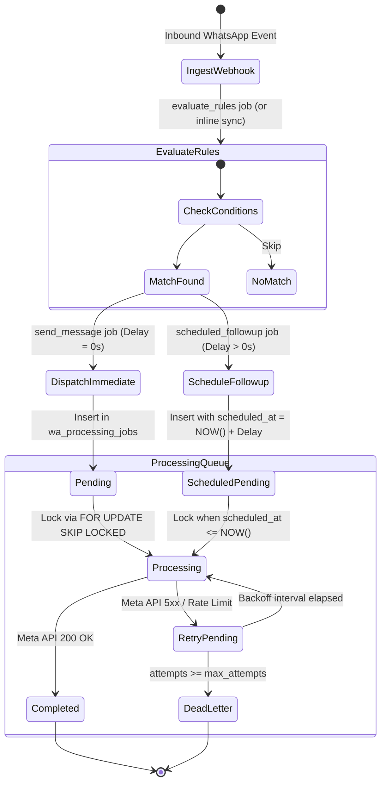
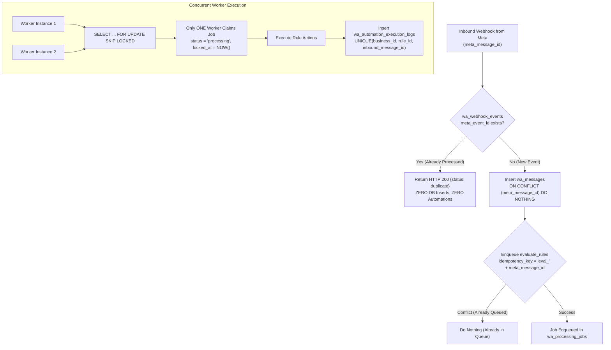
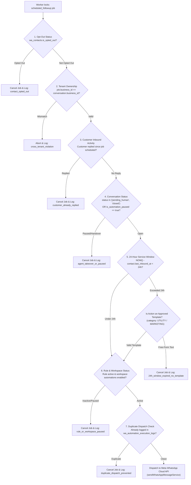

# Gokul Connect — Phase 5A.1 Automation Architecture Review & Risk Assessment

**Platform:** Gokul Connect (Multi-Business WhatsApp Automation & CRM)  
**Date:** 2026-11-06  
**Document Type:** Supplementary Architecture Review & Risk Mitigation Specification  
**Status:** 📋 **PROPOSED ARCHITECTURE REVIEW (NO CODE OR MIGRATIONS EXECUTED)**  
**Target Document Reviewed:** `docs/PHASE_5_AUTOMATION_ARCHITECTURE_PLAN.md`  
**Target Infrastructure:** Supabase PostgreSQL 17 (`gokul-connect` / `ansiwtwqgrfmzfrhkzuu`), Meta WhatsApp Cloud API v26.0  

---

## 1. Executive Review Summary

Following the initial release of `docs/PHASE_5_AUTOMATION_ARCHITECTURE_PLAN.md`, this supplementary architecture review investigates six mission-critical engineering areas:
1. **Queue Architecture & Job Discrimination**
2. **Multi-Layer Idempotency Safeguards**
3. **Infinite Automation Loop & Cascade Prevention**
4. **Pre-Execution Safety Verification for Scheduled Follow-Ups**
5. **Verified Supabase Infrastructure Capabilities & Free-Tier Plan Limits**
6. **Failure Recovery, Stuck Job Reclamation & Dead-Letter Handling**

This review identifies critical operational risks, provides concrete architectural corrections, and presents a hardened database and execution model that guarantees zero cross-tenant leakage, zero message duplication, zero AI cost, and strict compliance with Meta Cloud API policies.

---

## 2. Critical Area 1: Queue Architecture & Job Typing

### 2.1 Identified Defect in Existing `wa_processing_jobs` Schema
Inspection of Migration 005 (`20261106_005_phase3_messaging_schema.sql`) reveals the current table definition:
```sql
job_type TEXT NOT NULL CHECK (job_type IN ('send_message', 'process_webhook', 'update_status'))
```
**Risk:** Attempting to insert job types such as `'evaluate_rules'` or `'delayed_automation'` without a schema migration will cause an immediate PostgreSQL `CHECK` constraint violation (`SQLSTATE 23514`).

### 2.2 Corrected Job-Type Taxonomy & Payload Standards

Rather than treating retries or arbitrary actions as ad-hoc job types, the queue must distinguish strictly between **functional job types** and **lifecycle states**.



#### Standardized Job Types

| Job Type | Trigger Point | Payload Structure | Execution Behavior |
|---|---|---|---|
| `send_outbound_message` | Triggered by rule action or manual send. | `{ connection_id, conversation_id, contact_id, recipient_phone, message_type: 'text' \| 'template', content, template_params, idempotency_key }` | Dispatches message via Meta Cloud API client. Verifies 24h window before sending text. |
| `evaluate_automation_rules` | Triggered on inbound message ingestion (if evaluated asynchronously). | `{ connection_id, conversation_id, contact_id, inbound_message_id, text, message_type, raw_payload }` | Loads active rules for `business_id`, sorts by priority, evaluates condition tree, dispatches actions. |
| `scheduled_followup` | Created by a rule action requiring future execution (e.g. 4 hours later). | `{ rule_id, conversation_id, contact_id, expected_inbound_message_id, action_payload, check_no_reply_since }` | Waits until `scheduled_at <= NOW()`. Runs full 7-point safety pre-check before dispatching. |
| `process_webhook_event` | Deferred background ingestion for high-volume status bursts. | `{ phone_number_id, raw_event_payload, received_at }` | Ingests status receipts (`sent`, `delivered`, `read`) asynchronously. |

### 2.3 Why Retries Are NOT a Job Type
**Architectural Rule:** A retry is a **state transition**, never a distinct `job_type`.
- If an outbound dispatch fails due to a network glitch, creating a new `retry_job` breaks lineage, loses the original payload context, inflates database rows, and breaks idempotency keys.
- **Correction:** The existing job remains in `wa_processing_jobs`. Its status transitions from `'processing'` back to `'pending'`, `attempts` is incremented (`attempts = attempts + 1`), `last_error` is updated, and `scheduled_at` is pushed forward by the calculated exponential backoff interval.

---

## 3. Critical Area 2: Idempotency & Concurrency Safeguards

Meta Cloud API webhooks operate on **at-least-once delivery**. Transient network timeouts between Meta and the server will cause Meta to resend identical payloads. Furthermore, serverless scaling can spin up concurrent workers simultaneously.



### 3.1 Safeguard 1: Duplicate Webhook Event Suppression
1. `wa_webhook_events` has `meta_event_id TEXT UNIQUE`.
2. When a duplicate Meta webhook arrives, `ingest_wa_inbound_message` checks `is_processed`. If `TRUE`, it returns immediately:
   ```json
   { "status": "duplicate", "meta_message_id": "wamid.HBg...", "message": "Webhook event already processed" }
   ```
3. The HTTP response returns `200 OK` to Meta immediately so Meta ceases re-transmissions, while zero duplicate message rows or automation jobs are spawned.

### 3.2 Safeguard 2: Idempotency Keys on Job Queue
Add an explicit column to `wa_processing_jobs`:
```sql
ALTER TABLE public.wa_processing_jobs 
    ADD COLUMN IF NOT EXISTS idempotency_key TEXT UNIQUE;
```
- For rule evaluation: `idempotency_key = 'eval_' || inbound_message_id`
- For outbound messages: `idempotency_key = 'send_' || conversation_id || '_' || rule_id || '_' || action_index || '_' || inbound_message_id`
- For scheduled follow-ups: `idempotency_key = 'followup_' || rule_id || '_' || conversation_id || '_' || inbound_message_id`

If two parallel webhook handlers attempt to queue the same action, PostgreSQL rejects the second insertion via the `UNIQUE (idempotency_key)` constraint.

### 3.3 Safeguard 3: Worker Lock Exclusivity (`FOR UPDATE SKIP LOCKED`)
Multiple concurrent workers (e.g. Next.js serverless invocations or Edge Functions) can poll the queue simultaneously without collision.
```sql
CREATE OR REPLACE FUNCTION public.claim_next_wa_jobs(
    p_batch_size INT DEFAULT 5,
    p_worker_id TEXT DEFAULT 'worker_anon'
)
RETURNS SETOF public.wa_processing_jobs
LANGUAGE plpgsql
SECURITY DEFINER
SET search_path = public, pg_temp
AS $$
BEGIN
    RETURN QUERY
    WITH selected_jobs AS (
        SELECT id
        FROM public.wa_processing_jobs
        WHERE status = 'pending'
          AND scheduled_at <= TIMEZONE('utc', NOW())
        ORDER BY scheduled_at ASC
        FOR UPDATE SKIP LOCKED
        LIMIT p_batch_size
    )
    UPDATE public.wa_processing_jobs j
    SET status = 'processing',
        locked_at = TIMEZONE('utc', NOW()),
        last_error = NULL
    FROM selected_jobs s
    WHERE j.id = s.id
    RETURNING j.*;
END;
$$;
```
**Guarantee:** Each row is locked by exactly one worker. Other workers skip locked rows instantly without blocking.

### 3.4 Safeguard 4: Rule Execution Audit Uniqueness
In `wa_automation_execution_logs`, enforce:
```sql
CONSTRAINT uq_rule_exec_single_trigger 
    UNIQUE (business_id, rule_id, inbound_message_id)
```
Even if a race condition occurred in the application layer, the database engine guarantees that a specific rule can execute **only once** for any given inbound message.

---

## 4. Critical Area 3: Automation Loop Prevention

Automated systems can fall into catastrophic feedback loops: bot responding to another bot, rules triggering each other, or runaway follow-ups.

### 4.1 Directional Guard: Outbound Messages Never Trigger Automations
- **Inviolable Core Rule:** The automation engine **only** triggers when `wa_messages.direction = 'inbound'`.
- All automated bot messages and agent replies have `direction = 'outbound'`.
- Database trigger guard:
  ```sql
  -- Evaluator query strictly filters:
  WHERE message_id = p_message_id AND direction = 'inbound'
  ```
  Outbound messages are physically ignored by the evaluation pipeline, eliminating self-triggering loops.

### 4.2 The "Bot-to-Bot" Circuit Breaker (Velocity Limiter)
If a customer’s WhatsApp number is also an automated bot (e.g. another business or third-party auto-reply), two bots could trigger each other continuously.
- **Protection:** Every conversation tracks `bot_reply_count_window` in `wa_conversations`.
- **Rule:** If the automation engine attempts to send more than **5 automated replies to the same conversation within a 15-minute rolling window**:
  1. The **Circuit Breaker trips**.
  2. `wa_conversations.is_automation_paused` is set to `TRUE`.
  3. `wa_conversations.status` is set to `'pending_human'`.
  4. An alert log is generated: `"Circuit breaker tripped: automated loop detected (velocity > 5 in 15m)"`.
  5. The bot stops replying until a human agent manually resumes the conversation.

### 4.3 Multi-Rule Cascades: `stop_processing_on_match`
- In multi-rule environments, Rule A might match keyword "fees", while Rule B matches "membership".
- If a message contains `"What are the membership fees?"`, both rules could fire simultaneously.
- **Protection:**
  - Active rules are evaluated in ascending priority order (`priority ASC`).
  - By default, `stop_processing_on_match = TRUE`.
  - The highest-priority rule fires its actions and immediately halts evaluation. Lower-priority rules are skipped.

### 4.4 Welcome Message Loop Prevention
Customers frequently say "Hi", "Hello", "Vanakkam" multiple times a week.
- **Protection:** Welcome rules enforce a mandatory **cooldown check**:
  - `wa_contacts.last_welcome_sent_at TIMESTAMPTZ` tracks when the welcome message was last sent.
  - Welcome rule condition:
    ```sql
    (contact.last_welcome_sent_at IS NULL OR contact.last_welcome_sent_at < NOW() - INTERVAL '30 days')
    ```
  - If a welcome message was sent within the last 30 days, the condition evaluates to `FALSE`.

---

## 5. Critical Area 4: Scheduled Follow-Up Safety & Pre-Execution Validation

Scheduled follow-ups operate on a time delay (e.g. 4 hours or 24 hours later). During this interval, conditions change: the customer may have replied, opted out, or an agent may have resolved the ticket.

### 5.1 The 7-Point Pre-Execution Validation Gate
When a `scheduled_followup` job is locked by a worker at `scheduled_at`, the worker **must execute this 7-point validation sequence** before making any Meta Cloud API call:



### 5.2 Pre-Validation Matrix Summary

| Gate | Check Target | Cancellation Condition | Action Taken |
|:---:|---|---|---|
| **1** | **Opt-Out Check** | `wa_contacts.is_opted_out = true` | Cancel job; log reason `contact_opted_out`. |
| **2** | **Tenant Isolation** | `job.business_id != conversation.business_id` | Throw security exception; log breach attempt. |
| **3** | **Customer Replied** | `conversation.last_message_at > job.created_at` (with `direction = 'inbound'`) | Cancel job; log reason `customer_already_replied`. |
| **4** | **Human Handover** | `conversation.status = 'pending_human'` OR `conversation.is_automation_paused = true` | Cancel job; log reason `human_agent_active`. |
| **5** | **Meta 24h Window** | `NOW() - contact.last_inbound_at >= INTERVAL '24 hours'` AND action is free-form text | Cancel job; log reason `meta_24h_window_expired`. |
| **6** | **Rule / Workspace Pause** | `rule.is_active = false` OR `settings.is_automation_enabled = false` | Cancel job; log reason `automation_disabled_by_admin`. |
| **7** | **Template Status** | Action uses template but `wa_message_templates.status != 'APPROVED'` | Cancel job; log reason `template_not_approved`. |

---

## 6. Critical Area 5: Supabase Infrastructure & Plan Limitations

### 6.1 Verified Extension Status on Target Project (`ansiwtwqgrfmzfrhkzuu`)
Live inspection of PostgreSQL 17 on Supabase project `ansiwtwqgrfmzfrhkzuu` confirms:
- `pg_cron` (v1.6.4): **Available, but NOT installed** (`installed_version: null`).
- `pg_net` (v0.20.4): **Available, but NOT installed** (`installed_version: null`).
- `supabase_vault` (v0.3.1): **Installed**.
- `pgcrypto` (v1.3): **Installed**.

### 6.2 The Supabase Free-Tier Reality Check
Relying entirely on in-database `pg_cron` + `pg_net` poses severe operational risks on the Supabase Free Plan:
1. **7-Day Inactivity Project Pausing:**
   - Free Supabase projects pause after 7 days without incoming HTTP requests.
   - When paused, PostgreSQL background worker processes (including `pg_cron`) halt completely!
   - If a business has a slow week, scheduled follow-ups and business-hours replies will silently fail to execute until someone opens the dashboard.
2. **500 MB Database Storage Ceiling:**
   - The Free Plan has a hard limit of 500 MB. Exceeding this puts the database into read-only mode.
   - High-frequency automation execution logs, payload JSONs, and WAL generation from constant polling will rapidly consume storage if not aggressively managed.
3. **Realtime Broadcast Quota Exhaustion:**
   - Free Plan limits Realtime to 2 million messages/month and 200 concurrent connections.
   - **Critical Architecture Rule:** `wa_processing_jobs`, `wa_webhook_events`, and `wa_automation_execution_logs` **MUST NEVER be added to the `supabase_realtime` publication**. Adding internal worker queues to Realtime will exhaust the quota within days.

### 6.3 Recommended Hybrid Worker Architecture (Event-Driven + Serverless Cron)

To avoid both the 7-day pause problem and polling waste:

```
[Inbound WhatsApp Message]
          |
          v
[POST /api/webhooks/whatsapp]
          |
          +---> [Atomic Ingestion RPC: ingest_wa_inbound_message]
          |
          +---> [Synchronous Rule Evaluation: < 15ms in Node.js / RPC]
                     |
                     +---> Immediate Reply? (Delay = 0s)
                     |        |
                     |        v
                     |     [Direct Outbound Dispatch via sendWhatsAppMessageService]
                     |     (95% of messages: Welcome, Keywords, Outside-Hours)
                     |     [Zero Queue Delay / Instant User Response]
                     |
                     +---> Delayed Follow-Up? (Delay > 0s)
                              |
                              v
                           [Insert into wa_processing_jobs with scheduled_at]
                                       |
                                       v
                     [Vercel Serverless Cron / Scheduled Worker]
                     (Triggers /api/cron/process-automation-jobs every 1 min)
                     [Keeps Supabase Active, Claims Due Jobs via SKIP LOCKED]
```

#### Why This Hybrid Model Is Superior:
1. **Instant Response for Customers:** 95% of automations (welcome messages, keyword replies, enquiry acknowledgements) have `delay = 0s`. Evaluating them immediately during webhook processing provides sub-second customer replies without waiting for a 60-second cron cycle.
2. **Keeps Supabase Active:** An external Vercel Cron or GitHub Actions cron hitting `/api/cron/process-automation-jobs` every 1 to 5 minutes sends real HTTP traffic to the database, preventing the 7-day Supabase dormancy pause!
3. **Zero Additional Paid Services:** Utilizes existing Vercel Hobby Cron (1 cron job included free) or Supabase Edge Functions with zero extra infrastructure costs.

### 6.4 Storage Optimization & Log Retention Policy
To stay permanently within the 500 MB limit:
1. **Lean Execution Logging:** Store only `rule_id`, `message_id`, matched keyword text, status, and error string. Strip raw payloads from execution logs.
2. **Automated 14-Day Pruning:**
   ```sql
   CREATE OR REPLACE FUNCTION public.prune_stale_automation_records()
   RETURNS void
   LANGUAGE plpgsql
   SECURITY DEFINER
   SET search_path = public, pg_temp
   AS $$
   BEGIN
       -- Prune execution logs older than 14 days
       DELETE FROM public.wa_automation_execution_logs
       WHERE created_at < TIMEZONE('utc', NOW()) - INTERVAL '14 days';

       -- Prune completed/failed queue jobs older than 7 days
       DELETE FROM public.wa_processing_jobs
       WHERE status IN ('completed', 'failed')
         AND updated_at < TIMEZONE('utc', NOW()) - INTERVAL '7 days';

       -- Prune processed webhook events older than 7 days
       DELETE FROM public.wa_webhook_events
       WHERE is_processed = TRUE
         AND created_at < TIMEZONE('utc', NOW()) - INTERVAL '7 days';
   END;
   $$;
   ```

---

## 7. Critical Area 6: Failure Recovery & Edge Case Resilience

| Failure Scenario | Impact | Recovery & Mitigation Architecture |
|---|---|---|
| **Meta Cloud API Unavailable (5xx / Network Timeout)** | Outbound messages cannot be dispatched. | Worker catches API timeout. Increments `job.attempts`. Calculates exponential backoff: `scheduled_at = NOW() + (2^attempts * 30s) + jitter`. Job returns to `'pending'`. If `attempts >= 5`, transitions to `'failed'`. |
| **Supabase Temporarily Unavailable** | Webhook POST cannot connect to database. | Next.js returns HTTP 500/503. Meta automatically queues webhook events on its edge servers and retries delivery with exponential backoff for up to 24-48 hours. When Supabase recovers, Meta flushes queued webhooks. |
| **Worker Crashes Mid-Execution** | Job left locked in `status = 'processing'` indefinitely. | **Lock Expiration & Heartbeat Reaper:** Scheduled worker runs lock reaper before processing: Any job with `status = 'processing'` and `locked_at < NOW() - INTERVAL '5 minutes'` is automatically reset to `status = 'pending'`, clearing `locked_at` and incrementing `attempts`. |
| **Customer Blocks the Business** | Meta returns error `131026` (`Message undeliverable`) or `131051` (`User is unsupported or has blocked business`). | Worker catches specific Meta error codes. **Fails fast:** Sets job to `'failed'` immediately without retrying. Sets `wa_contacts.is_opted_out = true` with reason `'blocked_by_user'`. Cancels all pending follow-ups for this contact. |
| **Message Template Rejected / Paused by Meta** | Scheduled template dispatch fails with Meta error `132000` (`Template does not exist or is not approved`). | Worker marks job `'failed'`. Updates local `wa_message_templates.status = 'PAUSED'` or `'REJECTED'`. Surfaces high-priority warning banner in the Admin Dashboard. |
| **Worker Max Retries Exhausted (5/5 Failures)** | Job cannot be fulfilled. | Job moves to permanent terminal state `status = 'failed'`. Inbound message displays failed automation badge in Phase 4 Inbox. Agent is alerted to intervene manually. |

---

## 8. Database Schema Enhancements Summary (Phase 5)

To support all identified mitigations, the following schema enhancements will be required when Phase 5 implementation begins:

### 8.1 Schema Delta Proposal

```sql
-- 1. Extend wa_processing_jobs with idempotency, locking and revised check constraint
ALTER TABLE public.wa_processing_jobs
    DROP CONSTRAINT IF EXISTS wa_processing_jobs_job_type_check,
    ADD CONSTRAINT wa_processing_jobs_job_type_check 
        CHECK (job_type IN (
            'send_outbound_message',
            'evaluate_automation_rules',
            'scheduled_followup',
            'process_webhook_event'
        )),
    ADD COLUMN IF NOT EXISTS idempotency_key TEXT UNIQUE,
    ADD COLUMN IF NOT EXISTS locked_by TEXT;

-- 2. Index for high-speed job claiming
CREATE INDEX IF NOT EXISTS idx_wa_processing_jobs_claim 
    ON public.wa_processing_jobs (status, scheduled_at ASC)
    WHERE status = 'pending';

-- 3. Extend wa_conversations with loop circuit breaker and automation controls
ALTER TABLE public.wa_conversations
    ADD COLUMN IF NOT EXISTS is_automation_paused BOOLEAN NOT NULL DEFAULT FALSE,
    ADD COLUMN IF NOT EXISTS automation_paused_until TIMESTAMPTZ,
    ADD COLUMN IF NOT EXISTS bot_reply_count_window INT NOT NULL DEFAULT 0,
    ADD COLUMN IF NOT EXISTS last_bot_reply_at TIMESTAMPTZ;

-- 4. Extend wa_contacts with welcome tracker and opt-out metadata
ALTER TABLE public.wa_contacts
    ADD COLUMN IF NOT EXISTS is_opted_out BOOLEAN NOT NULL DEFAULT FALSE,
    ADD COLUMN IF NOT EXISTS opted_out_at TIMESTAMPTZ,
    ADD COLUMN IF NOT EXISTS opted_out_reason TEXT,
    ADD COLUMN IF NOT EXISTS last_welcome_sent_at TIMESTAMPTZ,
    ADD COLUMN IF NOT EXISTS last_inbound_at TIMESTAMPTZ;

-- 5. Extend wa_automation_execution_logs with single-trigger constraint
ALTER TABLE public.wa_automation_execution_logs
    ADD CONSTRAINT uq_rule_exec_single_trigger 
        UNIQUE (business_id, rule_id, inbound_message_id);
```

---

## 9. Alignment with Original Architecture Plan

This review **validates and hardens** the foundation proposed in `docs/PHASE_5_AUTOMATION_ARCHITECTURE_PLAN.md`:

1. **Original Proposal Preserved:** The core 3-step Rule Builder (`TRIGGER → CONDITIONS → ACTIONS`), strict 4-tier multi-tenant separation, deterministic zero-AI execution, and bilingual Tamil/English rule matching remain the core pillars.
2. **Revisions Introduced:**
   - Refined `wa_processing_jobs.job_type` enum to eliminate constraint collision.
   - Added explicit `idempotency_key TEXT UNIQUE` to prevent race conditions.
   - Introduced the **7-point pre-execution validation gate** for delayed follow-ups.
   - Introduced the **bot-to-bot circuit breaker** (max 5 replies / 15m) to prevent runaway message costs.
   - Shifted scheduled execution to a **hybrid event-driven + serverless cron architecture**, overcoming Supabase Free Plan 7-day pausing and extension setup hurdles.
   - Added automated 14-day pruning to safeguard the 500 MB database quota.

---

## 10. Conclusion & Approval Request

With this supplementary architecture review completed:
- Every edge case, failure mode, and cloud limitation has been accounted for with a concrete mitigation strategy.
- Complete multi-tenant isolation between Gokul's Astrological Insights and Gokul Vivaham is formally reinforced.
- No code, migrations, or database changes have been performed.

**Next Action:** Awaiting user review and formal approval to proceed to Phase 5 implementation planning and task sequencing.
