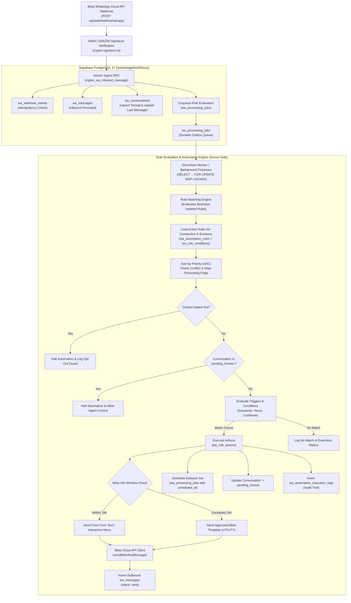

# Gokul Connect — Phase 5 Automation Engine Architecture Plan

**Platform:** Gokul Connect (Multi-Business WhatsApp Automation & CRM)  
**Date:** 2026-11-06  
**Document Type:** Architecture Assessment & Engineering Plan  
**Status:** 📋 **PROPOSED (AWAITING APPROVAL — NO CODE OR MIGRATIONS EXECUTED)**  
**Target Database:** Supabase PostgreSQL 17 (`gokul-connect` / `ansiwtwqgrfmzfrhkzuu`)  
**API Integration:** Meta WhatsApp Cloud API v26.0  
**Scope:** Rule-Based Deterministic Automation Engine & Visual Rule Builder  
**Supplementary Architecture Review:** See [docs/PHASE_5A_1_AUTOMATION_ARCHITECTURE_REVIEW.md](file:///e:/GAI/Whatsapp%20Automation/docs/PHASE_5A_1_AUTOMATION_ARCHITECTURE_REVIEW.md) for detailed risk analysis, idempotency safeguards, loop prevention circuit breakers, and Supabase free-plan optimizations.  

---

## 1. Executive Summary & Product Objective

### 1.1 Product Objective
Gokul Connect operates two distinct, independent business workspaces within a single unified multi-tenant architecture:
1. **Gokul's Astrological Insights** (`astrology` — Tenant UUID: `11111111-1111-1111-1111-111111111111`): Focuses on horoscope generation, astrological consultations, birth chart readings, and gemstone guidance.
2. **Gokul Vivaham** (`vivaham` — Tenant UUID: `22222222-2222-2222-2222-222222222222`): Focuses on Tamil matrimonial matchmaking, profile registrations, horoscope compatibility matching, and premium membership tiers.

Each business must independently create, configure, activate, pause, monitor, and audit its own automated WhatsApp workflows. Under no circumstances may an Astrological automation trigger on a Vivaham conversation, nor may Vivaham rules or templates execute within Astrology.

### 1.2 Deterministic, Rule-Based Execution (Zero AI API Overhead)
As mandated, the Phase 5 Automation Engine is **100% deterministic and rule-based**. 
- It does **not** rely on external LLMs, AI agents, or pay-per-token API services (such as OpenAI, Gemini, or Claude).
- Decision logic relies strictly on:
  - Exact, partial, and regex keyword matching in **both English and Tamil**.
  - Temporal checks (business hours, operating schedules, Indian Standard Time `Asia/Kolkata`).
  - Contact state (opt-in status, interaction frequency, new vs returning customer).
  - Conversation status (`open`, `pending_human`, `closed`).
- This guarantees **ultra-low latency (<15ms evaluation)**, **zero variable API cost**, **100% predictable replies**, and **complete compliance with business policies**.

---

## 2. Automation Capabilities Specification

The Phase 5 Automation Engine will provide eleven core automation capabilities:

| # | Capability | Description | Example Trigger / Scenario |
|:---:|---|---|---|
| **1** | **Automatic Welcome Messages** | Greets new contacts or contacts with no activity in >30 days. | Contact sends their first inbound message to Gokul Vivaham. |
| **2** | **Keyword-Triggered Responses** | Fires predetermined responses based on user message text. | User texts `"fees"`, `"pricing"`, or `"கட்டணம்"`. |
| **3** | **Exact & Substring Matching** | Supports exact match (`"1"`), partial contains (`"consultation"`), prefix (`"astro*"`), and regex patterns in English and Tamil. | User types `"I want a consultation tomorrow"` -> Matches partial `"consultation"`. |
| **4** | **Business-Hours Automatic Replies** | Evaluates active operating hours based on business timezone (`Asia/Kolkata`). Fulfills daytime enquiries with service menus. | Message arrives on Tuesday at 11:30 AM IST -> Sends service options and links. |
| **5** | **Outside-Hours Automatic Replies** | Alerts customers that the team is away and indicates when human coordinators will return. | Message arrives on Sunday at 10:00 PM IST -> Sends after-hours acknowledgement. |
| **6** | **Enquiry Acknowledgement & Routing** | Tags inbound lead, creates conversation record, and acknowledges receipt immediately. | Inbound message with `"horoscope matching"` tagged as `Lead: High Priority`. |
| **7** | **Delayed Follow-Up Messages** | Enqueues a delayed message (e.g., 2 hours or 24 hours later) if customer has not replied or closed enquiry. | Customer asked about Vivaham plans but did not register -> Send follow-up 4 hours later. |
| **8** | **Scheduled Broadcast / Reminders** | Sends messages at a specific future timestamp (e.g., appointment reminder). | Consultation reminder scheduled 1 hour before an Astrology appointment. |
| **9** | **Opt-In & Opt-Out Enforcement** | Complies with Meta WhatsApp Business Policies. Recognizes keywords (`STOP`, `UNSUBSCRIBE`, `நிறுத்து`, `START`, `தொடங்கு`). | User texts `"STOP"` -> Contact marked `opted_out = true`; all outbound automations halt. |
| **10** | **Human-Agent Handover & Pause** | Transfers conversation to a live agent when customer requests human help or replies `"0"` / `"AGENT"`. | Conversation status set to `pending_human`; all bot automations pause for that thread. |
| **11** | **Execution History & Observability** | Persists a structured audit trail of every trigger, evaluated condition, and dispatched action. | Dashboard displays which rule fired, why it matched, latency, and delivery status. |

---

## 3. Technical Architecture & Queue-Processing Flow

### 3.1 High-Level Architecture Diagram



### 3.2 Durable Outbox Queue (`wa_processing_jobs`) Evaluation

Phase 3 introduced `wa_processing_jobs` as the durable outbox queue. Phase 5 leverages this table directly for asynchronous, resilient automation execution:

1. **Job Types:**
   - `'evaluate_rules'`: Enqueued immediately upon inbound message ingestion.
   - `'send_message'`: Dispatches outbound message via Meta Cloud API.
   - `'delayed_automation'`: Follow-up messages scheduled for a future timestamp (`scheduled_at = NOW() + INTERVAL '4 hours'`).
   - `'status_check'`: Verifies if a customer replied before sending a scheduled follow-up.

2. **Concurrency Control & Race Condition Prevention:**
   - Background workers poll for pending jobs using PostgreSQL row-level locks:
     ```sql
     SELECT id, business_id, job_type, payload
     FROM public.wa_processing_jobs
     WHERE status = 'pending'
       AND scheduled_at <= TIMEZONE('utc', NOW())
     ORDER BY scheduled_at ASC
     FOR UPDATE SKIP LOCKED
     LIMIT 10;
     ```
   - This ensures multiple parallel serverless instances or Edge Functions can process the queue simultaneously without duplicate dispatches or deadlocks.

3. **Zero Browser Timers (Server-Side Exclusivity):**
   - **Strict architectural rule:** Zero client-side `setTimeout`, `setInterval`, or browser service-worker timers.
   - Scheduled follow-ups are stored durably in PostgreSQL with a UTC `scheduled_at` timestamp.
   - The scheduler runs via **Supabase `pg_cron` + `pg_net`** (calling an internal RPC or secure Edge Function every 1 minute) or an external serverless cron trigger (e.g., Vercel Cron hitting `/api/cron/process-automation-jobs` with bearer token validation).

### 3.3 Rule Priority, Conflict Handling & Evaluation Flow

When an inbound message arrives:
1. **Global Guards (Priority 0):**
   - **Opt-Out Check:** If contact has `is_opted_out = true`, the engine rejects all outbound automations. If incoming text matches `"STOP"`, `"UNSUBSCRIBE"`, or `"நிறுத்து"`, the contact is immediately marked opted-out, a single confirmation opt-out message is sent, and all further execution halts.
   - **Human Handover Check:** If `wa_conversations.status = 'pending_human'`, automated replies are suppressed to avoid interrupting the agent.
   - **Bot Handover Trigger:** If incoming text matches `"0"`, `"AGENT"`, `"HUMAN"`, or `"உதவி"`, conversation transitions to `pending_human`, an acknowledgement is sent, and lower-priority rules are skipped.
2. **Rule Ordering (`priority ASC`):**
   - Rules are evaluated in strict priority order (1, 2, 3...).
   - Each rule carries a boolean flag: `stop_processing_on_match` (default: `true`).
   - The first matching rule executes its actions and immediately terminates the evaluation chain, preventing conflicting or double replies.
3. **Cooldown & Rate Limiting:**
   - Each rule can define a `cooldown_seconds` (e.g., 86,400 seconds / 24 hours for welcome messages).
   - The engine checks `wa_automation_execution_logs` for that `(rule_id, contact_id)`. If an execution occurred within the cooldown window, the rule is skipped.

### 3.4 Retry Mechanism & Exponential Backoff

Meta API network blips or rate limits (e.g., error `130429`) are handled with durable retries:
- On API failure, worker updates `wa_processing_jobs`:
  - `attempts = attempts + 1`
  - `status = 'pending'` (if `attempts < max_attempts`) or `'failed'`
  - `last_error = api_error_message`
  - `scheduled_at = NOW() + (POWER(2, attempts) * INTERVAL '30 seconds') + (RANDOM() * INTERVAL '5 seconds')`
- Standard retry intervals: 30s ➡️ 1m ➡️ 2m ➡️ 4m ➡️ 8m (Max 5 attempts).
- Once `max_attempts` is exhausted, the job transitions to `status = 'failed'` and an alert is recorded in `wa_automation_execution_logs`.

---

## 4. Database Design Proposal

The proposed database design introduces 4 new tables, extends 2 existing tables, and maintains strict composite foreign key relationships and tenant immutability triggers.

### 4.1 New Tables

#### 1. `wa_automation_rules`
Defines the core automation rule for a business workspace.

```sql
CREATE TABLE IF NOT EXISTS public.wa_automation_rules (
    id UUID PRIMARY KEY DEFAULT gen_random_uuid(),
    business_id UUID NOT NULL REFERENCES public.businesses(id) ON DELETE CASCADE,
    connection_id UUID REFERENCES public.wa_connections(id) ON DELETE CASCADE, -- NULL = Applies to all connections in business
    name TEXT NOT NULL,
    description TEXT,
    trigger_type TEXT NOT NULL CHECK (trigger_type IN (
        'inbound_message',           -- Any inbound message
        'first_inbound_message',     -- First message from contact (Welcome)
        'keyword_match',             -- Explicit keyword trigger
        'outside_business_hours',    -- Inbound received outside working hours
        'inside_business_hours',     -- Inbound received during working hours
        'customer_enquiry',          -- Structured lead capture
        'opt_out',                   -- User requests unsubscribe
        'opt_in',                    -- User requests resubscribe
        'human_requested'            -- User requests human agent
    )),
    priority INT NOT NULL DEFAULT 100, -- Lower number = higher evaluation priority
    stop_processing_on_match BOOLEAN NOT NULL DEFAULT TRUE,
    cooldown_seconds INT NOT NULL DEFAULT 0, -- Min seconds before re-triggering for same contact
    is_active BOOLEAN NOT NULL DEFAULT TRUE,
    created_at TIMESTAMPTZ NOT NULL DEFAULT TIMEZONE('utc', NOW()),
    updated_at TIMESTAMPTZ NOT NULL DEFAULT TIMEZONE('utc', NOW()),

    CONSTRAINT uq_wa_automation_rules_id_business UNIQUE (id, business_id)
);

CREATE INDEX idx_wa_automation_rules_lookup 
    ON public.wa_automation_rules(business_id, is_active, priority ASC);

-- Tenant immutability trigger
CREATE TRIGGER trg_wa_automation_rules_immutable_business_id
    BEFORE UPDATE ON public.wa_automation_rules
    FOR EACH ROW
    EXECUTE FUNCTION public.prevent_tenant_reassignment();
```

#### 2. `wa_rule_conditions`
Defines the matching criteria (AND/OR logic) for each rule.

```sql
CREATE TABLE IF NOT EXISTS public.wa_rule_conditions (
    id UUID PRIMARY KEY DEFAULT gen_random_uuid(),
    business_id UUID NOT NULL REFERENCES public.businesses(id) ON DELETE CASCADE,
    rule_id UUID NOT NULL,
    condition_group INT NOT NULL DEFAULT 0, -- Conditions with same group evaluated with AND; separate groups with OR
    condition_type TEXT NOT NULL CHECK (condition_type IN (
        'keyword_exact',         -- Exact string equality
        'keyword_contains',      -- Substring match
        'keyword_starts_with',   -- Prefix match
        'keyword_regex',         -- Regular expression match
        'business_hours',        -- Is within business hours
        'outside_hours',         -- Is outside business hours
        'conversation_status',   -- Checks current conversation status
        'contact_opt_in',        -- Checks if contact is opted in
        'first_time_contact'     -- Has contact messaged previously
    )),
    operator TEXT NOT NULL DEFAULT 'equals' CHECK (operator IN (
        'equals', 'contains', 'starts_with', 'regex', 'is_true', 'is_false', 'in_list'
    )),
    match_value JSONB NOT NULL, -- e.g. {"keywords": ["consultation", "ஜாதகம்", "horoscope"], "case_sensitive": false}
    order_index INT NOT NULL DEFAULT 0,
    created_at TIMESTAMPTZ NOT NULL DEFAULT TIMEZONE('utc', NOW()),

    CONSTRAINT uq_wa_rule_conditions_id_business UNIQUE (id, business_id),
    CONSTRAINT fk_wa_rule_conditions_rule_tenant
        FOREIGN KEY (rule_id, business_id)
        REFERENCES public.wa_automation_rules(id, business_id) ON DELETE CASCADE
);

CREATE INDEX idx_wa_rule_conditions_rule_id 
    ON public.wa_rule_conditions(business_id, rule_id, order_index ASC);

CREATE TRIGGER trg_wa_rule_conditions_immutable_business_id
    BEFORE UPDATE ON public.wa_rule_conditions
    FOR EACH ROW
    EXECUTE FUNCTION public.prevent_tenant_reassignment();
```

#### 3. `wa_rule_actions`
Defines the actions dispatched when a rule's conditions evaluate to true.

```sql
CREATE TABLE IF NOT EXISTS public.wa_rule_actions (
    id UUID PRIMARY KEY DEFAULT gen_random_uuid(),
    business_id UUID NOT NULL REFERENCES public.businesses(id) ON DELETE CASCADE,
    rule_id UUID NOT NULL,
    action_type TEXT NOT NULL CHECK (action_type IN (
        'send_text_message',         -- Standard text response (within 24h window)
        'send_template_message',     -- Pre-approved Meta WhatsApp Template
        'send_interactive_buttons',  -- Up to 3 quick-reply buttons
        'send_interactive_list',     -- Interactive menu list
        'assign_agent',              -- Assign to specific agent or pool
        'update_conversation_status',-- Set to 'pending_human', 'closed', etc.
        'apply_contact_label',       -- Adds metadata label
        'set_opt_status',            -- Updates opted_in / opted_out
        'schedule_follow_up'         -- Enqueues future message in wa_processing_jobs
    )),
    action_payload JSONB NOT NULL,   -- Message text, template parameters, button options, or delay interval
    delay_seconds INT NOT NULL DEFAULT 0, -- Delay before executing (0 = immediate)
    order_index INT NOT NULL DEFAULT 0,   -- Execution order within the rule
    created_at TIMESTAMPTZ NOT NULL DEFAULT TIMEZONE('utc', NOW()),

    CONSTRAINT uq_wa_rule_actions_id_business UNIQUE (id, business_id),
    CONSTRAINT fk_wa_rule_actions_rule_tenant
        FOREIGN KEY (rule_id, business_id)
        REFERENCES public.wa_automation_rules(id, business_id) ON DELETE CASCADE
);

CREATE INDEX idx_wa_rule_actions_rule_id 
    ON public.wa_rule_actions(business_id, rule_id, order_index ASC);

CREATE TRIGGER trg_wa_rule_actions_immutable_business_id
    BEFORE UPDATE ON public.wa_rule_actions
    FOR EACH ROW
    EXECUTE FUNCTION public.prevent_tenant_reassignment();
```

#### 4. `wa_automation_execution_logs`
Provides a persistent, tamper-evident audit trail for every automation attempt.

```sql
CREATE TABLE IF NOT EXISTS public.wa_automation_execution_logs (
    id UUID PRIMARY KEY DEFAULT gen_random_uuid(),
    business_id UUID NOT NULL REFERENCES public.businesses(id) ON DELETE CASCADE,
    rule_id UUID REFERENCES public.wa_automation_rules(id) ON DELETE SET NULL,
    connection_id UUID NOT NULL REFERENCES public.wa_connections(id) ON DELETE CASCADE,
    conversation_id UUID NOT NULL,
    contact_id UUID NOT NULL,
    inbound_message_id UUID REFERENCES public.wa_messages(id) ON DELETE SET NULL,
    outbound_message_id UUID REFERENCES public.wa_messages(id) ON DELETE SET NULL,
    trigger_matched TEXT NOT NULL,
    conditions_snapshot JSONB NOT NULL DEFAULT '[]'::jsonb, -- Exact condition results
    actions_executed JSONB NOT NULL DEFAULT '[]'::jsonb,   -- Dispatched actions
    status TEXT NOT NULL CHECK (status IN ('success', 'skipped', 'failed', 'delayed')),
    skip_reason TEXT,
    error_message TEXT,
    execution_time_ms INT,
    created_at TIMESTAMPTZ NOT NULL DEFAULT TIMEZONE('utc', NOW()),

    CONSTRAINT fk_wa_exec_logs_conversation_tenant
        FOREIGN KEY (conversation_id, business_id)
        REFERENCES public.wa_conversations(id, business_id) ON DELETE CASCADE,
    CONSTRAINT fk_wa_exec_logs_contact_tenant
        FOREIGN KEY (contact_id, business_id)
        REFERENCES public.wa_contacts(id, business_id) ON DELETE CASCADE
);

CREATE INDEX idx_wa_exec_logs_business 
    ON public.wa_automation_execution_logs(business_id, created_at DESC);
CREATE INDEX idx_wa_exec_logs_contact 
    ON public.wa_automation_execution_logs(business_id, contact_id, created_at DESC);
CREATE INDEX idx_wa_exec_logs_rule 
    ON public.wa_automation_execution_logs(business_id, rule_id, created_at DESC);
```

### 4.2 Enhancements to Existing Tables

1. **`business_settings` (Working Hours & Automation Defaults):**
   ```sql
   ALTER TABLE public.business_settings
       ADD COLUMN IF NOT EXISTS business_hours JSONB NOT NULL DEFAULT '{
           "timezone": "Asia/Kolkata",
           "weekly_schedule": {
               "monday":    {"is_open": true,  "open_time": "09:00", "close_time": "18:00"},
               "tuesday":   {"is_open": true,  "open_time": "09:00", "close_time": "18:00"},
               "wednesday": {"is_open": true,  "open_time": "09:00", "close_time": "18:00"},
               "thursday":  {"is_open": true,  "open_time": "09:00", "close_time": "18:00"},
               "friday":    {"is_open": true,  "open_time": "09:00", "close_time": "18:00"},
               "saturday":  {"is_open": true,  "open_time": "10:00", "close_time": "16:00"},
               "sunday":    {"is_open": false, "open_time": "00:00", "close_time": "00:00"}
           },
           "holiday_dates": []
       }'::jsonb,
       ADD COLUMN IF NOT EXISTS automation_settings JSONB NOT NULL DEFAULT '{
           "is_automation_enabled": true,
           "opt_out_keywords": ["STOP", "UNSUBSCRIBE", "CANCEL", "QUIT", "நிறுத்து"],
           "opt_in_keywords": ["START", "UNSTOP", "JOIN", "தொடங்கு"],
           "human_handover_keywords": ["AGENT", "HUMAN", "REPRESENTATIVE", "0", "உதவி", "மனிதர்"],
           "max_bot_replies_per_hour": 10
       }'::jsonb;
   ```

2. **`wa_contacts` (Opt-in & Engagement Tracking):**
   ```sql
   ALTER TABLE public.wa_contacts
       ADD COLUMN IF NOT EXISTS is_opted_out BOOLEAN NOT NULL DEFAULT FALSE,
       ADD COLUMN IF NOT EXISTS opted_out_at TIMESTAMPTZ,
       ADD COLUMN IF NOT EXISTS last_inbound_at TIMESTAMPTZ,
       ADD COLUMN IF NOT EXISTS total_inbound_count INT NOT NULL DEFAULT 0;
   ```

3. **`wa_conversations` (Automation Pause State):**
   ```sql
   ALTER TABLE public.wa_conversations
       ADD COLUMN IF NOT EXISTS is_automation_paused BOOLEAN NOT NULL DEFAULT FALSE,
       ADD COLUMN IF NOT EXISTS automation_paused_until TIMESTAMPTZ,
       ADD COLUMN IF NOT EXISTS automation_paused_by UUID REFERENCES public.user_profiles(id);
   ```

---

## 5. Visual Rule-Builder UI Proposal

### 5.1 Architecture & UX Hierarchy
The Visual Rule Builder will live at `/workspace/[businessSlug]/automations` with subroutes `/new` and `/[ruleId]/edit`.

```
+---------------------------------------------------------------------------------------------------------+
|  GOKUL CONNECT > Gokul Vivaham > Automations > Edit Rule: "Membership Enquiry Response"                 |
|  [Status: ACTIVE]  [Priority: 10]  [Cooldown: 24h]                         [Test Rule]  [Save Changes]  |
+---------------------------------------------------------------------------------------------------------+
|                                                                                                         |
|  +---------------------------------------------------------------------------------------------------+  |
|  | STEP 1: TRIGGER                                                                                   |  |
|  | When this event occurs:                                                                           |  |
|  | [ (v) Incoming WhatsApp Message                                                                 ] |  |
|  | Connection: [ All Vivaham Numbers (or select specific line)                                     ] |  |
|  +---------------------------------------------------------------------------------------------------+  |
|                                                  |                                                      |
|                                                  v                                                      |
|  +---------------------------------------------------------------------------------------------------+  |
|  | STEP 2: CONDITIONS (Filter matching messages)                                                     |  |
|  | Match ANY of the following condition groups (OR):                                                 |  |
|  |                                                                                                   |  |
|  |  +-- Group 1 (AND) ----------------------------------------------------------------------------+ |  |
|  |  | [ Message Text ]  [ Contains any of ]  [ membership, கட்டணம், fees, plans, விலை ]           | |  |
|  |  | [+ Add Condition]                                                                           | |  |
|  |  +---------------------------------------------------------------------------------------------+ |  |
|  |                                                                                                   |  |
|  |  +-- Group 2 (AND) ----------------------------------------------------------------------------+ |  |
|  |  | [ Interactive Reply ID ]  [ Equals ]  [ btn_vivaham_membership_info ]                       | |  |
|  |  +---------------------------------------------------------------------------------------------+ |  |
|  |                                                                                                   |  |
|  |  [+ Add Condition Group (OR)]                                                                     |  |
|  +---------------------------------------------------------------------------------------------------+  |
|                                                  |                                                      |
|                                                  v                                                      |
|  +---------------------------------------------------------------------------------------------------+  |
|  | STEP 3: ACTIONS (Executed in sequence)                                                            |  |
|  |                                                                                                   |  |
|  |  1. [ Send WhatsApp Text Message                                                     ] [Delay: 0s] |  |
|  |     "Vanakkam! Welcome to Gokul Vivaham. Here are our active membership tiers:                    |  |
|  |      1. Silver Matrimony (3 Months)                                                               |  |
|  |      2. Gold Matching (6 Months + Astrological Compatibility)                                     |  |
|  |      Reply with 1 or 2 for registration details, or reply 0 to chat with an agent."               |  |
|  |                                                                                                   |  |
|  |  2. [ Apply Contact Label                                                                        ] |  |
|  |     Tag: "Enquiry: Membership Lead"                                                               |  |
|  |                                                                                                   |  |
|  |  3. [ Schedule Follow-Up Message                                                    ] [Delay: 4h] |  |
|  |     "Hi! Did you have any questions regarding the Gokul Vivaham plans? Reply AGENT to connect."   |  |
|  |     Condition: Only send if customer has not replied within 4 hours.                               |  |
|  |                                                                                                   |  |
|  |  [+ Add Action Step]                                                                              |  |
|  +---------------------------------------------------------------------------------------------------+  |
+---------------------------------------------------------------------------------------------------------+
```

### 5.2 Real-Time Rule Simulator / Dry-Run Testing
To prevent business disruptions, the Rule Builder includes an interactive **Rule Testing Drawer**:
- Admins input a mock incoming message (e.g., `"Need horoscope matching details and fees"`).
- The engine simulates the rule matching pipeline in-memory:
  - ✅ Trigger evaluation: Incoming text message matched.
  - ✅ Keyword match: `"matching"` and `"fees"` matched Group 1 condition.
  - ✅ Business hours: Within Tuesday operating hours.
  - ✅ Contact state: Not opted out.
  - 📋 Actions preview: Action 1 (Reply text) -> Action 2 (Label) -> Action 3 (Delayed follow-up).
- The simulator gives immediate visual feedback with zero WhatsApp API calls or database mutations.

---

## 6. Strict Multi-Tenant Business Isolation

Gokul Connect enforces an uncompromising 4-tier security barrier between **Gokul's Astrological Insights** and **Gokul Vivaham**:

```
+---------------------------------------------------------------------------------------------------------+
| TIER 1: DATABASE LEVEL (PostgreSQL Engine & Constraints)                                                |
| - Every table has NOT NULL business_id REFERENCES businesses(id).                                       |
| - trg_*_immutable_business_id prevents changing tenant ownership on UPDATE.                             |
| - Composite Foreign Keys ensure rules, conditions, and actions match the exact business_id.             |
+---------------------------------------------------------------------------------------------------------+
                                                  |
+---------------------------------------------------------------------------------------------------------+
| TIER 2: ROW LEVEL SECURITY (RLS) POLICIES                                                               |
| - All queries check: check_user_business_access(business_id).                                            |
| - Cross-tenant SELECT returns 0 rows. Cross-tenant INSERT/UPDATE/DELETE throws RLS policy error.         |
+---------------------------------------------------------------------------------------------------------+
                                                  |
+---------------------------------------------------------------------------------------------------------+
| TIER 3: SERVER ACTION AUTHORIZATION (Next.js Application Layer)                                         |
| - Every mutation validates user session membership using validateBusinessAccess(userId, businessId).   |
| - Role enforcement: only 'owner' and 'admin' roles can create, edit, or toggle automation rules.         |
+---------------------------------------------------------------------------------------------------------+
                                                  |
+---------------------------------------------------------------------------------------------------------+
| TIER 4: EXECUTION ENGINE ISOLATION (Automation Processor)                                               |
| - Inbound webhook resolves connection -> business_id from public.wa_connections.                        |
| - Rule query strictly predicates: WHERE business_id = $conn_business_id AND is_active = true.           |
| - Astrology rules NEVER execute on Vivaham messages; Vivaham rules NEVER execute on Astrology.         |
+---------------------------------------------------------------------------------------------------------+
```

### 6.1 Non-Leakage Verification Scenarios

| Cross-Tenant Scenario | Attempted Action | Prevention Mechanism | Result |
|---|---|---|:---:|
| **Scenario A** | Astrology Admin attempts to view Vivaham automation rules via API. | RLS policy on `wa_automation_rules` checks `check_user_business_access`. | **0 rows returned** |
| **Scenario B** | Vivaham incoming webhook received on Vivaham Phone ID. | Worker loads rules strictly filtering `business_id = vivaham_id`. | **Only Vivaham rules evaluated** |
| **Scenario C** | Malicious script modifies `rule.business_id` from Astrology to Vivaham. | `trg_wa_automation_rules_immutable_business_id` fires. | **SQLSTATE P0001 (Exception raised)** |
| **Scenario D** | Rule action attempts to send message through a connection belonging to another business. | Composite FK `(connection_id, business_id)` on message record. | **Foreign Key Violation (SQLSTATE 23503)** |

---

## 7. Meta WhatsApp Cloud API Compliance Architecture

WhatsApp enforces strict regulatory and operational policies. The Phase 5 Automation Engine adheres directly to these standards:

### 7.1 The 24-Hour Customer Service Window Rule
- **Rule:** When a customer sends a message, a 24-hour service window opens. Inside this window, businesses can send free-form text, interactive buttons, or media without pre-approval.
- **Outside 24h Window:** Once 24 hours elapse since the customer's last message (`wa_contacts.last_inbound_at`), free-form text messages are **rejected by Meta** with error `131047` (`Re-engagement message`). Only pre-approved **Meta Message Templates** (Utility or Marketing) can be sent.
- **Engine Enforcement:**
  ```typescript
  const hoursSinceLastInbound = differenceInHours(new Date(), contact.last_inbound_at);
  if (hoursSinceLastInbound >= 24) {
    if (action.action_type === 'send_text_message') {
      // Prevent Meta error: Auto-fallback to approved template or cancel with log
      await logExecutionSkipped(rule.id, "Cannot send free-form text outside 24h window. Template required.");
      return;
    }
  }
  ```

### 7.2 Opt-In & Opt-Out Handling (Mandatory Policy)
- **Automatic Keyword Detection:** If an inbound message equals `"STOP"`, `"UNSUBSCRIBE"`, `"CANCEL"`, or `"நிறுத்து"` (case-insensitive):
  1. `wa_contacts.is_opted_out` is set to `TRUE`.
  2. `wa_contacts.opted_out_at` is set to `NOW()`.
  3. A single mandatory compliance confirmation is dispatched:  
     *"You have successfully unsubscribed from Gokul Connect messages. Reply START to resubscribe."*
  4. All future automated and scheduled messages to this contact are immediately cancelled.
- **Resubscribe Workflow:** If an inbound message equals `"START"` or `"தொடங்கு"`, `is_opted_out` is reverted to `FALSE` and the opt-in timestamp is updated.

### 7.3 Human Handover Protocol
- Meta requires automated business accounts to provide an accessible path to human operators.
- Any message matching `"AGENT"`, `"HUMAN"`, `"0"`, or `"உதவி"`:
  1. Updates `wa_conversations.status = 'pending_human'`.
  2. Sets `wa_conversations.is_automation_paused = TRUE`.
  3. Sends an immediate acknowledgement:  
     *"Our coordinator will join this chat shortly. Office hours: 9 AM - 6 PM IST."*
  4. Triggers an inbox notification badge for online agents in Phase 4.

### 7.4 Anti-Spam Rate Limiting (Tier Protection)
To maintain Meta WhatsApp Phone Number Quality Rating (`GREEN`):
- **Per-Conversation Cap:** Max 10 automated replies per contact per hour.
- **Infinite Loop Guard:** The bot never triggers an automation from an `outbound` message. All triggers strictly require `direction = 'inbound'`.
- **Duplicate Suppression:** Idempotency checking on `meta_message_id` ensures network retries from Meta webhooks never trigger duplicate automations.

---

## 8. Cost Considerations & Infrastructure Optimization

### 8.1 Zero AI API Cost Guarantee
- The automation engine is built on deterministic Boolean expression trees, substring lookups, and regex parsing.
- **Cost: $0.00 / month** in AI tokens or third-party inference services.

### 8.2 Supabase Free Plan Optimization (500 MB Storage Ceiling)
The Supabase Free Plan offers 500 MB of PostgreSQL database storage and shared compute. Automation logs can grow quickly if left unchecked.
1. **Automated Log Pruning:**
   - Detailed condition snapshots in `wa_automation_execution_logs` are automatically pruned after 30 days via a scheduled cleanup function:
     ```sql
     CREATE OR REPLACE FUNCTION public.prune_old_automation_logs()
     RETURNS void LANGUAGE plpgsql AS $$
     BEGIN
         DELETE FROM public.wa_automation_execution_logs
         WHERE created_at < TIMEZONE('utc', NOW()) - INTERVAL '30 days';
     END;
     $$;
     ```
2. **Lean JSONB Payloads:**
   - Store only matched keyword snippets rather than entire raw payloads in `wa_rule_conditions` and execution logs.
3. **Connection Pooling:**
   - Background queue processing utilizes atomic stored procedures (`SECURITY DEFINER` RPCs) to execute batch updates in single round-trips, preventing connection pool exhaustion.

### 8.3 Eliminating Polling Waste
- **Event-Driven for Real-Time Rules:** Immediate automations (welcome messages, keyword replies, business-hours notices) are evaluated synchronously or enqueued during the webhook transaction, firing in <50ms without continuous database polling.
- **Batched Interval for Delayed Rules:** Delayed follow-ups are polled only once every 60 seconds (or triggered via serverless cron), executing up to 25 pending jobs per batch using `FOR UPDATE SKIP LOCKED`.

### 8.4 Meta WhatsApp Message Pricing Maximization
Under Meta's conversation-based pricing:
- **Free Service Window:** Inbound customer-initiated service conversations include all replies within the 24-hour window at **zero additional per-message Meta fees** (first 1,000 service conversations per month are completely free across the WABA).
- **Automations within 24h are 100% free of Meta conversation charges** when responding to customer messages.
- Delayed follow-ups scheduled >24 hours later are marked as `UTILITY` templates, minimizing Meta template costs compared to marketing categories.

---

## 9. Dependencies on Phase 3 and Phase 4

| Module | Phase | Dependency for Phase 5 |
|---|:---:|---|
| **`wa_connections` & Credential Vault** | Phase 2 / Phase 3 | Provides verified `phone_number_id` and decrypted Meta access tokens for outbound automation dispatches. |
| **`wa_webhook_events` & Ingestion RPC** | Phase 3 | `ingest_wa_inbound_message` acts as the single entry point. In Phase 5, this function enqueues the rule evaluation job. |
| **`wa_processing_jobs`** | Phase 3 | Serves as the durable outbox queue for retries, delayed follow-ups, and asynchronous dispatches. |
| **`sendWhatsAppMessageService`** | Phase 3 | Core dispatch library handling text and approved template payloads. |
| **WhatsApp Inbox Navigation & Chat Window** | Phase 4 | Displays `pending_human` status filter, shows automated bot badges on messages, and provides the "Pause Automation" toggle button in the chat header. |

---

## 10. Implementation Phases & Test Strategy

### 10.1 Implementation Roadmap (Sub-phases)

```
Phase 5A: Database Migration & Schema Foundation
└── Create tables: wa_automation_rules, wa_rule_conditions, wa_rule_actions, wa_automation_execution_logs
└── Add business_hours and automation_settings to business_settings
└── Add opt-out and engagement counters to wa_contacts and wa_conversations
└── Apply immutable triggers and strict RLS policies

Phase 5B: Core Rule Evaluation Engine (Server-Side)
└── Implement RuleMatcher (exact, partial, regex, Tamil/English normalizer)
└── Implement BusinessHoursEvaluator (Asia/Kolkata timezone schedule)
└── Implement Cooldown & Opt-Out Guard
└── Connect webhook ingestion to enqueue rule evaluation in wa_processing_jobs

Phase 5C: Queue Worker & Outbound Automation Dispatcher
└── Implement batch worker with SELECT ... FOR UPDATE SKIP LOCKED
└── Implement 24-hour Meta service window validation
└── Implement delayed follow-up scheduler
└── Implement exponential backoff and retry tracking

Phase 5D: Visual Rule Builder UI
└── Rule list view with Active/Pause switches and priority badges
└── 3-step block builder (Trigger -> Conditions -> Actions)
└── Tamil/English keyword chip input component
└── Real-time interactive dry-run simulator

Phase 5E: Verification & End-to-End Testing
└── Unit tests for matching engine, hours evaluator, and Tamil unicode support
└── Multi-tenant isolation verification (Astrology vs Vivaham)
└── Live Meta Cloud API automated dry-run testing
└── Production readiness audit and performance validation
```

### 10.2 Comprehensive Test Strategy Matrix

| Test Suite | Focus Area | Verification Criteria |
|---|---|---|
| **Unit Tests** | Keyword Normalization | Case-insensitivity, whitespace trimming, Tamil unicode matching (`ஜாதகம்`, `பொருத்தம்`), regex boundaries. |
| **Unit Tests** | Business Hours Evaluator | Accurate calculation of open/closed status for `Asia/Kolkata` across weekdays, weekends, and holidays. |
| **Multi-Tenant RLS** | Isolation Verification | Astrology admin cannot query or modify Vivaham rules; Vivaham webhook never fires Astrology actions. |
| **Integration Tests** | Queue & Worker | `FOR UPDATE SKIP LOCKED` handles concurrent executions without duplicate message sends. |
| **Compliance Tests** | Meta 24-Hour Rule | Automatically blocks free-form text if `last_inbound_at` > 24h; verifies fallback to approved templates. |
| **Compliance Tests** | Opt-Out Handling | Immediate stop on `"STOP"` keyword; all outbound automated messages blocked while opted out. |
| **End-to-End Tests** | Inbound Simulation | Inbound webhook -> atomic ingest -> rule evaluation -> outbox queue -> outbound reply -> execution log logged. |

---

## 11. Architectural Recommendation & Approval Request

This architectural design is robust, secure, cost-effective, and builds cleanly on top of the established Phase 3 and Phase 4 foundation.

- **Zero Breaking Changes:** Extends existing database tables without disrupting active messaging.
- **Zero AI Costs:** Completely deterministic, predictable, and instantaneous.
- **Strict Multi-Tenancy:** Guaranteed complete physical and logical isolation between Gokul's Astrological Insights and Gokul Vivaham.

**Next Action:** Awaiting user review and formal approval before authoring any database migrations or application code for Phase 5.
