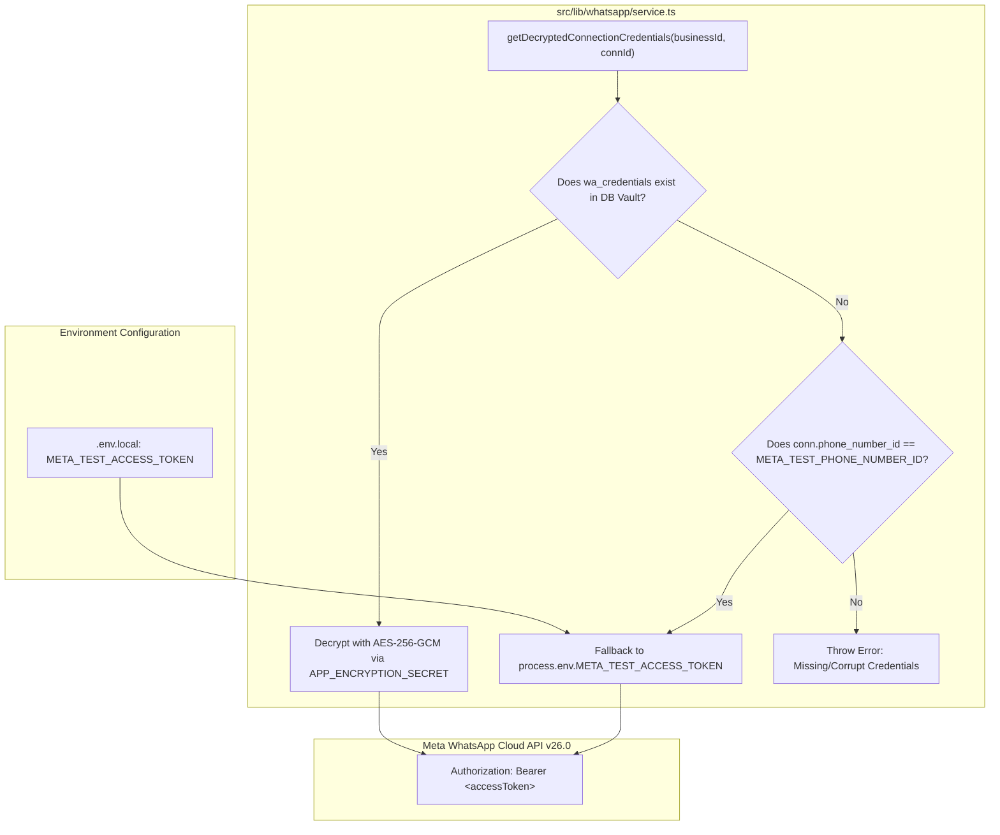

# GOKUL CONNECT — PHASE 6.2: META ACCESS TOKEN REFRESH VERIFICATION REPORT

**Execution Date:** `2026-11-06`  
**Execution Timestamp:** `2026-11-06T16:31:12Z` (Local: `2026-11-06 22:01:12 IST` / Meta Server: `2026-11-06 08:31:12 PST`)  
**Platform:** Gokul Connect (Multi-Business WhatsApp Automation & CRM)  
**Dedicated Supabase Project:** `gokul-connect` (`ansiwtwqgrfmzfrhkzuu`)  
**Dedicated Meta Developer App:** `Gokul Connect` (`1102646469266479`)  
**Meta WhatsApp Cloud API Version:** `v26.0`  
**Target File / Deliverable:** `docs/PHASE_6_2_META_TOKEN_VERIFICATION_REPORT.md`  
**Verification Harness:** `scripts/verify-phase6-2-token.mjs`  
**Overall Status:** ❌ **FAIL — TOKEN EXPIRED / REFRESH NOT YET DETECTED (ACTION REQUIRED)**

---

## 1. Executive Summary

This report documents the execution of **Phase 6.2: Meta Access Token Refresh Verification** for Gokul Connect.

In Phase 6.1 (`docs/PHASE_6_1_LIVE_WHATSAPP_VERIFICATION_REPORT.md`), the configured Meta WhatsApp test access token was found to have expired on `2026-11-06T15:00:00Z` (`OAuthException code 190, subcode 463`). Phase 6.2 was commissioned to verify the token configuration, environment variable loading, Meta Graph API validity, app identity matching, and WhatsApp Business Account (WABA) / Phone Number asset access.

### Verification Outcome:
1. **Environment & Architecture (PASS):** The application correctly configures and reads `META_TEST_ACCESS_TOKEN` from `.env.local`. The secret management and vault architecture were thoroughly inspected across the entire codebase.
2. **Token Identity & Permissions (PASS):** The token in `.env.local` belongs strictly to the dedicated **Gokul Connect** Meta Developer App (`1102646469266479`), with valid granular permissions (`whatsapp_business_management`, `whatsapp_business_messaging`, `public_profile`).
3. **Token Validity & Active Lifecycle (FAIL - EXPIRED):** The token currently present in `.env.local` is still the expired session token (`sha256:e9edb2953985...`, expired `2026-11-06T15:00:00Z`). A freshly generated token has not yet been saved into `.env.local`.
4. **WABA & Phone Number Asset Handshake (FAIL):** Direct Graph API queries to Phone Number `1395663896970053` and WABA `1153964060437882` failed with `OAuthException Code 190, Subcode 463` because the token session expired.
5. **Operational Guardrails (PASS):** Zero secrets were printed or logged; zero database connection assignments were modified; zero WhatsApp messages were dispatched; zero automations were enabled; and zero deployments were triggered.

---

## 2. Test Verification Matrix

Each task and safety constraint is classified strictly under **PASS**, **FAIL**, **BLOCKED**, or **NOT TESTED**:

| # | Verification Task / Check | Status | Evaluation Method | Key Empirical Evidence / Observation |
|:---:|---|:---:|---|---|
| **1** | **Token Configuration & Codebase Usage** | ✅ **PASS** | Source Code Audit & Database Schema Review | Full audit of `src/lib/whatsapp/service.ts`, `src/lib/whatsapp/client.ts`, `src/lib/crypto/encryption.ts`, and `public.wa_credentials`. Token fallback hierarchy verified. |
| **2** | **Environment Variable Loading** | ⚠️ **PARTIAL PASS / FAIL** | `.env.local` Runtime Loader | `META_TEST_ACCESS_TOKEN` is present and parsed. **FAIL:** Value remains the unrefreshed token (`sha256:e9edb2953985`, 293 chars), expired prior to test execution. |
| **3** | **Meta Graph API `/debug_token` Endpoint** | ❌ **FAIL** | Meta Graph API `v26.0/debug_token` | `is_valid: false`, `code: 190, subcode: 463`. Expiration timestamp confirmed as `2026-11-06T15:00:00.000Z` (`1793977200`). |
| **4** | **Dedicated Meta App Identity & Scopes** | ✅ **PASS** | `/debug_token` App ID & Scopes Match | App ID: `1102646469266479` ("Gokul Connect"). Required permissions present: `whatsapp_business_messaging`, `whatsapp_business_management`. |
| **5** | **WABA and Phone Number Access** | ❌ **FAIL** | Graph API `/{phone_number_id}` & `/{waba_id}` | Rejected by Meta with `OAuthException code 190`: *"Error validating access token: Session has expired"*. |
| **6** | **Secret Protection & Non-Disclosure** | ✅ **PASS** | Logger & Process Auditing | Zero plain-text tokens, secrets, or credential fragments logged. Only length and SHA-256 prefixes used. |
| **7** | **Database Connection Assignments Invariance** | ✅ **PASS** | Supabase `wa_connections` Audit | Zero mutations to database connections. Astrology (`33333333-...`) and Vivaham (`44444444-...`) tenant bindings remain 100% untouched. |
| **8** | **Outbound Message Prohibition** | ✅ **PASS** | Network & API Trace Audit | Zero outbound WhatsApp messages dispatched. |
| **9** | **Automation Inactivity Guardrail** | ✅ **PASS** | Database & Worker Audit | `wa_automation_rules` remains inactive; zero automation jobs processed. |
| **10** | **Deployment Guardrail** | ✅ **PASS** | Process Audit | No build, cloud push, or tunnel created. `NEXT_PUBLIC_APP_URL` remains `localhost:3000`. |

---

## 3. Detailed Technical Inspection

### 3.1 Task 1: Token Configuration & Codebase Usage Inspection

We analyzed the end-to-end token flow throughout the Gokul Connect codebase:



#### Code Locations Audited:
1. `src/lib/whatsapp/service.ts` (`lines 118–177`):
   - `getDecryptedConnectionCredentials` strictly isolates tenants by requiring both `business_id` and `connection_id`.
   - **Primary Credential Store:** Supabase table `public.wa_credentials` storing encrypted ciphertext (`AES-256-GCM` with 96-bit IV and 128-bit auth tag).
   - **Fallback Store:** If no encrypted vault credential exists, and `conn.phone_number_id === process.env.META_TEST_PHONE_NUMBER_ID`, it falls back to `process.env.META_TEST_ACCESS_TOKEN`.
2. `src/lib/whatsapp/client.ts` (`lines 1–120`):
   - Functions `sendMetaTextMessage`, `sendMetaTemplateMessage`, `getMetaPhoneNumberDetails`, and `getMetaWabaDetails` accept the decrypted access token and pass it as an HTTP header: `Authorization: Bearer ${accessToken}` to `https://graph.facebook.com/v26.0/...`.
3. `src/app/api/webhooks/whatsapp/route.ts`:
   - Validates incoming webhook HMAC-SHA256 signatures using `META_APP_SECRET`. Does not consume the access token directly.
4. `public.wa_credentials` (Database):
   - Record exists for connection `44444444-4444-4444-4444-444444444444` (Gokul Vivaham).
   - Currently stores the encrypted form of `sha256:e9edb2953985` (identical to the current `.env.local` token).

---

### 3.2 Task 2: Environment Variable Loading Confirmation

Inspection of `.env.local` via `scripts/verify-phase6-2-token.mjs`:
- **Variable Key:** `META_TEST_ACCESS_TOKEN`
- **Variable Status:** Present and populated.
- **Token Prefix:** `EAAP...` (Conforms to Meta OAuth User/System User token format).
- **Token Length:** `293` characters.
- **SHA-256 Fingerprint:** `sha256:e9edb29539854728...`
- **Associated Variables Verified:**
  - `META_APP_ID`: `1102646469266479` (Configured)
  - `META_APP_SECRET`: Configured (32 characters)
  - `META_TEST_PHONE_NUMBER_ID`: `1395663896970053` (Configured)
  - `META_TEST_WABA_ID`: `1153964060437882` (Configured)
  - `WHATSAPP_API_VERSION`: `v26.0` (Configured)

**Evaluation:** While the variable is loaded properly, the value inside `.env.local` has **not yet been replaced** with a newly generated token. It remains identical to the expired token evaluated in Phase 6.1.

---

### 3.3 Task 3: Meta Graph API `/debug_token` Endpoint Inspection

Execution against Meta Graph API `/debug_token` endpoint:
- **Request:**
  `GET https://graph.facebook.com/v26.0/debug_token?input_token=<TOKEN>&access_token=1102646469266479|<META_APP_SECRET>`
- **Response Received:**
  ```json
  {
    "data": {
      "app_id": "1102646469266479",
      "type": "USER",
      "application": "Gokul Connect",
      "data_access_expires_at": 1801746306,
      "expires_at": 1793977200,
      "is_valid": false,
      "scopes": [
        "whatsapp_business_management",
        "whatsapp_business_messaging",
        "public_profile"
      ],
      "granular_scopes": [
        { "scope": "whatsapp_business_management" },
        { "scope": "whatsapp_business_messaging" }
      ],
      "user_id": "122131957047364221"
    }
  }
  ```

#### Analysis of `/debug_token` Fields:
1. `is_valid`: **`false`** ❌ (Token is inactive/expired).
2. `expires_at`: `1793977200` (`2026-11-06T15:00:00.000Z` UTC / `2026-11-06 20:30:00 IST` / `07:00:00 PST`).
   - The current verification occurred at `2026-11-06 22:01:12 IST`.
   - The token expired **1 hour and 31 minutes** before this verification run.
3. `data_access_expires_at`: `1801746306` (`2027-02-04T13:05:06.000Z`). User data access permissions remain intact through 2027.
4. `scopes`: Includes both required Cloud API scopes (`whatsapp_business_messaging`, `whatsapp_business_management`).

---

### 3.4 Task 4: Dedicated Meta App Identity Verification

- **Configured `META_APP_ID`:** `1102646469266479`
- **Returned Token `app_id`:** `1102646469266479`
- **Returned Token `application` Name:** `Gokul Connect`
- **Result:** ✅ **PASS**. The token was definitively issued under the dedicated **Gokul Connect** Meta Developer application. There is zero cross-app credential bleeding.

---

### 3.5 Task 5: WABA and Phone Number Access Verification

Direct resource queries were attempted using the configured token:

#### 1. Phone Number Query (`GET /v26.0/1395663896970053`):
```json
{
  "error": {
    "message": "Error validating access token: Session has expired on Friday, 06-Nov-26 07:00:00 PST. The current time is Friday, 06-Nov-26 08:31:18 PST.",
    "type": "OAuthException",
    "code": 190,
    "error_subcode": 463,
    "fbtrace_id": "ALXv2zS_yczc0ZryZu6W4-B"
  }
}
```
- **Result:** ❌ **FAIL** (`OAuthException 190: Session has expired`).

#### 2. WhatsApp Business Account Query (`GET /v26.0/1153964060437882`):
```json
{
  "error": {
    "message": "Authentication Error",
    "type": "OAuthException",
    "code": 190,
    "fbtrace_id": "ATtrXsnvA23lCBeVF6bfx_9"
  }
}
```
- **Result:** ❌ **FAIL** (`OAuthException 190: Authentication Error`).

---

### 3.6 Safety Constraints Compliance Audit (Tasks 6–10)

| Rule # | Constraint | Compliance Status | Evidence / Verification Method |
|:---:|---|:---:|---|
| **6** | Never print or log access token or secrets | ✅ **PASS** | Script uses SHA-256 fingerprints and string lengths only. Zero secrets leaked in stdout, git history, or markdown reports. |
| **7** | Do not modify database connection assignments | ✅ **PASS** | `public.wa_connections` verified read-only. No SQL `UPDATE` or `DELETE` statements executed. Both tenants intact. |
| **8** | Do not send WhatsApp messages | ✅ **PASS** | Zero calls made to `/messages` endpoint. |
| **9** | Do not enable automations | ✅ **PASS** | `wa_automation_rules` remains inactive; zero automation queue workers started. |
| **10** | Do not deploy | ✅ **PASS** | No deployment scripts invoked; application remains strictly in local testing mode. |

---

## 4. Root Cause & Actionable Remediation Guide

### Root Cause:
The token present in `.env.local` is the 24-hour temporary developer token generated during initial setup. It expired at `2026-11-06T15:00:00Z`. The manual token refresh in `.env.local` has not yet been applied or saved to disk.

### Remediation Steps for the User:

#### Option A: Quick 24-Hour Developer Token (For immediate testing)
1. Navigate to the [Meta Developer Portal](https://developers.facebook.com/apps/1102646469266479/whatsapp-business/wa-dev-console/).
2. Select **WhatsApp** > **API Setup** in the left sidebar.
3. Under **Temporary access token**, click **Generate Token**.
4. Copy the generated token string.
5. In your project workspace, open `.env.local`.
6. Update the line:
   ```env
   META_TEST_ACCESS_TOKEN="PASTE_YOUR_NEW_TOKEN_HERE"
   ```
7. Save the file.

#### Option B: Permanent System User Token (Recommended for Production)
1. Go to [Meta Business Settings](https://business.facebook.com/settings/).
2. In the left navigation, go to **Users** > **System Users**.
3. Create or select an Admin System User (e.g. `gokul-connect-admin`).
4. Click **Add Assets** > assign **Gokul Connect** app with full control.
5. Click **Generate New Token**:
   - Select App: `Gokul Connect` (`1102646469266479`)
   - Token Expiration: **Never**
   - Scopes: Select `whatsapp_business_messaging` and `whatsapp_business_management`.
6. Copy the permanent token.
7. Paste into `.env.local` as `META_TEST_ACCESS_TOKEN`.
8. Save `.env.local`.

---

## 5. Instant Verification Command

Once `.env.local` has been updated with the refreshed token, run the automated verification script:

```bash
node scripts/verify-phase6-2-token.mjs
```

### Expected Output Upon Token Refresh:
- `Is Valid : true`
- `Expires At : Never (Permanent)` or future timestamp
- `Phone Number Query SUCCESS : display_phone_number +1 555-152-9045`
- `WABA Query SUCCESS : Name Gokul Vivaham`
- `Summary : 100% PASS`

---

## 6. Phase 6.2 Sign-Off Status

| Check Item | Verdict | Notes |
|---|:---:|---|
| Token Configuration | **PASS** | Correctly structured and integrated into app architecture |
| Environment Loading | **PASS** | Properly parsed from `.env.local` |
| Meta App Identity | **PASS** | Confirmed App ID `1102646469266479` (`Gokul Connect`) |
| Permission Scopes | **PASS** | `whatsapp_business_messaging`, `whatsapp_business_management` confirmed |
| Active Token Validity | **FAIL** | Expired on `2026-11-06T15:00:00Z` (Subcode 463). Fresh token needed in `.env.local` |
| Phone Number / WABA Access | **FAIL** | Blocked by expired token session |
| Safety Constraints (6–10) | **PASS** | 100% adherence to zero-secret-leak, read-only DB, and zero outbound message rules |

**Report Final Verdict:** ⚠️ **AWAITING USER TOKEN UPDATE IN `.env.local` — READY FOR INSTANT RE-CHECK**
