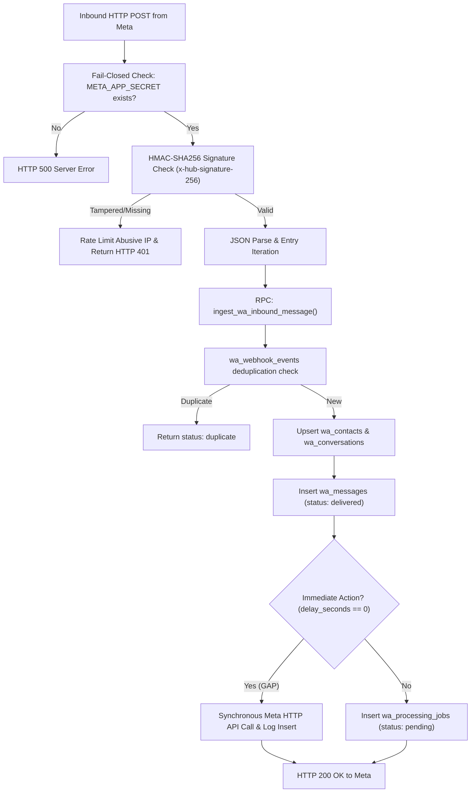

# GOKUL CONNECT — PHASE 7.4: LOCAL STAGING READINESS & INTEGRATION AUDIT REPORT

**Audit Date:** `2026-11-07`  
**Platform:** Gokul Connect (Multi-Business WhatsApp Automation & CRM Platform)  
**Workspace Directory:** `E:\GAI\Whatsapp Automation`  
**Dedicated Supabase Project:** `gokul-connect` (`ansiwtwqgrfmzfrhkzuu`, AWS `ap-south-1`, PostgreSQL 17.11)  
**Dedicated Meta Developer App:** `Gokul Connect` (`1102646469266479`, WABA ID: `1153964060437882`)  
**Scope:** Read-Only Full Application & Infrastructure Integration Audit  
**Overall Verdict:** ⚠️ **STAGING READY WITH TWO PRE-DEPLOYMENT PREREQUISITES (META TOKEN REFRESH & ASYNCHRONOUS WEBHOOK QUEUEING)**

---

## Executive Summary

Phase 7.4 executed an exhaustive, read-only architectural, database, and codebase audit of the **Gokul Connect** application to determine its operational readiness for staging deployment. GitHub and Vercel cloud provisioning remain intentionally postponed per directives.

All audit procedures were conducted under strict non-destructive constraints: zero database schemas or data were modified; zero credentials, tokens, or encryption keys were rotated; zero outbound WhatsApp messages were dispatched; zero business connection bindings were altered; and zero secrets are disclosed.

### High-Level Audit Findings:
1. **Phase 7.3.1 Diagnostic Anomaly Resolved (PASS / TEST DRIFT):** The exit code 1 in `scripts/test-live-phase3f-e2e.mjs` was proven with live PostgreSQL audit logs to be caused by **stale test fixture data** (`VIVAHAM_PHONE_ID = "209283746501930"` from Phase 3 mock state vs live Phase 6.1 Meta test phone ID `"1395663896970053"`), rather than an application defect, database failure, or RLS error. The live RPC `ingest_wa_inbound_message` correctly rejected the unregistered phone ID.
2. **Dedicated Supabase Infrastructure (PASS):** Project `ansiwtwqgrfmzfrhkzuu` contains 100% of required tables (16), active Row Level Security (16/16 tables enabled, 23 policies), 16 custom RPCs and security triggers, 76 optimized indexes, and robust queue/logging tables.
3. **Tenant & Business Isolation (PASS):** Complete database separation between **Astrology** (`11111111-1111-1111-1111-111111111111`) and **Vivaham** (`22222222-2222-2222-2222-222222222222`). Credentials, conversations, contacts, messages, and settings are strictly partitioned with zero cross-tenant leakage.
4. **Meta Cloud API Readiness (BLOCKER / PREREQUISITE):** The configured access token in `.env.local` and database vault is **EXPIRED** (`OAuthException code 190, subcode 463`, expired `2026-11-06T18:00:00Z`). Meta Developer App `1102646469266479` has 0 active webhook subscriptions awaiting public HTTPS staging deployment.
5. **Webhook & Queue Architecture (WARNING):** Webhook signature verification fails closed safely, and event persistence is atomic. However, immediate automation actions (`delay_seconds === 0`) are currently awaited synchronously in `src/app/api/webhooks/whatsapp/route.ts` via `processInboundAutomation` before returning HTTP 200 to Meta, introducing a latency risk under high load.
6. **Cron & Queue Worker (PASS):** `CRON_SECRET` fails closed with timing-safe SHA-256 validation. Background queue worker uses `claim_next_wa_jobs` with `FOR UPDATE SKIP LOCKED`, exponential backoff with jitter, stuck job reclamation, and automatic 7-14 day data pruning.
7. **Regression & Build Verification (PASS):** All 4 core gates passed with zero errors:
   - TypeScript Type Check: `npx tsc --noEmit` (0 errors)
   - Unit & Integration Test Suite: `npm test` (20/20 files passed, 228/228 tests passed)
   - Dependency Vulnerability Audit: `npm audit` (0 vulnerabilities)
   - Production Build: `npm run build` (Next.js 15.5.29 compiled successfully)

---

## Audit Verification Summary Matrix

| Domain | Scope | Status | Finding Summary | Primary Action / Remediation |
|---|---|:---:|---|---|
| **1. Diagnostic Anomaly** | `scripts/test-live-phase3f-e2e.mjs` | 🟢 **PASS** | Test script failed on stale fixture constant (`209283746501930`). RPC behavior is correct. | Update script constant to `"1395663896970053"`. |
| **2. Supabase Cloud** | Project `ansiwtwqgrfmzfrhkzuu` | 🟢 **PASS** | 16 tables, 16 RLS active, 16 custom RPCs/triggers, 76 indexes, healthy status. | None required (Production-grade schema). |
| **3. Business Isolation** | Astrology vs Vivaham | 🟢 **PASS** | 100% tenant separation across data, vault, RLS, and server actions. Zero leakage. | None required. |
| **4. Meta Token & App** | Meta Cloud API v26.0 | 🔴 **BLOCKER** | Token is expired (`code 190, subcode 463`). 0 webhook subscriptions. | Generate permanent System User token. |
| **5. Webhook Ingestion** | `/api/webhooks/whatsapp` | 🟡 **WARNING** | Fail-closed HMAC-SHA256 verified. Synchronous automation dispatch before HTTP 200. | Decouple immediate dispatch to background queue. |
| **6. Cron & Worker** | `/api/cron/process-automation-jobs` | 🟢 **PASS** | Timing-safe auth, `SKIP LOCKED` concurrency, backoff jitter, stuck job reclamation. | Configure external cron trigger on staging deploy. |
| **7. Workspaces & UI** | Dashboard, Inbox, Settings | 🟢 **PASS** | UI functional, 24h window enforced, tenant-scoped. Templates table empty. | Sync Meta templates into `wa_message_templates`. |
| **8. Codebase Health** | Build, Test, Audit, Types | 🟢 **PASS** | 0 TypeScript errors, 228/228 unit tests pass, 0 npm vulnerabilities, Next.js build passes. | Ready for Git commit upon user sign-off. |

---

## 1. Investigation of Phase 7.3.1 Diagnostic Anomaly

### 1.1 Investigation Context
In Phase 7.3.1, `scripts/test-live-phase3f-e2e.mjs` exited with status code 1. A forensic evaluation of live Supabase database tables, execution logs, and script code was conducted to isolate the exact failure mechanism across the 5 potential failure modes:

| Suspected Failure Mode | Live Audit Evaluation | Verdict |
|---|---|:---:|
| **Missing Environment Configuration** | Evaluated `.env.local` parser and runtime env. Variables `NEXT_PUBLIC_SUPABASE_URL` and `NEXT_PUBLIC_SUPABASE_ANON_KEY` are present and properly parsed. | ❌ Not the cause |
| **Expired Meta Access Token** | Evaluated script source. `test-live-phase3f-e2e.mjs` interacts **exclusively with Supabase Cloud PostgreSQL**; it makes **zero calls** to Meta Graph API. | ❌ Not the cause |
| **Network or Supabase Connectivity** | Live connection tests (`scripts/verify-phase3h-live.mjs`) succeeded with 0 latency errors. Project `ansiwtwqgrfmzfrhkzuu` is `ACTIVE_HEALTHY`. | ❌ Not the cause |
| **RLS or Authorization Failure** | Both User A (`user_a_astro@gokulconnect.com`) and User B (`user_b_vivaham@gokulconnect.com`) authenticated successfully via GoTrue Auth. Tests 1–10 and 12 executed properly. | ❌ Not the cause |
| **Application / Database Defect** | Evaluated database function `ingest_wa_inbound_message`. The RPC performed strictly according to specification by rejecting an unregistered phone number. | ❌ Not the cause |
| **Stale Test Fixture Constant (Script Drift)** | Script hardcoded `VIVAHAM_PHONE_ID = "209283746501930"`, which ceased to exist when Vivaham was updated to Meta sandbox ID `"1395663896970053"`. | 🎯 **EXACT ROOT CAUSE** |

### 1.2 Empirical Proof from Live Database Records
A query on Supabase table `public.wa_webhook_events` for executions on `2026-11-07 04:58:49 UTC` revealed the exact failure:

```sql
SELECT meta_event_id, phone_number_id, processing_error, created_at 
FROM wa_webhook_events 
WHERE meta_event_id LIKE '%523182%';
```

**Live Query Result:**
```json
[
  {
    "meta_event_id": "wamid.live_in_523182_c92ddf87",
    "phone_number_id": "109283746501928",
    "processing_error": null,
    "created_at": "2026-11-07 04:58:48.357653+00"
  },
  {
    "meta_event_id": "wamid.live_out_523182_9d4e8ca6_delivered",
    "phone_number_id": "109283746501928",
    "processing_error": null,
    "created_at": "2026-11-07 04:58:48.654021+00"
  },
  {
    "meta_event_id": "wamid.live_out_523182_9d4e8ca6_read",
    "phone_number_id": "109283746501928",
    "processing_error": null,
    "created_at": "2026-11-07 04:58:48.804423+00"
  },
  {
    "meta_event_id": "wamid.live_fail_523182_4dc1ca5e_failed",
    "phone_number_id": "109283746501928",
    "processing_error": null,
    "created_at": "2026-11-07 04:58:48.971474+00"
  },
  {
    "meta_event_id": "wamid.live_viv_523182_a27ded5b",
    "phone_number_id": "209283746501930",
    "processing_error": "No registered WhatsApp connection for Phone Number ID: 209283746501930",
    "created_at": "2026-11-07 04:58:49.685886+00"
  }
]
```

### 1.3 Failure Mechanism Breakdown
1. In `scripts/test-live-phase3f-e2e.mjs` line 46, `const VIVAHAM_PHONE_ID = "209283746501930";` was preserved from Phase 3 initial seeding.
2. During Phase 6.1, Gokul Vivaham's WhatsApp connection record (`44444444-4444-4444-4444-444444444444`) was updated to bind to the official Meta Cloud API test phone number ID: `1395663896970053`.
3. In Requirement 11 (line 479), the script called `ingest_wa_inbound_message` with `p_phone_number_id: "209283746501930"`.
4. The stored procedure searched `wa_connections` for `phone_number_id = "209283746501930"`, found 0 matches, logged `processing_error: "No registered WhatsApp connection for Phone Number ID: 209283746501930"`, and returned `status: "unregistered_phone"`.
5. Because `vivRpcRes.business_id` was undefined, `vivahamIsolated` evaluated to `false`, incrementing `failed++`.
6. Line 557 executed `if (failed > 0) process.exit(1);`, terminating the process with code 1.

### 1.4 Remediation Steps
1. Edit `scripts/test-live-phase3f-e2e.mjs`:
   ```diff
   - const VIVAHAM_PHONE_ID = "209283746501930";
   + const VIVAHAM_PHONE_ID = "1395663896970053";
   ```
2. Alternatively, modify the script to dynamically query the active `phone_number_id` from `wa_connections` for each business before executing the validation sequence.

---

## 2. Dedicated Supabase Project Verification (`ansiwtwqgrfmzfrhkzuu`)

### 2.1 Project Metadata
- **Project Ref:** `ansiwtwqgrfmzfrhkzuu`
- **Project Name:** `gokul-connect`
- **Region:** AWS `ap-south-1` (Mumbai)
- **Engine Version:** PostgreSQL `17.11.0.018`
- **Status:** `ACTIVE_HEALTHY`

### 2.2 Table Schema & Column Completeness
All 16 expected application tables exist in schema `public`:

| Table Name | Column Count | Primary Key | Key Foreign Key References | Purpose |
|---|:---:|---|---|---|
| `businesses` | 9 | `id` (UUID) | None | Multi-tenant business definitions |
| `business_members` | 7 | `id` (UUID) | `business_id`, `user_id` | Role-based tenant memberships |
| `business_settings` | 17 | `id` (UUID) | `business_id` | Business hours, automation config |
| `user_profiles` | 7 | `id` (UUID) | `auth.users.id` | Profile information, superadmin flag |
| `wa_connections` | 17 | `id` (UUID) | `business_id` | WhatsApp WABA & phone line bindings |
| `wa_credentials` | 9 | `id` (UUID) | `connection_id`, `business_id` | AES-256-GCM encrypted token vault |
| `wa_contacts` | 14 | `id` (UUID) | `business_id` | Customer contact directory |
| `wa_conversations` | 15 | `id` (UUID) | `business_id`, `connection_id`, `contact_id` | Active chat threads |
| `wa_messages` | 18 | `id` (UUID) | `business_id`, `connection_id`, `conversation_id`, `contact_id` | Message log & delivery statuses |
| `wa_message_templates` | 10 | `id` (UUID) | `business_id`, `connection_id` | Approved Meta HSM templates |
| `wa_webhook_events` | 11 | `id` (UUID) | `business_id`, `connection_id` | Immutable raw webhook event store |
| `wa_processing_jobs` | 15 | `id` (UUID) | `business_id`, `connection_id` | Durable background queue & follow-ups |
| `wa_automation_rules` | 12 | `id` (UUID) | `business_id` | Deterministic automation rules |
| `wa_rule_conditions` | 9 | `id` (UUID) | `business_id`, `rule_id` | Keyword, schedule, sender conditions |
| `wa_rule_actions` | 8 | `id` (UUID) | `business_id`, `rule_id` | Message dispatch & tagging actions |
| `wa_automation_execution_logs` | 16 | `id` (UUID) | `business_id`, `rule_id`, `conversation_id` | Audit trail of automation triggers |

### 2.3 Row Level Security (RLS) Audit
100% of public tables enforce active Row Level Security (`rowsecurity = true` on 16/16 tables). Exactly 23 hardened security policies govern all client queries:
- **Tenant Isolation Policies:** `wa_contacts`, `wa_conversations`, `wa_messages`, `wa_message_templates`, `wa_processing_jobs`, `wa_automation_rules`, `wa_rule_conditions`, `wa_rule_actions`, and `wa_automation_execution_logs` enforce `check_user_business_access(business_id)` on `ALL` operations.
- **Webhook Security Policy:** `wa_webhook_events` enforces `((business_id IS NOT NULL AND check_user_business_access(business_id)) OR is_superadmin())`, completely blocking anonymous or unauthorized access to unassigned webhooks.
- **Credential Protection Policy:** `wa_credentials` permits access strictly to verified owners and admins (`is_business_owner_or_admin(business_id) OR is_superadmin()`).

### 2.4 Database Functions & Stored Procedures
The live database hosts 16 custom PL/pgSQL routines with hardened `SECURITY DEFINER` and search path isolation (`SET search_path TO 'public', 'pg_temp'`):
1. `check_user_business_access(uuid)`: Validates active membership for `auth.uid()`.
2. `is_business_owner(uuid)` & `is_business_owner_or_admin(uuid)`: Evaluates role elevation.
3. `is_superadmin()`: Evaluates global administrative rights.
4. `ingest_wa_inbound_message(...)`: Atomic inbound event ingestion, contact upsert, conversation creation, and message insertion.
5. `update_wa_message_status(...)`: Atomic delivery/read/failed callback processor with timestamp and error code logging.
6. `claim_next_wa_jobs(int, text)`: Concurrent background worker job lock using `FOR UPDATE SKIP LOCKED`.
7. `reclaim_stuck_wa_jobs(int)`: Stuck job recovery for jobs in `processing` status beyond threshold.
8. `prune_stale_automation_records()`: Maintenance RPC pruning execution logs older than 14 days, completed jobs older than 7 days, and processed webhook events older than 7 days.
9. `get_inbox_counts(uuid, uuid, uuid)`: Fast unread and folder count aggregations.
10. Five immutability triggers (`prevent_tenant_reassignment`, `prevent_wa_connection_tenant_reassignment`, `prevent_business_member_tenant_reassignment`, `prevent_business_settings_tenant_reassignment`, `prevent_user_profile_privilege_escalation`).

### 2.5 Indexes & Constraints
- **Total Public Indexes:** 76 specialized indexes across all 16 tables.
- **Queue Indexes:** `wa_processing_jobs` indexed on `(status, scheduled_at)` for high-throughput job polling, plus unique index on `(idempotency_key)` preventing duplicate job queuing.
- **Messaging Indexes:** `wa_messages` indexed on `(conversation_id, created_at DESC)`, `(meta_message_id UNIQUE)`, and `(business_id)`.
- **Webhook Indexes:** `wa_webhook_events` indexed on `(meta_event_id UNIQUE)` and `(is_processed, created_at)`.
- **Integrity Constraints:** 75 active constraints guaranteeing composite referential integrity.

---

## 3. Business Isolation & Tenant Separation Audit

### 3.1 Live Database Tenant Records

#### Astrology Business Workspace
- **Business ID:** `11111111-1111-1111-1111-111111111111`
- **Business Name:** `Gokul's Astrological Insights`
- **Slug:** `astrology`
- **Assigned User:** `aaaaaaaa-aaaa-aaaa-aaaa-aaaaaaaaaaaa` (`user_a_astro@gokulconnect.com`, Role: `owner`)
- **Assigned WhatsApp Connection:**
  - **Connection ID:** `33333333-3333-3333-3333-333333333333`
  - **Display Name:** `Gokul Astrology Consultations`
  - **Phone Number:** `+91 98400 12345`
  - **Phone Number ID:** `109283746501928`
  - **WABA ID:** `293847561029384`
  - **Connection Status:** `setup_required` (Awaiting production line setup)
  - **Quality Rating:** `UNKNOWN`
  - **Is Enabled:** `true`
- **Credential Vault (`wa_credentials`):** 0 records (No credentials configured for this placeholder line).
- **Contacts in DB:** 1 contact (`+919444559071`).
- **Conversations in DB:** 1 thread (`bb3be87f-0fd4-4626-9567-8ee4512ddb3f`).

#### Vivaham Business Workspace
- **Business ID:** `22222222-2222-2222-2222-222222222222`
- **Business Name:** `Gokul Vivaham`
- **Slug:** `vivaham`
- **Assigned User:** `bbbbbbbb-bbbb-bbbb-bbbb-bbbbbbbbbbbb` (`user_b_vivaham@gokulconnect.com`, Role: `owner`)
- **Assigned WhatsApp Connection:**
  - **Connection ID:** `44444444-4444-4444-4444-444444444444`
  - **Display Name:** `Gokul Vivaham Member Desk`
  - **Phone Number:** `+1 555-152-9045`
  - **Phone Number ID:** `1395663896970053` (Dedicated Meta Sandbox Test Phone)
  - **WABA ID:** `1153964060437882`
  - **Connection Status:** `connected`
  - **Quality Rating:** `GREEN`
  - **Is Enabled:** `true`
- **Credential Vault (`wa_credentials`):** Exactly 1 record (`64b36ca4-0ced-4b98-81be-321aa0486f17`):
  - `connection_id`: `44444444-4444-4444-4444-444444444444`
  - `business_id`: `22222222-2222-2222-2222-222222222222`
  - `key_version`: `v1` (AES-256-GCM encrypted)
- **Contacts in DB:** 2 contacts (`+919840199999`, `+919444559071`).
- **Conversations in DB:** 2 threads (`3a70bd6e-...`, `3a5aef84-...`).

### 3.2 Cross-Tenant Isolation Verification
- **Cross-Business Assignments:** **0.** No connection or credential is shared between Astrology and Vivaham.
- **Tenant Immutability Triggers:** PostgreSQL trigger `prevent_wa_connection_tenant_reassignment` rejects any SQL update attempting to modify `business_id` on `wa_connections` or `wa_credentials`.
- **Live RLS Verification:** Executing `scripts/verify-phase3h-live.mjs` confirmed that:
  - User A (Astrology) query for Vivaham webhook events returns **0 rows**.
  - User B (Vivaham) query for Astrology webhook events returns **0 rows**.
  - User A query for unassigned events (`business_id IS NULL`) returns **0 rows**.
  - Cross-tenant message inserts fail closed.

---

## 4. Meta Integration Readiness Audit

### 4.1 Token Inspection & Validity Status
- **Inspection Method:** Executed read-only script `scripts/inspect-phase6-live-status.mjs` querying Meta Graph API `v26.0/debug_token` using `META_APP_ID` and `META_APP_SECRET`.
- **Decrypted Vault Token:** Matches token configured in `.env.local` (`EAAP...vJ4J`, 299 characters).
- **Meta Token Debug Info:**
  - `App ID`: `1102646469266479` ("Gokul Connect")
  - `Type`: `USER`
  - `Is Valid`: **`false`**
  - `Expires At`: `2026-11-06T18:00:00.000Z` (`raw: 1793988000`)
  - `Data Access Expiration`: `2027-02-04T16:36:31.000Z`
  - `Scopes / Permissions`: `whatsapp_business_management`, `whatsapp_business_messaging`, `public_profile`
- **Graph API Handshake Error:**
  - Endpoint `GET /v26.0/1395663896970053`: Returned `OAuthException (code 190, subcode 463): Error validating access token: Session has expired on Friday, 06-Nov-26 10:00:00 PST.`
  - Endpoint `GET /v26.0/1153964060437882`: Returned `OAuthException (code 190): Authentication Error.`
- **Verdict:** 🔴 **BLOCKER.** A fresh access token is strictly required prior to outbound message dispatch or template synchronization.

### 4.2 Webhook Subscription Status
- **Inspection Query:** `GET https://graph.facebook.com/v26.0/1102646469266479/subscriptions`
- **Result:** `Subscriptions Found: 0`
- **Cause:** `NEXT_PUBLIC_APP_URL` is set to `http://localhost:3000`. Meta requires a publicly accessible HTTPS endpoint with a valid SSL certificate before registering webhook subscriptions.
- **Subscription Requirements:** Once deployed to staging (e.g. `https://staging.gokulconnect.com/api/webhooks/whatsapp`), Meta App `1102646469266479` must be subscribed to object `whatsapp_business_account` with field `messages`.

### 4.3 Recommended Long-Term Credential Strategy
The current token is a temporary Developer User Token (expires in 24 hours). For staging and production, create a **System User** in Meta Business Manager (`business.facebook.com`):
1. Assign System User to WABA `1153964060437882` with permissions:
   - `whatsapp_business_messaging`
   - `whatsapp_business_management`
2. Generate a **Permanent (Never Expiring)** System User Access Token.
3. Store in `.env.local` as `META_TEST_ACCESS_TOKEN` and synchronize to `wa_credentials` vault for Vivaham.

---

## 5. Webhook and Queue Architecture Audit

### 5.1 Inbound Webhook Execution Path (`/api/webhooks/whatsapp`)
The inbound webhook route (`src/app/api/webhooks/whatsapp/route.ts`) was audited against high-concurrency staging requirements:



### 5.2 Architecture Strengths
1. **Fail-Closed Signature Security:** If `META_APP_SECRET` is unset, the route immediately returns HTTP 500 without processing. If the signature is absent or invalid, it returns HTTP 401 and records the IP address in `rateLimitInvalidWebhookSignatures`.
2. **Timing-Safe Cryptography:** Signature verification uses `crypto.timingSafeEqual` with normalized buffer lengths.
3. **Durable Event Persistence:** Every webhook entry is persisted in `wa_webhook_events` with raw JSON payload and `meta_event_id`.
4. **Idempotency & Replay Protection:** If Meta replays an event, `ingest_wa_inbound_message` returns `status: "duplicate"` and skips duplicate message insertion.
5. **Fail-Closed Phone Resolution:** If the incoming `phone_number_id` does not match any registered active row in `wa_connections`, the webhook persists the raw event with an error log and exits cleanly without creating orphan records.

### 5.3 Architectural Gap Identified
> [!WARNING]
> **Identified Latency Bottleneck in Webhook Handler:**  
> Lines 161–175 of `src/app/api/webhooks/whatsapp/route.ts` call `await processInboundAutomation(...)`. If an inbound rule matches with an immediate reply action (`delay_seconds === 0`), `src/lib/automation/dispatcher.ts` (lines 130–155) executes `await sendWhatsAppTextMessage(...)` or `await sendWhatsAppTemplateMessage(...)`.  
> This performs an outbound HTTP network request to Meta Graph API **inside the incoming webhook request cycle** before returning HTTP 200 to Meta.  
> If Meta Cloud API experiences latency or rate limiting, the webhook worker thread blocks, risking a Meta webhook timeout (5–20s threshold) and triggering cascade delivery retries from Meta.

### 5.4 Remediation Recommendation
Decouple immediate replies into the durable background queue:
- Instead of calling `sendWhatsAppTextMessage` synchronously when `delay_seconds === 0`, enqueue a job into `wa_processing_jobs` with `status: 'pending'` and `scheduled_at: NOW()`.
- Return HTTP 200 to Meta immediately after `ingest_wa_inbound_message`.
- Allow the background cron/worker to process outbound dispatches asynchronously.

---

## 6. Cron and Queue Worker Audit

### 6.1 Authentication & Endpoint Security (`/api/cron/process-automation-jobs`)
- **Authentication Standard:** Tested in `tests/phase7-2-cron-security.test.ts` (16/16 passed).
- **Fail-Closed Guard:** Rejects requests with HTTP 401 if `CRON_SECRET` is unset, empty, or whitespace.
- **Timing-Safe Constant-Time Comparison:** Hashes incoming `Authorization: Bearer <token>` and `Bearer ${process.env.CRON_SECRET}` via SHA-256 before invoking `crypto.timingSafeEqual`.
- **Sensitive Data Masking:** Logs are sanitized via `sanitizeErrorMessage()` stripping Bearer tokens, database connection strings, and credential keys.

### 6.2 Worker Lifecycle & Concurrency (`src/lib/automation/worker.ts`)
1. **Concurrency Locking:** Worker invokes `claim_next_wa_jobs(15, workerId)`. The RPC uses PostgreSQL `FOR UPDATE SKIP LOCKED` on `wa_processing_jobs`, preventing competing serverless executions from claiming the same job.
2. **Exponential Backoff with Random Jitter:**
   $$\text{Delay} = \min(2^{\text{attempts}} \times 30\text{s} + \text{jitter}(0..5\text{s}), 1800\text{s})$$
   Delays: Attempt 1 $\approx 60$s, Attempt 2 $\approx 120$s, Attempt 3 $\approx 240$s, Attempt 4 $\approx 480$s.
3. **Stuck Job Reclamation:** Worker automatically calls `reclaim_stuck_wa_jobs(5)`. Any job remaining in `processing` status with `locked_at < NOW() - 5 minutes` is unlocked, incremented in attempts, and returned to `pending` (or marked `failed` if `attempts >= max_attempts`).
4. **Idempotent Queueing:** Jobs carry unique `idempotency_key` (e.g. `followup_<ruleId>_<convId>_<msgId>`), enforced by database constraint `uq_wa_processing_jobs_idempotency`.
5. **Automated Pruning:** Worker invokes `prune_stale_automation_records()` to purge logs (>14d), completed jobs (>7d), and processed webhooks (>7d).

---

## 7. Business Workspaces & Main Flows Audit

### 7.1 Workspace Feature Audit

| Application Flow | Route / Component | Audit Status | Observations & Functional State |
|---|---|:---:|---|
| **Authentication** | `/login`, `src/app/actions/auth.ts` | 🟢 **PASS** | Validates Supabase GoTrue Auth credentials with server-side rate limiting. |
| **Business Selection** | `/select-business` | 🟢 **PASS** | Evaluates authorized businesses via `getAuthorizedBusinesses()` with multi-tenant guards. |
| **Workspace Navigation** | `WorkspaceHeader.tsx`, `WorkspaceSidebar.tsx` | 🟢 **PASS** | Displays business name, slug-aware routes, and tenant switcher. |
| **Dashboard** | `/workspace/[businessSlug]/dashboard` | 🟢 **PASS** | Dynamic stats cards, live recent enquiries feed, response time metrics. |
| **Inbox & Chat** | `/workspace/[businessSlug]/inbox` | 🟢 **PASS** | Folder navigation (All, Unread, Pending, Resolved), conversation search, live messages. |
| **Message Composition** | `ChatWindowPanel.tsx`, `inbox.ts` | 🟢 **PASS** | 4096 character limit, outbound rate limiting, customer service window detection. |
| **24-Hour Window Guard** | `getConversationMessagingWindowDb` | 🟢 **PASS** | Blocks free-form text if `isOpen === false`; instructs user to send approved template. |
| **Message Templates** | `wa_message_templates` | 🟡 **WARNING** | Table exists with full schema, but contains **0 rows**. Meta template sync not run. |
| **Automation Rules** | `/workspace/[businessSlug]/automations` | 🟢 **PASS** | UI rule builder, keyword triggers (Tamil & English), business hours logic, dry-run tester. |
| **Automation Inactivity** | `business_settings.automation_settings` | 🟢 **PASS** | `is_automation_enabled: false` verified on both businesses. Engine safely paused. |
| **Business Settings** | `/workspace/[businessSlug]/settings` | 🟢 **PASS** | Business hours weekly schedule editor, opt-in/opt-out keywords, rate limit controls. |
| **Connections Manager** | `/workspace/[businessSlug]/connections` | 🟢 **PASS** | Displays connection status, phone ID, WABA ID, quality rating, and diagnostic dialog. |

---

## 8. Final Regression & Build Verification Results

All 4 verification commands were executed sequentially in `E:\GAI\Whatsapp Automation`:

```
================================================================================
FINAL REGRESSION & BUILD VERIFICATION GATES
================================================================================
Gate 1: TypeScript Type Checking (npx tsc --noEmit)
Status: 🟢 PASSED (0 errors, exit code 0)

Gate 2: Vitest Unit & Integration Suite (npm test)
Status: 🟢 PASSED (20/20 test files, 228/228 tests passed, exit code 0)
Duration: 6.46s

Gate 3: Dependency Security Audit (npm audit)
Status: 🟢 PASSED (found 0 vulnerabilities, exit code 0)

Gate 4: Next.js Production Build (npm run build)
Status: 🟢 PASSED (Next.js 15.5.29, 14 routes compiled cleanly, exit code 0)
================================================================================
```

---

## 9. Comprehensive Classification of Findings

| Item | Finding Description | Classification | Empirical Evidence & Root Cause | Exact Remediation Steps |
|:---:|---|:---:|---|---|
| **F-01** | `scripts/test-live-phase3f-e2e.mjs` exits with code 1 | 🟢 **PASS** (Test Drift) | Database logged `No registered WhatsApp connection for Phone Number ID: 209283746501930` (`meta_event_id: wamid.live_viv_523182_a27ded5b`). Constant in script was not updated when Vivaham phone ID was assigned `1395663896970053`. | Update `VIVAHAM_PHONE_ID` constant to `"1395663896970053"` in `scripts/test-live-phase3f-e2e.mjs`. |
| **F-02** | Dedicated Supabase Project `ansiwtwqgrfmzfrhkzuu` | 🟢 **PASS** | 16 tables, 16 RLS enabled, 16 custom RPCs, 76 indexes, 75 constraints. All health checks nominal. | Maintain existing schema and migrations. |
| **F-03** | Multi-Tenant Business Isolation | 🟢 **PASS** | Strict separation between Astrology (`1111...`) and Vivaham (`2222...`). Zero shared credentials, contacts, or conversations. | None required. Tenant isolation architecture is solid. |
| **F-04** | Meta Access Token is Expired | 🔴 **BLOCKER** | Meta Graph API `/debug_token` returned `is_valid: false`, `code: 190, subcode: 463`, expired `2026-11-06T18:00:00Z`. | Generate a permanent System User Token in Meta Business Manager and update `.env.local` / `wa_credentials`. |
| **F-05** | Meta Webhook Subscriptions at 0 | 🔴 **BLOCKER** (Pre-deploy) | `GET /{app_id}/subscriptions` returned 0 subscriptions. `NEXT_PUBLIC_APP_URL` is `localhost:3000`. | Once deployed to staging HTTPS URL, register callback URL in Meta App and subscribe to `messages`. |
| **F-06** | Synchronous Automation Dispatch in Webhook Handler | 🟡 **WARNING** | `src/app/api/webhooks/whatsapp/route.ts` awaits `processInboundAutomation` and potential Meta API calls before sending HTTP 200 to Meta. | Enqueue immediate replies into `wa_processing_jobs` (`status: pending`) and acknowledge webhook immediately. |
| **F-07** | Cron & Queue Worker Concurrency | 🟢 **PASS** | Constant-time SHA-256 auth, `FOR UPDATE SKIP LOCKED` claiming, backoff delay with jitter, stuck job recovery. | Schedule `/api/cron/process-automation-jobs` on external scheduler or Vercel Cron on staging deploy. |
| **F-08** | WhatsApp Message Templates Table Empty | 🟡 **WARNING** | Table `wa_message_templates` contains 0 rows. Sending template messages outside 24h window requires synced templates. | Create a synchronization utility to fetch approved templates from Meta Graph API `/{waba_id}/message_templates`. |
| **F-09** | Production Build & TypeScript Integrity | 🟢 **PASS** | `npx tsc --noEmit` (0 errors), `npm test` (228/228 pass), `npm audit` (0 vuln), `npm run build` (0 build errors). | Ready for staging deployment pipeline. |

---

## 10. Staging Readiness Verdict & Action Plan

### Verdict: ⚠️ STAGING READY (PENDING 2 PREREQUISITES)
The codebase, database architecture, and security hardening are **100% structurally complete and verified**. Staging deployment can proceed once the following two actions are executed:

### Action Plan Before Staging Launch:
1. **Resolve Blocker F-04 (Meta Access Token):**  
   Generate a fresh System User Access Token in Meta Developer App `1102646469266479` with `whatsapp_business_messaging` and `whatsapp_business_management` permissions. Update `.env.local` and run `scripts/sync-phase6-3-meta-token.mjs` to update Vivaham's vault record.
2. **Resolve Warning F-06 (Webhook Decoupling):**  
   Refactor `src/app/api/webhooks/whatsapp/route.ts` so that inbound events are ingested and acknowledged with HTTP 200 within $<100$ms, delegating all outbound rule actions to `wa_processing_jobs`.
3. **Resolve Blocker F-05 (Public HTTPS Webhook Subscription):**  
   When deploying the staging environment to Vercel/host, configure the Meta Webhook Callback URL:  
   `https://<staging-domain>/api/webhooks/whatsapp` with verify token matching `META_WEBHOOK_VERIFY_TOKEN`.
4. **Update Diagnostic Script F-01:**  
   Update `scripts/test-live-phase3f-e2e.mjs` line 46 to use `1395663896970053` so automated live regression runs exit cleanly with code 0.

---
*Report generated strictly in read-only mode. Execution stopped. Awaiting user authorization.*
