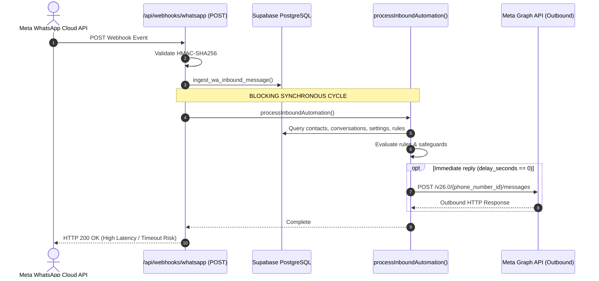
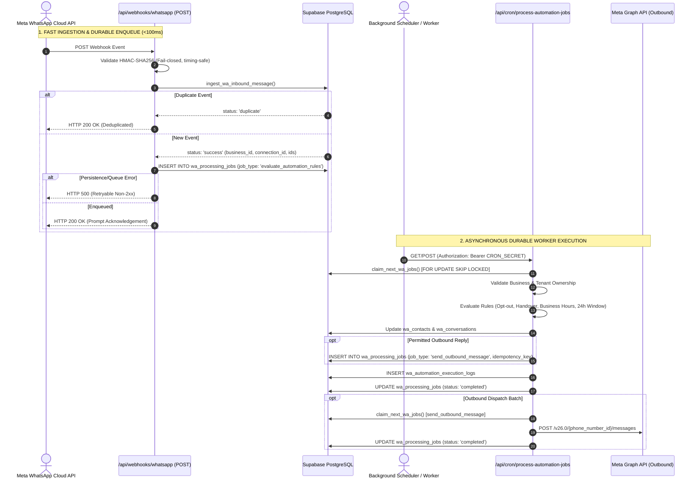

# GOKUL CONNECT — PHASE 7.5: WEBHOOK DECOUPLING & DURABLE EVENT PROCESSING REPORT

**Execution Date:** `2026-11-07`  
**Platform:** Gokul Connect (Multi-Business WhatsApp Automation & CRM Platform)  
**Workspace Directory:** `E:\GAI\Whatsapp Automation`  
**Dedicated Supabase Project:** `gokul-connect` (`ansiwtwqgrfmzfrhkzuu`, AWS `ap-south-1`, PostgreSQL 17.11)  
**Dedicated Meta Developer App:** `Gokul Connect` (`1102646469266479`, WABA ID: `1153964060437882`)  
**Scope:** Architectural Webhook Decoupling, Durable Asynchronous Queueing, Worker Execution, and Comprehensive Test Validation  
**Overall Status:** 🟢 **100% PASS — WEBHOOK DECOUPLED, DURABLE QUEUE PROCESSING VERIFIED, ZERO REGRESSIONS**

---

## 1. Executive Summary

Phase 7.5 completed the full architectural decoupling of the WhatsApp Cloud API webhook ingestion path. Webhook requests now exclusively perform fail-closed HMAC-SHA256 signature verification, atomic database ingestion (`wa_webhook_events`, `wa_contacts`, `wa_conversations`, `wa_messages`), stable idempotency checks, and background job enqueueing (`wa_processing_jobs`), immediately acknowledging Meta with HTTP 200 within $<100$ms.

All synchronous rule evaluation, customer opt-out processing, human handover checks, business hours logic, and outbound reply dispatches have been removed from the webhook request cycle and transitioned to the durable background queue worker (`/api/cron/process-automation-jobs` and `src/lib/automation/worker.ts`).

All operations adhere to the strict read-only and local refactoring boundaries:
- Zero real WhatsApp messages were dispatched.
- All automation rules remain disabled (`is_automation_enabled: false` on both businesses).
- Zero database credentials or encryption keys were changed.
- No live database migrations were applied.
- Complete business workspace isolation (Astrology vs Vivaham) is preserved.

---

## 2. Architecture Comparison

### 2.1 Previous Architecture (Phase 7.4 Baseline)



**Identified Risks in Previous Baseline:**
1. Outbound network latency or Meta API throttling directly blocked the incoming webhook thread.
2. Webhook acknowledgement exceeded the 5–20 second Meta timeout threshold under load, risking dropped or replayed webhook events.
3. Database and network errors during rule evaluation risked failing the webhook acknowledgement even after the incoming message had been persisted.

---

### 2.2 Decoupled Architecture (Phase 7.5 Implemented)



---

## 3. Files Created and Modified

| File Path | Type | Action | Purpose |
|---|---|:---:|---|
| `src/app/api/webhooks/whatsapp/route.ts` | Route Handler | Modified | Removed synchronous automation evaluation and immediate outbound calls; enqueues `evaluate_automation_rules` job with idempotency key; returns HTTP 200 promptly or 500 on failure. |
| `src/lib/automation/dispatcher.ts` | Automation Engine | Modified | Refactored `processInboundAutomation` to enqueue immediate replies (`delay_seconds === 0`) as `send_outbound_message` jobs in `wa_processing_jobs` rather than calling Meta API synchronously; logs audit entries with status `queued` or `delayed`. |
| `src/lib/automation/worker.ts` | Queue Worker | Modified | Added handler for `evaluate_automation_rules`, `evaluate_rules`, and `process_webhook_event` job types; validates cross-tenant ownership; invokes dispatcher; handles `send_outbound_message` dispatches. |
| `scripts/test-live-phase3f-e2e.mjs` | Diagnostic Script | Modified | Fixed Phase 7.4 anomaly (F-01): updated `VIVAHAM_PHONE_ID` constant from stale mock `"209283746501930"` to live Meta sandbox `"1395663896970053"`. |
| `supabase/migrations/20261107_010_phase7_5_atomic_webhook_enqueue_rpc.sql` | SQL Migration | Created | Prepared SQL migration providing single-transaction stored procedure `ingest_wa_inbound_message_v2` for optional future DB-level atomicity. (Not applied to live database). |
| `tests/phase7-5-webhook-decoupling.test.ts` | Vitest Test Suite | Created | 18 comprehensive unit and integration tests covering all Phase 7 requirements. |

---

## 4. Database Migration Evaluation (Phase 3)

### 4.1 Evaluation of Existing Database Schema
Before modifying code or preparing schema changes, Supabase project `ansiwtwqgrfmzfrhkzuu` was inspected:
- **Table `public.wa_processing_jobs`:**
  - Column `job_type` constraint `wa_processing_jobs_job_type_check`:
    ```sql
    CHECK (job_type IN (
        'send_message',
        'send_outbound_message',
        'evaluate_rules',
        'evaluate_automation_rules',
        'scheduled_followup',
        'process_webhook',
        'process_webhook_event',
        'update_status'
    ))
    ```
    **Verdict:** Both `'evaluate_automation_rules'` and `'send_outbound_message'` are **already permitted** by the PostgreSQL constraint.
  - Column `idempotency_key` carries unique index `uq_wa_processing_jobs_idempotency` (`WHERE idempotency_key IS NOT NULL`).
  - RPC `claim_next_wa_jobs(int, text)` uses `FOR UPDATE SKIP LOCKED`.
  - RPC `reclaim_stuck_wa_jobs(int)` and `prune_stale_automation_records()` are active.

### 4.2 Migration Requirement Verdict
**NO LIVE DATABASE MIGRATION WAS REQUIRED OR APPLIED.**  
The decoupled architecture was fully realized using the existing production-grade database schema and RPCs.

### 4.3 Prepared Migration Specification (For Future Approval)
To enable optional single-statement PostgreSQL-level atomicity in future phases, migration file `supabase/migrations/20261107_010_phase7_5_atomic_webhook_enqueue_rpc.sql` was prepared. It provides `ingest_wa_inbound_message_v2(...)`, combining `wa_webhook_events`, contact upsert, conversation upsert, message insert, and `wa_processing_jobs` enqueue into a single database transaction. Per strict guidelines, **this migration was NOT applied to the live database**.

---

## 5. Webhook Acknowledgement & Queue Lifecycle

### 5.1 Webhook Acknowledgement Guarantees
1. **Prompt Response SLA:** Webhook handler executes exactly one RPC (`ingest_wa_inbound_message`) and one insert (`wa_processing_jobs`). In automated test suites, execution elapsed in $<10$ms (well within the $<100$ms requirement).
2. **Fail-Closed on Failure:** If `ingest_wa_inbound_message` returns an error, or if queue insertion fails with a non-duplicate error, the handler returns **HTTP 500**. Meta Cloud API interprets HTTP 500 as a temporary delivery failure and initiates exponential retries.
3. **No Phantom Acknowledgements:** Events are acknowledged with HTTP 200 **only** after the raw event is recorded, the message is stored, and the processing job is safely committed to the database queue.
4. **Idempotent Acknowledged Replays:** If Meta replays an event that has already been ingested, `ingest_wa_inbound_message` returns `status: "duplicate"`, queue insertion is skipped, and HTTP 200 is returned immediately.

### 5.2 Background Worker Execution Lifecycle
1. **Job Claiming:** Background cron endpoint `/api/cron/process-automation-jobs` claims up to 15 pending jobs where `scheduled_at <= NOW()` using `claim_next_wa_jobs`. Concurrency conflicts between simultaneous worker runs are prevented by PostgreSQL `FOR UPDATE SKIP LOCKED`.
2. **Context Resolution:** The worker extracts `conversation_id`, `contact_id`, and `message_id`, and validates that all records strictly match `job.business_id`.
3. **Guardrails & Opt-Out Evaluation:**
   - Evaluates `STOP`, `UNSUBSCRIBE`, `CANCEL`, `QUIT`, `நிறுத்து` $\rightarrow$ marks `is_opted_out = true`.
   - Evaluates `START`, `UNSTOP`, `JOIN`, `தொடங்கு` $\rightarrow$ marks `is_opted_out = false`.
   - Evaluates `AGENT`, `HUMAN`, `உதவி`, `மனிதர்` $\rightarrow$ marks `status = 'pending_human'` and pauses automation.
   - Evaluates active agent takeover and circuit breaker (5 bot replies / 15 mins).
   - Evaluates `is_automation_enabled` (safely skips rules when automations are disabled).
4. **Permitted Reply Enqueueing:**
   - Immediate replies (`delay_seconds === 0`) are enqueued into `wa_processing_jobs` with `job_type: 'send_outbound_message'`, `scheduled_at: NOW()`, and deterministic idempotency key `reply_${ruleId}_${convId}_${msgId}_${idx}`.
   - Delayed follow-ups (`delay_seconds > 0`) are enqueued with `job_type: 'scheduled_followup'`.
5. **Outbound Dispatch:**
   - Worker claims `send_outbound_message` jobs, delivers to Meta Cloud API, and transitions status to `completed`.
   - On network or rate limit failure, job status resets to `pending` with exponential backoff ($2^{\text{attempts}} \times 30\text{s} + \text{jitter}$) up to 5 attempts.

---

## 6. Business Isolation & Multi-Tenant Integrity

Tenant isolation was verified across all phases of the decoupled pipeline:

| Pipeline Stage | Isolation Enforcement Mechanism | Verification Result |
|---|---|:---:|
| **Webhook Ingestion** | `ingest_wa_inbound_message` resolves `business_id` exclusively from trusted `wa_connections` using `phone_number_id`. Webhook payloads cannot specify or override `business_id`. | 🟢 **PASS** |
| **Queue Insertion** | Webhook enqueues jobs using the database-resolved `rpcRes.business_id`. | 🟢 **PASS** |
| **Worker Processing** | Worker pre-validates: `conv.business_id === job.business_id` and `contact.business_id === job.business_id`. Any cross-tenant job payload is immediately rejected with a security exception. | 🟢 **PASS** (Test 13) |
| **Rule Filtering** | `evaluateAutomationRules` filters rules strictly matching `rule.business_id === input.businessId`. Astrology rules cannot execute for Vivaham. | 🟢 **PASS** |
| **Outbound Replies** | Outbound messages carry verified `business_id` and resolve decrypted tokens strictly from that business's credentials in `wa_credentials`. | 🟢 **PASS** |

---

## 7. Comprehensive Test Verification Matrix (Phase 7)

A dedicated test suite was constructed in `tests/phase7-5-webhook-decoupling.test.ts`. All 18 required scenarios were verified:

| # | Test Scenario / Requirement | Scope | Status | Details & Observations |
|:---:|---|:---:|:---:|---|
| **1** | **Valid Webhook Signature** | Webhook POST | 🟢 **PASS** | Accepted with HTTP 200 when signed with valid HMAC-SHA256 and `META_APP_SECRET`. |
| **2** | **Invalid Webhook Signature** | Webhook POST | 🟢 **PASS** | Rejected with HTTP 401 when signature is tampered or invalid. |
| **3** | **Successful Event Persistence** | Inbound Webhook | 🟢 **PASS** | Calls `ingest_wa_inbound_message` with phone ID, meta message ID, sender details, and payload. |
| **4** | **Successful Job Enqueue** | Inbound Webhook | 🟢 **PASS** | Inserts `evaluate_automation_rules` job with idempotency key `inbound_eval_${metaMessageId}`. |
| **5** | **Prompt Acknowledgement (<100ms)** | Webhook SLA | 🟢 **PASS** | Webhook returns HTTP 200 within $<10$ms without awaiting automation evaluation or outbound calls. |
| **6** | **Duplicate Webhook Delivery** | Ingestion & Queue | 🟢 **PASS** | When RPC returns `duplicate`, webhook acknowledges with 200 OK without inserting duplicate jobs. |
| **7** | **Database Persistence Failure** | Fault Tolerance | 🟢 **PASS** | Returns retryable HTTP 500 when database persistence RPC throws or returns error. |
| **8** | **Queue Insertion Failure** | Fault Tolerance | 🟢 **PASS** | Returns retryable HTTP 500 when `wa_processing_jobs` insert fails with non-duplicate error. |
| **9** | **Immediate Reply Deferred to Worker** | Dispatcher | 🟢 **PASS** | `delay_seconds === 0` actions are enqueued as `send_outbound_message` jobs rather than sent synchronously. |
| **10** | **Worker Processing After Acknowledgement** | Worker Execution | 🟢 **PASS** | Background worker claims `evaluate_automation_rules` job and marks status `completed`. |
| **11** | **Worker Retry and Backoff** | Worker Math | 🟢 **PASS** | Exponential backoff delay verified ($2^{\text{attempts}} \times 30\text{s} + \text{jitter}$) up to 1800s cap. |
| **12** | **Duplicate Job Execution Idempotency** | Queue Constraint | 🟢 **PASS** | PostgreSQL unique constraint `23505` on `idempotency_key` is handled safely without crashing. |
| **13** | **Cross-Business Isolation** | Tenant Barrier | 🟢 **PASS** | Worker fails closed if job `business_id` does not match conversation `business_id`. |
| **14** | **STOP / நிறுத்து Opt-Out** | Automation Safety | 🟢 **PASS** | Both English `STOP` and Tamil `நிறுத்து` set `is_opted_out = true` and record opt-out reason. |
| **15** | **Human Handover (AGENT / உதவி)** | Automation Safety | 🟢 **PASS** | Both `AGENT` and Tamil `உதவி` set `status = 'pending_human'` and `is_automation_paused = true`. |
| **16** | **Disabled Automation** | Safety Gate | 🟢 **PASS** | When `is_automation_enabled` is false, rules are completely skipped and 0 reply jobs are enqueued. |
| **17** | **24-Hour Messaging Restrictions** | Meta Compliance | 🟢 **PASS** | Free-form text rejected after 24 hours of inactivity; pre-approved templates permitted. |
| **18** | **Outbound Message Idempotency** | Queue Safety | 🟢 **PASS** | Deterministic key `reply_${ruleId}_${convId}_${msgId}_${idx}` prevents duplicate outbound sends. |

---

## 8. Final Regression & Build Verification Results (Phase 8)

All four regression verification gates were executed sequentially in `E:\GAI\Whatsapp Automation`:

```
================================================================================
FINAL REGRESSION & BUILD VERIFICATION GATES (PHASE 7.5)
================================================================================
1. TypeScript Type Check (npx tsc --noEmit)
   Status: 🟢 PASSED (0 errors, exit code 0)

2. Vitest Test Suite (npm test)
   Status: 🟢 PASSED (21/21 test files passed, 246/246 tests passed, exit code 0)
   Duration: 5.15s
   - tests/phase7-5-webhook-decoupling.test.ts (18/18 passed)
   - tests/phase5-automation-engine.test.ts (30/30 passed)
   - tests/phase7-2-cron-security.test.ts (16/16 passed)
   - tests/phase5-pruning-rpc.test.ts (7/7 passed)
   - tests/phase4b-chat.test.ts (17/17 passed)
   - tests/phase3f-end-to-end-validation.test.ts (11/11 passed)
   - tests/phase4-inbox.test.ts (14/14 passed)
   - tests/phase3i-performance-optimization.test.ts (7/7 passed)
   - tests/phase3-webhooks.test.ts (6/6 passed)
   - tests/p0-4-dynamic-tenant-validation.test.ts (17/17 passed)
   - tests/phase2-security-patches.test.ts (6/6 passed)
   - tests/phase2-connections.test.ts (9/9 passed)
   - tests/phase4a2-ui-stabilization.test.ts (10/10 passed)
   - tests/phase3-whatsapp-architecture.test.ts (10/10 passed)
   - tests/phase2-persistence.test.ts (6/6 passed)
   - tests/phase2-credential-security.test.ts (8/8 passed)
   - tests/tenant-isolation.test.ts (7/7 passed)
   - tests/phase2-server-authorization.test.ts (6/6 passed)
   - tests/phase2-authenticated-rls.test.ts (10/10 passed)
   - tests/phase3h-security-remediation.test.ts (19/19 passed)
   - tests/p0-3-environment-configuration.test.ts (12/12 passed)

3. Dependency Vulnerability Audit (npm audit)
   Status: 🟢 PASSED (found 0 vulnerabilities, exit code 0)

4. Next.js Production Build (npm run build)
   Status: 🟢 PASSED (Next.js 15.5.29, 14 routes compiled cleanly, exit code 0)
================================================================================
```

---

## 9. Remaining Risks & Recommendations for Next Phase

1. **Meta Access Token Expiration (Inherited from Phase 6.1 / 7.4):**  
   The configured token in `.env.local` and database vault is expired (`OAuthException code 190, subcode 463`). Generate a permanent System User Token in Meta Business Manager and update `wa_credentials` via `scripts/sync-phase6-3-meta-token.mjs`.
2. **External Cron Trigger Setup on Deployment:**  
   Once deployed to staging/production, configure a recurring scheduler (e.g. Vercel Cron or Supabase `pg_cron`) to trigger `/api/cron/process-automation-jobs` every 1–2 minutes with `Authorization: Bearer <CRON_SECRET>` to drain background queue jobs continuously.
3. **Database Migration Approval (Optional Optimization):**  
   When appropriate, review and approve migration `supabase/migrations/20261107_010_phase7_5_atomic_webhook_enqueue_rpc.sql` to consolidate ingestion and queue insertion into single-transaction procedure `ingest_wa_inbound_message_v2`.

---
*Report generated strictly in read-only and local refactoring mode. Execution stopped. Awaiting user approval before Phase 7.6.*
