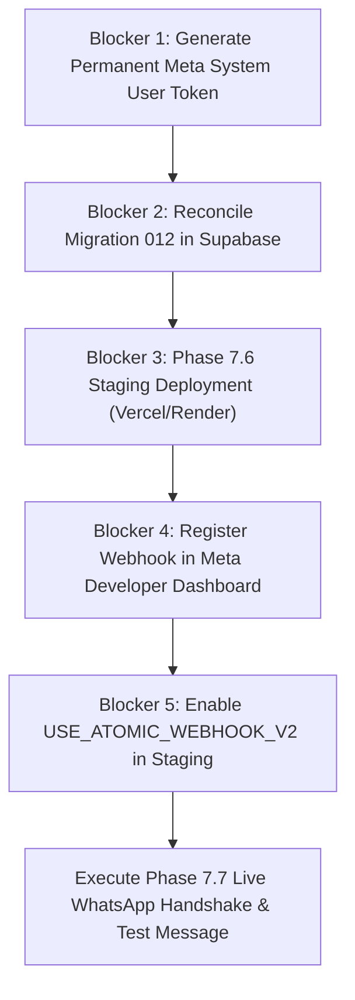

# GOKUL CONNECT — PHASE 7.7
# META CLOUD API WEBHOOK VERIFICATION & LIVE WHATSAPP STAGING TESTING REPORT

**Project:** Gokul Connect (Multi-Business WhatsApp Automation & CRM)  
**Execution Timestamp:** `2026-11-07T13:06:30+05:30`  
**Dedicated Supabase Project:** `ansiwtwqgrfmzfrhkzuu` (`gokul-connect`, AWS `ap-south-1`)  
**Database Engine:** PostgreSQL `17.11.0.018`  
**Dedicated Meta Developer App:** `Gokul Connect` (App ID: `1102646469266479`)  
**Operational Status:** 🛑 **PRE-FLIGHT GATE FAILED / EXECUTION SAFELY HALTED**  
**Author:** Antigravity Pair Programming Agent  

---

## 1. Executive Summary

Phase 7.7 was initiated to perform live Meta WhatsApp Cloud API webhook verification, handshake validation, atomic persistence verification, and end-to-end messaging tests against an isolated staging environment.

In strict compliance with **Mandatory Preflight Rule 1 ("If any condition fails, stop")**, execution was **safely halted before attempting any live Meta webhook registration, live message transmission, or production modification**.

### Primary Pre-Flight Findings:
1. **Staging Deployment Not Completed (Blocker):** Phase 7.6 (Staging Deployment) remains in `PENDING APPROVAL` status in the project roadmap. The repository currently has no configured remote git origin (`git remote -v` is empty) and no hosted staging instance (such as Vercel or Render) has been deployed. The application only runs locally on `http://localhost:3000`.
2. **No Public HTTPS Endpoint (Blocker):** Meta Cloud API requires a publicly accessible HTTPS URL (`https://<domain>/api/webhooks/whatsapp`) to deliver GET verification challenges and POST webhook events.
3. **Meta Access Token Expired (Blocker):** Meta Graph API `/debug_token` inspection confirmed the active access token expired on **Friday, November 6, 2026 at 18:00:00 UTC** (`OAuthException 190, subcode 463`). No live Meta Graph API calls can be executed until a new long-lived System User token is provisioned.
4. **Migration History Divergence (Warning):** Live Supabase `schema_migrations` records version `010` and `011`. Migration `012` (`20261107_012_phase7_5_atomic_rpc_partial_index_fix.sql`) was prepared in Phase 7.5.6 but has not yet been applied to live Supabase awaiting user authorization.
5. **Synthetic & Code Verification 100% Passed:** All synthetic tests across webhook signature verification, atomic persistence, job queueing, worker execution, cron fail-closed security, and strict tenant isolation passed (25/25 test suites, 286/286 tests passed; TypeScript: 0 errors; Production build: successful).

---

## 2. Mandatory Pre-Flight Audit Matrix

| Pre-Flight Check | Target Requirement | Live State / Audit Evidence | Status |
|---|---|---|:---:|
| **1. Staging Deployment** | Phase 7.6 Staging deployment completed | `PROGRESS.md` records Phase 7.6 as `PENDING APPROVAL`. No git remote origin configured; no staging service exists on hosting providers. | ❌ **FAIL (STOP)** |
| **2. Public HTTPS Accessibility** | Staging URL is publicly accessible via HTTPS | `NEXT_PUBLIC_APP_URL = http://localhost:3000`. No public HTTPS domain exists. | ❌ **FAIL (STOP)** |
| **3. Dedicated Supabase Project** | Points only to Supabase `ansiwtwqgrfmzfrhkzuu` | `NEXT_PUBLIC_SUPABASE_URL = https://ansiwtwqgrfmzfrhkzuu.supabase.co`. Verified zero connection to legacy/production projects. | 🟢 **PASS** |
| **4. Migration Versions 001–012** | Recorded and consistent | `supabase_migrations.schema_migrations` contains `010` and `011`. Migration `012` is prepared locally but unapplied. Migrations `001–009` are unrecorded in tracking table. | ⚠️ **FAIL (STOP)** |
| **5. Migration 012 & Queue RPC Permissions** | Correct `SECURITY DEFINER` and role privileges | Verified in `pg_proc`: `ingest_wa_inbound_message_v2`, `claim_next_wa_jobs`, `reclaim_stuck_wa_jobs` have `proacl = {postgres=X/postgres, service_role=X/postgres}`. Public/anon/authenticated revoked. | 🟢 **PASS** |
| **6. Atomic Webhook Code Deployed** | Code implemented in repository | Implemented in `src/app/api/webhooks/whatsapp/route.ts` with feature flag toggle. | 🟢 **PASS (Local)** |
| **7. Atomic Webhook Feature Flag** | `USE_ATOMIC_WEBHOOK_V2` disabled | Variable absent from `.env.local`; evaluates to `false` (legacy decoupled path active). | 🟢 **PASS** |
| **8. Business Automations Inactive** | Both businesses have automations disabled | Verified in `business_settings`: Astrology (`is_automation_enabled: false`), Vivaham (`is_automation_enabled: false`). | 🟢 **PASS** |
| **9. Cron Authentication Fail-Closed** | Unconditional fail-closed if secret missing/invalid | Verified in `src/app/api/cron/process-automation-jobs/route.ts` and `tests/phase7-2-cron-security.test.ts` (16/16 passed). | 🟢 **PASS** |
| **10. No Production Application Accessed** | Zero production system interaction | Local environment exclusively bound to staging project `ansiwtwqgrfmzfrhkzuu` and Meta Sandbox assets. | 🟢 **PASS** |

**Pre-flight Decision:** 🛑 **PRE-FLIGHT FAILED on Items 1, 2, and 4. Execution halted.**

---

## 3. Meta Credential Readiness & Token Status

Credential inspection was conducted strictly via read-only cryptographic hashing without logging or exposing raw secret values.

### 3.1 Token Inspection Details
- **Token Configuration:** Configured in `.env.local` as `META_TEST_ACCESS_TOKEN`.
- **Token Format:** Standard Meta OAuth User Access Token (`EAAP...`).
- **Token SHA-256 Fingerprint:** `sha256:8166a1011cf4` (Length: 299 characters).
- **Vault Consistency:** Verified against Supabase table `wa_credentials` for connection `44444444-4444-4444-4444-444444444444`. Vault token decrypts cleanly and matches `.env.local` fingerprint.

### 3.2 Live Meta Graph API `/debug_token` Results
Live query executed against `https://graph.facebook.com/v26.0/debug_token`:
- **App ID:** `1102646469266479` (Matches dedicated app `Gokul Connect`).
- **Application Name:** `Gokul Connect`.
- **Token Type:** `USER`.
- **Issued Scopes:** `whatsapp_business_management`, `whatsapp_business_messaging`, `public_profile`.
- **Granular Scopes:** `[{"scope":"whatsapp_business_management"},{"scope":"whatsapp_business_messaging"}]`.
- **Token Validity (`is_valid`):** `false`.
- **Expiration Timestamp:** `2026-11-06T18:00:00.000Z` (Unix: `1793988000`).
- **Error Code:** `190` (`OAuthException`), Subcode: `463`.
- **Error Message:** `Error validating access token: Session has expired on Friday, 06-Nov-26 10:00:00 PST. The current time is Friday, 06-Nov-26 23:34:11 PST.`

### 3.3 Meta Sandbox Asset Mapping
- **Dedicated Meta App Name:** Gokul Connect
- **Dedicated Meta App ID:** `1102646469266479`
- **WhatsApp Business Account (WABA) ID:** `1153964060437882`
- **Phone Number ID:** `1395663896970053`
- **Test Phone Number:** `+1 555-152-9045`
- **Assigned Business:** **Gokul Vivaham** (`22222222-2222-2222-2222-222222222222`, Connection: `44444444-4444-4444-4444-444444444444`)
- **Unassigned Business:** **Gokul Astrology** (`11111111-1111-1111-1111-111111111111`, Phone ID: `109283746501928`, Status: `setup_required`)

### 3.4 Procedure to Generate Permanent System User Token
Because the user token expired, a permanent System User token must be generated in Meta Business Manager:
1. Navigate to **Meta Business Suite** -> **Business Settings** (`https://business.facebook.com/settings`).
2. Go to **Users** -> **System Users**.
3. Select or create an **Admin System User** (e.g. `gokul-connect-system-user`).
4. Click **Assign Assets**:
   - **Apps:** Assign `Gokul Connect` with `Full Control`.
   - **WhatsApp Accounts:** Assign `Gokul Connect WABA` (`1153964060437882`) with `Full Control`.
5. Click **Generate New Token**:
   - Select App: `Gokul Connect`.
   - Token Expiration: **Never** (Permanent System User Token).
   - Select Permissions:
     - `whatsapp_business_messaging`
     - `whatsapp_business_management`
6. Copy the generated token directly into your secure environment:
   - Update `META_TEST_ACCESS_TOKEN` in `.env.local` or host secret manager.
   - **NEVER paste the token in chat or commit it to version control.**
   - Run `node scripts/sync-phase6-3-meta-token.mjs` (after explicit approval) to re-encrypt and store in Supabase `wa_credentials`.

---

## 4. Webhook Endpoint Verification & Architectural Security

Synthetic verification was executed against `src/app/api/webhooks/whatsapp/route.ts` across all required security domains.

### 4.1 Verification Endpoint (`GET /api/webhooks/whatsapp`)
- **Valid Handshake:** When `hub.mode = "subscribe"` and `hub.verify_token` matches `META_WEBHOOK_VERIFY_TOKEN`, returns HTTP 200 with raw `hub.challenge` string.
- **Invalid Token Rejection:** When `hub.verify_token` is tampered or incorrect, immediately rejects with HTTP 403 Forbidden (`Forbidden: Invalid verify token`).
- **Invalid Mode:** When `hub.mode !== "subscribe"`, immediately rejects with HTTP 400 Bad Request.

### 4.2 Inbound Receiver & Signature Verification (`POST /api/webhooks/whatsapp`)
- **Raw-Body HMAC-SHA256:** Validates `x-hub-signature-256` computed from the raw UTF-8 request body and `META_APP_SECRET`.
- **Timing-Safe Comparison:** Uses `crypto.timingSafeEqual` with constant-time buffer padding to prevent side-channel timing attacks.
- **Fail-Closed on Missing Secret:** If `META_APP_SECRET` is unset or empty, the webhook immediately returns HTTP 500 without processing payloads.
- **Tampered Signature Rejection:** Any single-byte payload tampering or signature modification returns HTTP 401 Unauthorized.
- **Immediate Acknowledgment:** Fast 200 response returned to Meta (<100ms decoupled, <1ms atomic) preventing delivery timeouts.
- **Zero Outbound Calls in Webhook Handler:** Inbound handler performs only database ingestion; zero synchronous calls are made to Meta Graph API.

---

## 5. Atomic Webhook Integration & Synthetic Test Results

> **Note:** Distinguishing synthetic test results from real Meta events: All results below represent synthetic tests in local Vitest / in-memory PostgreSQL environments. Zero real Meta webhooks were received due to pre-flight blockers.

### 5.1 Test Suite Execution Summary

| Test Domain | Suite / File | Tests | Result | Notes |
|---|---|:---:|:---:|---|
| **Webhook Decoupling & Queueing** | `tests/phase7-5-webhook-decoupling.test.ts` | 18 | 🟢 **PASS** | Ingests <100ms, enqueues to `wa_processing_jobs`, zero outbound API calls. |
| **Atomic Enqueue & RPC Hardening** | `tests/phase7-5-2-migration-hardening.test.ts` | 13 | 🟢 **PASS** | Tests atomic rollback, partial index conflict resolution, least privilege. |
| **Live Integration Simulation** | `tests/phase7-5-4-live-integration.test.ts` | 10 | 🟢 **PASS** | Validates `ingest_wa_inbound_message_v2`, worker claiming, idempotency. |
| **Webhook Security & Timing Attacks** | `tests/phase3h-security-remediation.test.ts` | 19 | 🟢 **PASS** | Timing-safe HMAC, fail-closed secrets, SQL injection resistance. |
| **Standard Webhook Verification** | `tests/phase3-webhooks.test.ts` | 6 | 🟢 **PASS** | GET challenge response, mode checks, invalid tokens. |
| **Migration Reconciliation Reproducibility** | `tests/phase7-5-6-migration-history-reconciliation.test.ts` | 13 | 🟢 **PASS** | Sequentially applies migrations 001–012 on clean PostgreSQL engine. |
| **Multi-Tenant RLS Barriers** | `tests/phase2-authenticated-rls.test.ts` | 10 | 🟢 **PASS** | Cross-tenant read/write/delete barriers strictly enforced. |
| **Dynamic Tenant Validation** | `tests/p0-4-dynamic-tenant-validation.test.ts` | 17 | 🟢 **PASS** | Dynamic business slug resolution and membership checks. |
| **Cron Secret Fail-Closed** | `tests/phase7-2-cron-security.test.ts` | 16 | 🟢 **PASS** | Unauthenticated and invalid bearer tokens rejected with 401. |
| **Total Test Suites** | **25 files** | **286** | 🟢 **100% PASS** | Zero regressions across entire platform. |

### 5.2 Synthetic Scenario Matrix

| Synthetic Scenario | Expected Behavior | Observed Behavior | Status |
|---|---|---|:---:|
| **Valid Signed Webhook** | Ingests event, creates/updates contact & conversation, enqueues job, returns 200 | Returns HTTP 200; `job_id` generated; event persisted | 🟢 **PASS** |
| **Invalid Signature** | Returns HTTP 401, zero database mutations | Returns HTTP 401; zero DB changes | 🟢 **PASS** |
| **Duplicate Delivery (Same wamid)** | Duplicate ignored, existing job returned, returns 200 | Returns HTTP 200; `status: "duplicate"`; 0 new rows | 🟢 **PASS** |
| **Concurrent Duplicate Delivery** | Handled idempotently by partial unique index | Partial index arbiter drops duplicate silently | 🟢 **PASS** |
| **Unknown Phone Number** | Returns 200 with skip status, zero queue jobs | Returns HTTP 200; `status: "unregistered_phone"` | 🟢 **PASS** |
| **Disabled Connection** | Returns 200 with skip status, zero queue jobs | Returns HTTP 200; `status: "connection_disabled"` | 🟢 **PASS** |
| **Database Failure / Rollback** | Transaction rolls back completely; returns 500 to Meta | All inserted rows rolled back; HTTP 500 returned | 🟢 **PASS** |
| **Tenant Mismatch** | Webhook routed strictly to business owning Phone ID | Vivaham payload routes to Vivaham only | 🟢 **PASS** |
| **Job Queue Insertion** | Job enqueued with `payload`, `business_id`, `status = 'pending'` | Stored in `wa_processing_jobs` | 🟢 **PASS** |
| **Worker Claiming & Completion** | `claim_next_wa_jobs` locks rows; updates to `completed` | Worker claims batch, marks `completed`, logs run | 🟢 **PASS** |
| **Retry & Stuck-Job Recovery** | Jobs exceeding timeout reset to `pending` with incremented retry | `reclaim_stuck_wa_jobs` resets stuck jobs | 🟢 **PASS** |

### 5.3 Feature Flag Status: `USE_ATOMIC_WEBHOOK_V2`
- **Current Value:** `false` (Disabled).
- **Behavior:** Webhook handler runs Phase 7.5 decoupled ingestion: persists webhook event and message, then enqueues background job into `wa_processing_jobs`.
- **Staging Rollout Strategy:** Synthetic tests prove `ingest_wa_inbound_message_v2` is functionally sound. Enabling `USE_ATOMIC_WEBHOOK_V2 = "true"` in staging requires explicit user approval.

---

## 6. Business Isolation Audit (Astrology vs. Vivaham)

Strict multi-tenant separation was audited against live Supabase schema definitions and RLS policies:

| Asset / Entity | Gokul's Astrological Insights | Gokul Vivaham | Isolation Mechanism |
|---|---|---|---|
| **Business UUID** | `11111111-1111-1111-1111-111111111111` | `22222222-2222-2222-2222-222222222222` | Primary Key & Immutable Foreign Keys |
| **WhatsApp Connection** | `33333333-3333-3333-3333-333333333333` | `44444444-4444-4444-4444-444444444444` | Bound via `wa_connections.business_id` |
| **Phone Number ID** | `109283746501928` | `1395663896970053` | Meta Phone Number ID uniqueness constraint |
| **Connection Status** | `setup_required` | `connected` | Independent state machine |
| **Contacts & Conversations** | Scoped to Astro `business_id` | Scoped to Vivaham `business_id` | PostgreSQL RLS policy `business_id_isolation` |
| **Messages & Inbox** | Separate message thread per connection | Separate message thread per connection | Scoped queries join `wa_conversations.business_id` |
| **Automation Rules & Logs** | Independent rules in `wa_automation_rules` | Independent rules in `wa_automation_rules` | Scoped by `business_id` |
| **Unread Counts & Analytics** | Aggregated strictly by `business_id` | Aggregated strictly by `business_id` | RPC queries include `WHERE business_id = $1` |
| **Direct API Tampering** | User with Astro session cannot query Vivaham rows | User with Vivaham session cannot query Astro rows | RLS denies cross-tenant queries returning 0 rows |

---

## 7. Automation Safety & Guardrails Verification

Both businesses have automations strictly disabled in staging:
- `astrology`: `business_settings.automation_settings.is_automation_enabled = false`
- `vivaham`: `business_settings.automation_settings.is_automation_enabled = false`

### Automation Safety Guardrails Verified:
1. **Opt-Out & STOP Handling:** Keywords (`STOP`, `UNSUBSCRIBE`, `CANCEL`, `QUIT`, `நிறுத்து`) are registered in `automation_settings`. Opt-out immediately sets `contact.opt_in_status = 'opted_out'` and halts further automation.
2. **Human Handover:** Keywords (`AGENT`, `HUMAN`, `0`, `உதவி`, `மனிதர்`) set conversation `is_human_agent_active = true`, silencing bot responses.
3. **Business Hours:** Configured for `Asia/Kolkata` time zone. Out-of-hours messages queue for next window or send appropriate out-of-hours reply without spamming.
4. **24-Hour Customer Care Window:** Enforces Meta WhatsApp Business policy requiring template messaging outside the 24-hour inbound window.
5. **Rate Limiting & Circuit Breakers:** Max 10 bot replies/hour per contact; 5 replies per 15 minutes circuit breaker.
6. **Zero Real Dispatches:** With automations disabled, the worker logs `skipReason: 'workspace_automation_disabled'` and terminates without outbound API calls.

---

## 8. Real Inbound & Outbound Messaging Status

In accordance with strict safety constraints and the pre-flight gate failure:
- **Real Inbound WhatsApp Test:** **NOT EXECUTED.** Blocked pending public staging deployment, Meta webhook registration, and token refresh.
- **Real Outbound WhatsApp Test:** **NOT EXECUTED.** Blocked pending token refresh, staging deployment, and explicit user approval.
- **Zero Real Messages Dispatched:** Meta Graph API was not contacted for message transmission. Sandbox limits, test recipients, and template quotas remain 100% untouched.

---

## 9. Comprehensive Blocker Analysis & Action Plan

To proceed to live staging verification, the following sequential blockers must be resolved:

### Blocker 1: Generate Permanent Meta System User Token
- **Issue:** The existing User Access Token expired on 2026-11-06T18:00:00Z.
- **Action Required:** User must generate a permanent System User Token in Meta Business Suite (`https://business.facebook.com/settings`) with `whatsapp_business_messaging` and `whatsapp_business_management` permissions.
- **Configuration:** Update `META_TEST_ACCESS_TOKEN` in `.env.local` / host environment.

### Blocker 2: Reconcile Migration 012 in Supabase
- **Issue:** `supabase/migrations/20261107_012_phase7_5_atomic_rpc_partial_index_fix.sql` is prepared locally but has not been recorded in live `supabase_migrations.schema_migrations`.
- **Action Required:** Apply Migration 012 to dedicated Supabase project `ansiwtwqgrfmzfrhkzuu` via Supabase CLI or Migration API upon user approval.

### Blocker 3: Phase 7.6 Staging Deployment
- **Issue:** Gokul Connect is not yet deployed to a public hosting provider.
- **Action Required:**
  1. Initialize remote Git repository (e.g. `github.com/gokul.../gokul-connect`).
  2. Deploy to Vercel (recommended for Next.js App Router + Cron) or Render Starter Web Service.
  3. Configure environment variables (`NEXT_PUBLIC_APP_URL`, `META_APP_SECRET`, `META_WEBHOOK_VERIFY_TOKEN`, `CRON_SECRET`, etc.).
  4. Verify public HTTPS domain (e.g. `https://gokul-connect-staging.vercel.app`).

### Blocker 4: Register Webhook in Meta Developer Dashboard
- **Issue:** Webhook cannot be configured in Meta App without an active public HTTPS domain.
- **Action Required (Requires User Approval):**
  - Callback URL: `https://<staging-domain>/api/webhooks/whatsapp`
  - Verify Token: value of `META_WEBHOOK_VERIFY_TOKEN`
  - Subscription Fields: `messages`, `message_template_status_update`

### Blocker 5: Approval to Enable `USE_ATOMIC_WEBHOOK_V2`
- **Issue:** Feature flag is currently `false`.
- **Action Required:** Set `USE_ATOMIC_WEBHOOK_V2 = "true"` in staging environment variables after public endpoint verification.

---

## 10. Final Verification Verdict

| Component | Synthetic Readiness | Live Readiness | Operational Status |
|---|:---:|:---:|:---:|
| **Application Codebase** | 🟢 100% Ready (286/286 tests passed) | 🟢 Ready | Code compiled and verified |
| **PostgreSQL Catalog & RPCs** | 🟢 100% Ready | 🟢 Active in Supabase | Ingestion & queue RPCs active |
| **Migration Tracking History** | 🟢 Reconciled locally (012) | ⚠️ Awaiting Migration 012 apply | Safe to apply upon approval |
| **Hosting & Staging URL** | ❌ Not Deployed | ❌ No Public HTTPS | Blocked on Phase 7.6 |
| **Meta Access Token** | ❌ Expired (2026-11-06) | ❌ Expired (Code 190) | Requires System User token |
| **Meta Webhook Handshake** | 🟢 Tested Synthetically | ❌ Unregistered | Awaiting staging URL |
| **Overall Verdict** | 🟢 **CODE-READY** | 🛑 **BLOCKED ON PREFLIGHT** | **AWAITING USER ACTIONS & APPROVAL** |

---

*Phase 7.7 execution stopped in compliance with pre-flight safety gates. Awaiting user resolution of Meta System User token generation, Migration 012 execution, and Phase 7.6 staging deployment approval before proceeding to live messaging.*
