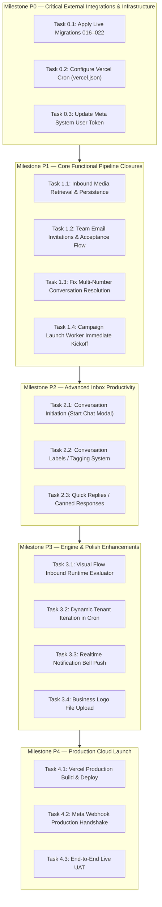

# Gokul Connect — Remaining Development Roadmap

**Document Status:** Complete & Execution-Ready  
**Creation Date:** November 9, 2026  
**Target Milestone:** Full Production Feature-Completeness (v1.0 Launch)  
**Dedicated Database Target:** Supabase Project `ansiwtwqgrfmzfrhkzuu` (`gokul-connect`, AWS Mumbai `ap-south-1`)  
**Current Baseline:** 45 Test Suites, 684/684 Tests Passing  

---

## 1. Roadmap Architecture & Guiding Principles

This roadmap translates the findings from `docs/DEVELOPMENT_GAP_ANALYSIS.md` into an actionable, prioritized engineering plan. To preserve platform integrity and respect existing achievements:

1. **Zero Duplicate Redevelopment:** Re-use all verified modules, components, types, and server actions.
2. **Smallest Code Deltas:** Implement the minimum viable, surgically targeted code changes needed to close each gap cleanly.
3. **Strict Multi-Tenant Isolation:** Enforce PostgreSQL Row-Level Security, tenant immutability triggers, and server-side authorization guards across every new action and route.
4. **Deterministic & Safe Operations:** Maintain 100% deterministic automation (Zero AI halluncinations), constant-time cryptographic verification, and strict WhatsApp 24-hour customer service window compliance.

---

## 2. Milestone Overview & Phase Prioritization



---

## 3. Detailed Task Breakdown & Specifications

### Milestone P0: Critical External Integrations & Infrastructure

#### Task 0.1: Apply Migrations 016–022 to Dedicated Live Supabase
- **Objective:** Reconcile schema drift between local verified PGlite sandbox and live Supabase project `ansiwtwqgrfmzfrhkzuu`.
- **Target Files:**
  - `supabase/migrations/20261107_016_phase12_1_team_management_and_agent_assignment.sql`
  - `supabase/migrations/20261107_017_phase12_2_media_messaging.sql`
  - `supabase/migrations/20261108_018_phase12_3_scheduled_messages.sql`
  - `supabase/migrations/20261108_019_phase12_4_campaign_management.sql`
  - `supabase/migrations/20261108_020_phase12_5_crm_lifecycle_and_followups.sql`
  - `supabase/migrations/20261109_021_phase12_6_notification_center_and_durable_reminders.sql`
  - `supabase/migrations/20261109_022_phase12_7_visual_flows_and_realtime.sql`
- **Exact Implementation:**
  - Capture pre-flight backup snapshot of dedicated Supabase database.
  - Apply migrations 016 through 022 sequentially via Supabase MCP `apply_migration`.
  - Verify tables, triggers, indexes, and publications (`supabase_realtime`) exist in live database catalog.
- **Verification:** Run `tests/phase11-6-final-regression.test.ts` against live database.

#### Task 0.2: Configure Vercel Cron (`vercel.json`)
- **Objective:** Automate execution of all four background workers in production.
- **Target File:** Create `vercel.json` in repository root.
- **Exact Implementation:**
  ```json
  {
    "crons": [
      {
        "path": "/api/cron/process-automation-jobs",
        "schedule": "* * * * *"
      },
      {
        "path": "/api/cron/process-scheduled-messages",
        "schedule": "* * * * *"
      },
      {
        "path": "/api/cron/process-campaigns",
        "schedule": "*/2 * * * *"
      },
      {
        "path": "/api/cron/process-crm-reminders",
        "schedule": "*/15 * * * *"
      }
    ]
  }
  ```
- **Verification:** Confirm JSON format validity and path alignment with `src/app/api/cron/`.

#### Task 0.3: Refresh Meta System User Access Token
- **Objective:** Eliminate `OAuthException 190, subcode 463` (expired token) blocker.
- **Target File:** `.env.local`
- **Exact Implementation:**
  - Update `META_ACCESS_TOKEN` with a permanent System User token generated from Meta Business Manager.
  - Test live connection handshake using `/workspace/[businessSlug]/connections` "Test Connection" button.
- **Verification:** `GET https://graph.facebook.com/v26.0/me` returns HTTP 200 with App ID `1102646469266479`.

---

### Milestone P1: Core Functional Pipeline Closures

#### Task 1.1: Persistent Inbound Media Retrieval & Storage Integration
- **Objective:** Enable agents to view and download incoming images, documents, audio, and video sent by customers over WhatsApp.
- **Target Files:**
  - `src/lib/whatsapp/media-fetcher.ts` (New utility)
  - `src/app/actions/inbox.ts` (Update `getMediaDownloadUrlAction`)
  - `src/lib/automation/worker.ts` or `src/app/api/webhooks/whatsapp/route.ts`
- **Exact Implementation:**
  1. Create `fetchAndPersistInboundMedia(businessId, messageId)` in `src/lib/whatsapp/media-fetcher.ts`:
     - Looks up `wa_messages` by `messageId` and resolves `media_id` from `raw_payload`.
     - Calls existing `downloadMetaMediaContent(media_id, accessToken)` from `src/lib/whatsapp/client.ts`.
     - Passes retrieved buffer to existing `storeMediaFile` in `src/lib/media/storage.ts`.
     - Updates `wa_messages.storage_path`, `wa_media_files.storage_path`, and sets `download_status = 'completed'`.
  2. In `getMediaDownloadUrlAction` (`src/app/actions/inbox.ts`):
     - If `!msg.storage_path && msg.media_id`, trigger `fetchAndPersistInboundMedia` on-demand before returning the signed download URL.
- **Verification:** Author automated unit test in `tests/phase12-2-media-messaging.test.ts` confirming simulated incoming media ID triggers download and returns valid signed URL.

#### Task 1.2: Team Email Invitations & Self-Service Onboarding Flow
- **Objective:** Allow business owners to invite team members via email and allow invitees to accept and activate their accounts.
- **Target Files:**
  - `src/lib/team/database.ts` (Update `inviteTeamMemberDb`)
  - `src/app/(auth)/accept-invite/page.tsx` (New route)
  - `src/app/actions/team.ts` (New action `acceptInvitationAction`)
- **Exact Implementation:**
  1. In `inviteTeamMemberDb`:
     - Integrate Supabase Auth invite API:
       ```ts
       await supabaseAdmin.auth.admin.inviteUserByEmail(normalizedEmail, {
         data: { business_id: businessId, role: input.role, invitation_token: invitation.token },
         redirectTo: `${process.env.NEXT_PUBLIC_APP_URL}/accept-invite?token=${invitation.token}`,
       });
       ```
  2. Create page `src/app/(auth)/accept-invite/page.tsx`:
     - Validates token against `business_invitations` table.
     - Collects full name and initial password from user.
     - Transitions invitation status to `accepted` and inserts row into `business_members`.
     - Redirects user into `/workspace/[businessSlug]/dashboard`.
- **Verification:** Unit test inviting a new email, validating token, and verifying `business_members` row creation.

#### Task 1.3: Multi-Number Conversation Resolution Fix
- **Objective:** Prevent PostgREST `PGRST116` crashes when a customer interacts across multiple WhatsApp numbers.
- **Target File:** `src/lib/crm/database.ts` (`getOrCreateConversationForContactDb`, lines 1319-1328)
- **Exact Implementation:**
  - Update query to accept optional `connectionId`:
    ```ts
    let query = supabase
      .from("wa_conversations")
      .select("id")
      .eq("business_id", businessId)
      .eq("contact_id", contactId);

    if (connectionId) {
      query = query.eq("connection_id", connectionId);
    } else {
      query = query.order("last_message_at", { ascending: false }).limit(1);
    }

    const { data: conv } = await query.maybeSingle();
    ```
- **Verification:** Test creating conversations for the same contact across two distinct connection IDs.

#### Task 1.4: Campaign Launch Immediate Worker Kickoff
- **Objective:** Eliminate delays where newly launched campaigns remain stuck in `queued` status until a cron request occurs.
- **Target File:** `src/app/actions/campaigns.ts` (`launchCampaignAction`, lines 405-413)
- **Exact Implementation:**
  - In `launchCampaignAction`, immediately invoke `processCampaignsBatch` asynchronously after status transition:
    ```ts
    const campaign = await launchCampaign(business.id, campaignId, { id: user.id, name: user.email || "Staff" });

    // Asynchronously kick off the first recipient batch without blocking server action
    processCampaignsBatch({ batchSize: 20, workerId: `launch_trigger_${campaignId}` }).catch((err) => {
      console.warn("[Campaign Launch Trigger Error]", err.message);
    });
    ```
- **Verification:** Launch test campaign and verify first batch transitions to `sending`/`sent` immediately.

---

### Milestone P2: Advanced Inbox Productivity

#### Task 2.1: Conversation Initiation ("Start New Chat" Modal)
- **Objective:** Empower agents to initiate a conversation with any valid WhatsApp number directly from the inbox.
- **Target Files:**
  - `src/components/inbox/StartConversationModal.tsx` (New component)
  - `src/components/inbox/ConversationListPanel.tsx` (Add "+ New Chat" button)
  - `src/app/actions/inbox.ts` (New action `startNewConversationAction`)
- **Exact Implementation:**
  1. Build `StartConversationModal.tsx`:
     - Inputs: Recipient Phone Number (with E.164 validation), Contact Name, Category, WhatsApp Line selector.
     - Message Type: Approved Template (required if outside 24h window).
     - Template variable input fields.
  2. Action `startNewConversationAction`:
     - Upserts contact into `wa_contacts`.
     - Creates conversation in `wa_conversations` bound to selected `connection_id`.
     - Dispatches template message via `sendWhatsAppMessageService`.
     - Returns new `conversationId` and focuses the active chat window.
- **Verification:** Test initiating conversation with new phone number from inbox client.

#### Task 2.2: Conversation Labels & Tagging System
- **Objective:** Allow agents to organize, categorize, and filter customer conversations with colored labels.
- **Target Files:**
  - `supabase/migrations/20261109_023_conversation_labels.sql` (New migration)
  - `src/app/actions/inbox.ts` (New action `updateConversationLabelsAction`)
  - `src/components/inbox/ChatWindowPanel.tsx` (Add interactive label manager popover)
  - `src/components/inbox/ConversationNavPanel.tsx` (Add label filter to sidebar)
- **Exact Implementation:**
  1. Migration:
     ```sql
     ALTER TABLE public.wa_conversations
         ADD COLUMN IF NOT EXISTS labels TEXT[] NOT NULL DEFAULT '{}';
     CREATE INDEX IF NOT EXISTS idx_wa_conversations_labels ON public.wa_conversations USING GIN (labels);
     ```
  2. Implement `updateConversationLabelsAction(businessSlug, conversationId, labels)`.
  3. Wire UI popover in `ChatWindowPanel.tsx` permitting adding/removing labels (`VIP`, `Follow-up Required`, `Consultation Booked`, `Profile Verified`).
- **Verification:** Add, remove, and filter conversations by label.

#### Task 2.3: Quick Replies & Canned Responses
- **Objective:** Speed up agent response times with pre-saved message snippets callable via keyboard shortcuts.
- **Target Files:**
  - `supabase/migrations/20261109_024_canned_responses.sql` (New migration)
  - `src/lib/inbox/canned-responses.ts` (New service)
  - `src/app/actions/inbox.ts` (CRUD actions for canned responses)
  - `src/components/inbox/ChatWindowPanel.tsx` (Add `/` trigger popover in composer)
- **Exact Implementation:**
  1. Create `public.wa_canned_responses` table (`id`, `business_id`, `shortcut`, `title`, `content`, `category`, RLS).
  2. In `ChatWindowPanel.tsx` composer textarea: Detect `/` character at start of word; display dropdown of matching snippets; on Enter, replace shortcut with full text.
- **Verification:** Type `/pricing` or `/bank` in composer and verify snippet insertion.

---

### Milestone P3: Engine & Polish Enhancements

#### Task 3.1: Visual Flow Inbound Message Runtime Execution
- **Objective:** Connect published Visual Flows from `wa_visual_flows` into the real-time inbound message evaluation pipeline.
- **Target Files:**
  - `src/lib/flows/runtime.ts` (New flow execution engine)
  - `src/lib/automation/worker.ts` (Wire flow execution before/alongside rules)
- **Exact Implementation:**
  1. Implement `executeVisualFlow(flow, inboundMessage, conversation)`:
     - Matches `trigger_keyword` on start node.
     - Traverses connected nodes (Message, Interactive Quick Reply, Condition).
     - Emits outbound message via `sendWhatsAppMessageService`.
     - Updates conversation state.
  2. In `src/lib/automation/worker.ts`:
     - Query active published flows for `job.business_id`.
     - If an active flow matches the inbound message, execute flow; otherwise fall back to `wa_automation_rules`.
- **Verification:** Test inbound simulated message matching flow trigger keyword and verify automated response.

#### Task 3.2: Dynamic Tenant Iteration in Cron Endpoints
- **Objective:** Eliminate hardcoded `ASTRO_BUSINESS_ID` and `VIVAHAM_BUSINESS_ID` from background jobs.
- **Target File:** `src/app/api/cron/process-crm-reminders/route.ts`
- **Exact Implementation:**
  - Replace static IDs with dynamic query:
    ```ts
    const { data: businesses } = await supabase.from("businesses").select("id").eq("is_active", true);
    for (const biz of businesses || []) {
      await generateFollowUpRemindersDb(biz.id);
    }
    ```
- **Verification:** Verify reminder generation loops over all active business tenants.

#### Task 3.3: Realtime Notification Bell Push
- **Objective:** Update the workspace header notification bell badge immediately when a new reminder is created without requiring a page refresh.
- **Target File:** `src/components/notifications/NotificationBell.tsx`
- **Exact Implementation:**
  - Add Supabase Realtime channel subscription:
    ```ts
    const channel = supabase
      .channel(`notifications:${business.id}`)
      .on('postgres_changes', { event: 'INSERT', schema: 'public', table: 'crm_follow_up_reminders', filter: `business_id=eq.${business.id}` }, () => {
        fetchNotifications();
      })
      .subscribe();
    ```
- **Verification:** Insert test reminder in database and observe instant badge increment in UI.

#### Task 3.4: Business Logo File Upload to Storage
- **Objective:** Allow businesses to upload an actual brand logo image (PNG/SVG) to replace the text monogram.
- **Target Files:**
  - `src/components/workspace/BusinessSettingsClient.tsx`
  - `src/app/actions/connections.ts`
- **Exact Implementation:**
  - Add file input for logo in `BusinessSettingsClient.tsx`.
  - Upload file to Supabase Storage path `businesses/${businessId}/branding/logo.png`.
  - Store public or signed URL in `business_settings.logo_placeholder` (or new column `logo_url`).
- **Verification:** Upload custom business logo and verify rendering across header and settings.

---

### Milestone P4: Production Cloud Launch

#### Task 4.1: Vercel Production Build & Environment Setup
- **Objective:** Deploy Gokul Connect to Vercel production infrastructure.
- **Actions:**
  - Link repository to Vercel project.
  - Configure production environment variables (`NEXT_PUBLIC_SUPABASE_URL`, `SUPABASE_SERVICE_ROLE_KEY`, `APP_ENCRYPTION_SECRET`, `CRON_SECRET`, `META_APP_SECRET`, `META_WEBHOOK_VERIFY_TOKEN`).
  - Execute production build verification: `next build`.

#### Task 4.2: Meta Webhook Production Handshake & Endpoint Registration
- **Objective:** Connect live Meta Cloud API webhooks to the production URL.
- **Actions:**
  - In Meta App Dashboard > WhatsApp > Configuration:
    - Set Callback URL to `https://<production-domain>/api/webhooks/whatsapp`.
    - Provide `META_WEBHOOK_VERIFY_TOKEN`.
    - Subscribe to `messages` and `message_template_status_update` webhook fields.
  - Verify handshake returns challenge with HTTP 200.

#### Task 4.3: End-to-End Live UAT
- **Objective:** Validate end-to-end user workflows across both business tenants.
- **Validation Checklist:**
  1. Inbound text message triggers automated reply from KP Astrology line.
  2. Inbound image message persists and renders in Inbox with lightbox preview.
  3. Outbound approved template dispatched outside 24-hour window re-opens conversation.
  4. Scheduled message dispatches at exact scheduled timestamp in `Asia/Kolkata` time.
  5. Bulk campaign launches, dispatches with opt-out exclusion, and updates delivery metrics.
  6. Staff invitation accepted, role enforced, and tenant boundary preserved.

---

## 4. Verification & Quality Gate Protocol

Every task executed within this roadmap must satisfy the following four quality gates prior to milestone sign-off:

1. **TypeScript Typecheck:** `npx tsc --noEmit` must complete with **0 errors**.
2. **Automated Regression Suite:** `npx vitest run` must pass **100% of tests** (baseline: 684 tests, with new tests added for each package).
3. **Multi-Tenant Isolation Audit:** Automated RLS tests must confirm zero cross-tenant query visibility or mutation between `astrology` and `vivaham`.
4. **Next.js Production Build:** `npm run build` must compile cleanly with 0 route or bundle errors.
